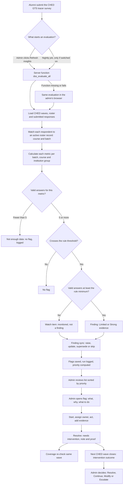
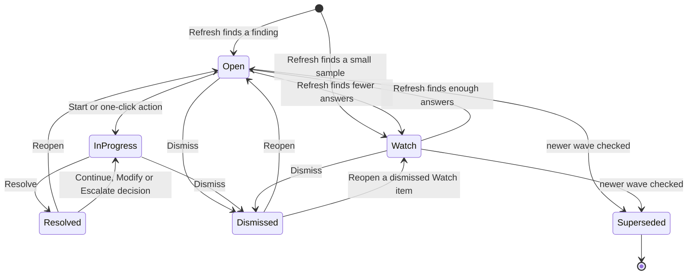
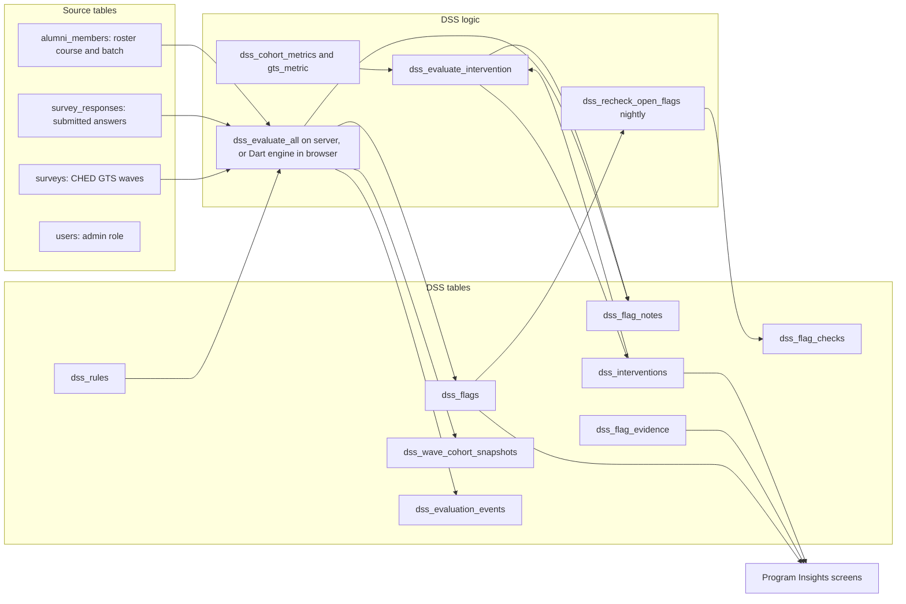

# AESS Decision Support System (DSS): User and Developer Guide

**Feature name in the app:** Program Insights
**Where:** Admin portal → sidebar section **Alumni** → **Program Insights**
**Guide written:** 2026-10-12, from source-code inspection of this repository (commit `fe0bdca` plus the files listed in Part 16).

> **How to read the verification labels in this guide**
>
> - **Verified in code**: the behaviour was read directly in the source files named.
> - **Recorded test result**: a result written down during development (in `docs/dss-capability-audit.md` or the development log). Tests were **not** re-run while writing this guide.
> - **Not verified**, **Partially implemented**, **Requires confirmation**: the detail could not be confirmed from the code alone (for example, live database values, screen layout, or scheduled job runs).
> - **Hypothetical example**: invented numbers used only to explain a rule. They are not real alumni data and not real system output.
>
> No database was contacted to write this guide. Screen descriptions come from the Flutter source, not from screenshots. **Please verify Part 7 against screenshots before using it in a manuscript or defense.**

---

## Table of contents

1. [What the DSS is](#part-1-what-the-dss-is)
2. [Feature inventory](#part-2-feature-inventory)
3. [How the DSS works, step by step](#part-3-how-the-dss-works-step-by-step)
4. [Rules and thresholds](#part-4-rules-and-thresholds)
5. [Metrics and how they are calculated](#part-5-metrics-and-how-they-are-calculated)
6. [Flags, findings and recommendations](#part-6-flags-findings-and-recommendations)
7. [Admin guide, click by click](#part-7-admin-guide-click-by-click)
8. [What is automatic and what is manual](#part-8-what-is-automatic-and-what-is-manual)
9. [Database and data flow](#part-9-database-and-data-flow)
10. [Real-world data conditions](#part-10-real-world-data-conditions)
11. [Permissions, security and privacy](#part-11-permissions-security-and-privacy)
12. [Tests](#part-12-tests)
13. [Troubleshooting](#part-13-troubleshooting)
14. [Limitations](#part-14-limitations)
15. [Defense preparation](#part-15-defense-preparation)
16. [Source code reference](#part-16-source-code-reference)
17. [Quick reference](#part-17-quick-reference)

---

## Part 1: What the DSS is

### 1.1 Plain-language overview

AESS collects the CHED Graduate Tracer Survey (GTS) from alumni. The DSS, shown in the app as **Program Insights**, reads the submitted tracer answers, groups alumni by **course** and **batch** (graduation year), calculates a small set of measures for each group (for example, the share of alumni not currently employed), and compares each measure against **fixed rules** that an admin can tune.

When a group crosses a rule, and enough alumni answered for the result to be trustworthy, the DSS creates a **flag**. Each flag explains:

- **what was found** (the value, how many alumni answered, the likely range),
- **why it matters**,
- **what to do next** (a recommended action and step-by-step playbook),
- **how urgent it is** (a rule-based priority with a reason for every point).

Admins then record what they did (owner office, evidence, interventions), close the flag, and later see whether the next tracer wave showed a change.

The DSS **does not make decisions by itself**. It does not close flags, choose interventions, or claim that an intervention caused an improvement. Artificial intelligence (AI) is optional and only writes plain-language explanations; it never decides, ranks or closes anything (Part 11.5).

### 1.2 Analogy

Think of a **school clinic's annual check-up**:

| Clinic | AESS DSS |
|---|---|
| Lab tests with normal reference ranges | Rules with thresholds (for example, "not employed ≥ 25%") |
| A result outside the range is marked "abnormal" | A group crossing a rule gets a **flag** |
| "Too few readings to tell" — repeat the test | **Watch** (5–9 answers) or **Not enough data** (under 5 answers) |
| The doctor reads the result and decides treatment | The admin reads the flag and chooses an intervention |
| The chart records who treated what and when | Owner office, evidence entries and the action log |
| A follow-up test next year | The next tracer wave judges the intervention outcome |
| A better follow-up result does not prove the medicine worked | The DSS says the change is "observed, not proof that the intervention caused it" |

### 1.3 Three short descriptions

**For beginners (one paragraph).**
Program Insights is the part of AESS that turns tracer survey answers into alerts. It checks each course and batch against simple rules, such as "a quarter or more of alumni are not employed". If a rule is crossed and enough alumni answered, it shows an alert with the numbers, the reason, and suggested next steps. Admins assign the alert to an office, record what they did, and close it. The next tracer survey shows whether things changed.

**For a manuscript (formal).**
The AESS Decision Support System is a deterministic, rule-based module that evaluates submitted CHED Graduate Tracer Survey responses per course–batch cohort. For each enabled rule it computes a proportion or bracket-gap metric, applies a sample-size policy (fewer than 5 valid answers: not reported; 5 to below the rule minimum, at least 10: monitored; 10–29: limited evidence; 30 or more: strong evidence), estimates a 95% Wilson score interval, and raises a finding when the metric crosses an administrator-configurable threshold. Small cohorts are pooled into course or institution level. Findings carry a transparent additive priority score, structured accountability fields, intervention records, and a next-wave outcome classification. Artificial intelligence is limited to optional explanatory text that is validated before display and has no influence on findings, priority or status.

**For an oral defense (spoken, about 20 seconds).**
"Our DSS reads the tracer survey, checks every course and batch against clear rules, and raises an alert only when enough alumni answered. Every alert shows the number, how sure we are, why it is urgent, and what to do. Admins record the action and the proof, and the next survey wave tells us what changed. The rules decide; AI only helps explain."

---

## Part 2: Feature inventory

### 2.1 What exists now, and what changed

"Earlier implementation" means the state recorded in the capability audit on 2026-10-08 (`docs/dss-capability-audit.md`, Parts 1–3), before DSS Phases 1–10. "Now" means the code at commit `fe0bdca`.

| Feature | Earlier implementation | Now | Status |
|---|---|---|---|
| Rule-based flags per course × batch | Existed (8 rules incl. trend) | Kept; one rule added (`SEEKING_WORK_HIGH`, switched off by default) | Verified in code |
| Minimum sample size | Checked against group size, not the question's answers; live minimum was **1** | Checked against the metric's own valid answers; floors enforced (10 for outcome/opportunity/trend, 1 for data quality) in Settings, the evaluator and a database constraint | Verified in code |
| Small-sample handling | Flags could be raised from 1 answer | **Not enough data** (< 5), **Watch** (5 to gate − 1), **Limited** (10–29), **Strong** (30+) | Verified in code |
| Roll-up of small groups | Existed | Kept, using the per-rule minimum; "Batch not recorded" counts at course level only | Verified in code |
| Unknown / unmatched respondents | Bucketed as "Unknown" and could produce a flag | Excluded ("unclassified"); only active roster members with a course count | Verified in code |
| Roster at wave time | Always today's roster | Open wave: today's roster, saved as a snapshot; closed wave: the saved snapshot, else today's roster with a note | Verified in code |
| Q17 reasons (not employed) | Not used | Shown on "Not currently employed" flags; drive playbook steps; feed `SEEKING_WORK_HIGH` | Verified in code |
| Same finding across waves | Old-wave flags stayed open; closed flags re-raised on next Refresh | Finding identity (`finding_key`); newer wave **supersedes** older open/Watch flags; closed flags are not re-raised for the same wave | Verified in code |
| Evaluation log | None | `dss_evaluation_events` (keys and counts only) and the History "Evaluation runs" card | Verified in code |
| Priority | Severity only; an "AI prioritize" button existed | Deterministic score with reasons (Critical / High / Medium / Low / Watch); AI prioritize **removed** | Verified in code |
| Accountability | Assigned admin and notes | Owner office, responsible person, start / due / next-review dates, evidence entries, cause-specific playbooks | Verified in code |
| "Did it work?" | Impact check recomputed the **same** wave (mostly measured late submissions) | Renamed **Coverage re-check (same wave)**; real **intervention outcome** judged from the **next** CHED wave; Resolve / Continue / Modify / Escalate decision | Verified in code |
| Where evaluation runs | Only in the admin's browser (Dart) | Server function `dss_evaluate_all` with the browser engine as fallback; optional nightly job | Verified in code; nightly job state: see Part 8 |
| History | Counts by rule and month | Period choice, intervention outcomes by type and rule, last 20 evaluation runs | Verified in code |
| Report card PDF | Program only | Program or "Whole institution (all programs)", with intervention outcomes | Verified in code |
| AI explanation | Requested automatically on page open; could look identical to rule text | On demand ("Explain with AI"); facts only; reply checked; rule-based fallback | Verified in code |
| Q34 suggestion themes | AI grouping | AI grouping kept, with emails, phone numbers and links removed before sending; keyword grouping otherwise | Verified in code |
| One-click actions | Send reminders / Send matching jobs | Kept (server re-checks recipients) | Verified in code |
| CSV export | Basic columns | Adds evidence strength, priority, accountability columns | Verified in code |

### 2.2 Where the database changes are applied

| Environment | Phase 1–8 migrations | Nightly evaluation job `aess-dss-evaluate` |
|---|---|---|
| Demo project | Applied 2026-10-11 (recorded) | Switched **on**; first scheduled run **not yet observed** when last checked |
| Live project | Applied 2026-10-12 (recorded) | Exists, switched **off** |

Phases 5, 9 and 10 changed app code only.

---

## Part 3: How the DSS works, step by step

### 3.1 The flow in one picture

### 3.2 The steps in words

1. **Data collection.** Alumni submit the built-in CHED GTS survey. Only **submitted** responses count; one response per survey and alumnus (database unique constraint). Drafts are ignored.
2. **Trigger.** An admin clicks **Refresh insights**, or the nightly job runs (only if switched on; Part 8).
3. **Where it runs.** The app calls the server function `dss_evaluate_all`. If that function is missing or fails, the app runs the same evaluation in the browser (`DssEvaluationService.evaluateInApp`). It does **not** fall back when another evaluation is already running (error code 55P03) or the caller is not an admin (42501). *(Verified in code: `dss_evaluation_service.dart`, `fallsBackOn`.)*
4. **Which surveys.** Every CHED GTS built-in survey that is published or closed and not archived. Each one is a **wave**, ordered by publish date (else open date, else creation date).
5. **Grouping.** Each respondent is matched to an **active** roster record (`alumni_members`) by account. The roster's course and graduation year become the group. No match or no course: **unclassified**, left out of every group. No graduation year: "Batch not recorded", counted at course level only.
6. **Metrics.** For each group the DSS calculates the measures in Part 5. Each measure has its own **valid answers** (people who answered that question).
7. **Sample-size check.** Fewer than 5 valid answers: nothing is reported for that measure (logged as "not enough data").
8. **Roll-up.** If a batch is too small for a rule, its answers are pooled into the course group; if the course is still too small, into the whole institution (Part 4.4).
9. **Rule comparison.** The value is compared with the rule's threshold using the rule's operator (Part 4.2).
10. **Evidence and certainty.** The DSS labels the evidence (Watch, Limited, Strong), computes a 95% likely range, and marks the result **Confirmed** or **Possible**.
11. **Finding sync.** The DSS decides what to do with each result: raise a new flag, update the existing one, move it between Watch and Open, supersede an older wave's flag, or skip it (Part 6.4). Each decision is logged.
12. **Priority.** Each active finding gets a rule-based priority (Part 5.6).
13. **Admin review and action** (Part 7).
14. **Resolve.** The admin closes the finding with an intervention, a note and proof. A **coverage re-check** on the same wave runs automatically.
15. **Outcome.** When the next CHED wave has closed, the intervention's outcome is judged and the admin decides what happens next.

---

## Part 4: Rules and thresholds

### 4.1 The rules

Values below are the **defaults written by the migrations** (seed values plus Phase 1 and Phase 2 changes). Admins can change the threshold and the minimum, and switch rules on or off, in **Rules** (Part 7.13). **The values currently saved on the live project require confirmation in the Rules page**; at the 2026-10-08 audit, live had a different unemployment threshold (0.20) and a data-quality threshold of 0 (Part 14).

| Rule ID | Name shown in the app | Category | Measure | Operator | Default threshold | Default minimum (valid answers) | Severity | Default state |
|---|---|---|---|---|---|---|---|---|
| `DATA_QUALITY_LOW` | Survey data quality | Data quality | Response rate (submissions ÷ roster) | less than (`lt`) | 40% | Seed 0 → raised to the floor of 1 by Phase 1 (live was 2 after rollout, recorded) | Warning | On |
| `UNEMPLOYMENT_HIGH` | Not currently employed | Outcome | Q16 "No" or "Never Employed" ÷ Q16 answers | at least (`gte`) | 25% | 10 (seed 20; Phase 1 floor 10) | Critical | On |
| `SEEKING_WORK_HIGH` | Many alumni looking for work | Outcome | Looking for work ÷ (employed + looking) | at least | 15% | 10 | Warning | **Off** (inserted switched off) |
| `RELATEDNESS_LOW` | Jobs not aligned with course | Outcome | (Q24 "No" or Q32 "No") ÷ answered either | at least | 40% | 10 | Warning | On |
| `UNDEREMPLOYMENT` | Underemployment (job level) | Outcome | Q30 "Rank or Clerical" ÷ employed with a job level | at least | 35% | 10 | Warning | On |
| `TIME_TO_JOB_LONG` | Long time to first job | Outcome | Q29 1 to less than 4 years ÷ Q29 answers (excluding "Others") | at least | 40% | 10 | Warning | On |
| `SALARY_STAGNATION` | Salary below peer programs | Outcome | Other courses' median Q31 bracket − this group's median bracket | at least | 1.0 bracket | 10 | Info | On |
| `RELATEDNESS_HIGH` | Strong course alignment | Opportunity | Aligned ÷ answered either (Q24/Q32) | at least | 75% | 10 | Info | On |
| `UNEMPLOYMENT_TREND_UP` | Unemployment rising between waves | Trend | This wave's not-employed rate − previous wave's | at least | +10 percentage points | 10 (in **both** waves) | Warning | On |

Notes (verified in code):

- The seed minimum for outcome rules was 20. Phase 1 only **raised** values below the floor; values already at or above it were kept. If an admin later saved 20 on a project, 20 applies.
- `DATA_QUALITY_LOW` also fires when the group has **fewer responses than its minimum** ("too few responses"), even if the rate is fine. It runs on course × batch groups only.
- `SALARY_STAGNATION` is never evaluated at whole-institution level (there are no "other courses" to compare against).
- Settings can change threshold, minimum and on/off only. It **cannot** change the operator, severity, category, wording or playbook. This is why the trend rule only detects **rises**.

### 4.2 How "crossing" is decided

Every rule uses one comparison function, `crosses(operator, value, threshold)` (`dss_metrics.dart`; server: `dss_crosses` / `dss_crosses_float`):

| Operator | Meaning | Crossed when |
|---|---|---|
| `gte` (default) | at least | value ≥ threshold |
| `gt` | more than | value > threshold |
| `lte` | at most | value ≤ threshold |
| `lt` | less than | value < threshold |

**Boundary matters.** With `gte` and a 25% threshold, exactly 25% **is** a flag. With `lt` and a 40% threshold, exactly 40% is **not** a flag.

### 4.3 Sample-size policy (evidence strength)

Source: `lib/features/admin/dss/application/dss_policy.dart`.

"Valid answers" = the people who answered the question the measure is built on (the measure's own denominator), not the size of the group.

| Valid answers | Label | What happens |
|---|---|---|
| 0–4 | **Not enough data** | No value shown, no flag. Logged as `not_enough_data`. |
| 5 to (gate − 1) | **Watch** | If the rule is crossed, a **Watch** item is saved. It is monitored, not a finding. |
| gate to 29 | **Limited evidence** | Finding |
| 30 or more | **Strong evidence** | Finding |

**Gate** = the larger of the rule's minimum and 10. With the default minimum of 10, Watch = 5–9.

Extra labels:

- **Coverage warning**: the group's response rate is below 30%.
- **Confidence**: "ok" only when evidence is Strong **and** coverage is at least 30%; otherwise "low".
- Settings floors: outcome, opportunity and trend minimums cannot be saved below 10; data quality cannot be below 1. Threshold must be 0–100% for rates, and more than 0 and at most 5 brackets for salary.

### 4.4 Roll-up (pooling small groups)

Source: `dss_rollup.dart` (`DssRollup.plan`, `planChange` for trends).

For each outcome and opportunity rule:

1. Every batch group is evaluated on its own (it may produce a Watch item).
2. If a batch has fewer valid answers than the rule minimum, or its batch is "Batch not recorded", the course is considered: if the **course total** reaches the minimum, a **course-level** group ("Course & batch" → "All batches") is evaluated.
3. If the course total is still too small, and the **institution total** reaches the minimum, an **institution-level** group ("Whole institution") is evaluated.

The trend rule pools the same way but needs enough answers in **both** waves.

### 4.5 One hypothetical example per rule

All numbers are **hypothetical** and use default thresholds.

| Rule | Hypothetical group | Calculation | Result |
|---|---|---|---|
| `DATA_QUALITY_LOW` | Course A, batch 2023: 40 on the roster, 10 submitted | 10 ÷ 40 = 25%; 25% < 40% | Flag "Low survey response rate" (reason: low rate) |
| `DATA_QUALITY_LOW` (sparse) | Course B, batch 2024, minimum set to 5: 3 submitted out of 6 | 3 < 5 responses | Flag "Too few survey responses" even though 50% ≥ 40% |
| `UNEMPLOYMENT_HIGH` | 12 answered Q16; 6 said "No" or "Never Employed" | 6 ÷ 12 = 50% ≥ 25% | Finding (Limited evidence) |
| `SEEKING_WORK_HIGH` (if switched on) | 10 employed; 3 not employed citing "No job opportunity" | 3 ÷ (10 + 3) = 23.1% ≥ 15% | Finding (13 valid answers) |
| `RELATEDNESS_LOW` | 14 answered Q24 or Q32; 6 said "No" to either | 6 ÷ 14 = 42.9% ≥ 40% | Finding |
| `UNDEREMPLOYMENT` | 12 employed with a job level; 5 "Rank or Clerical" | 5 ÷ 12 = 41.7% ≥ 35% | Finding |
| `TIME_TO_JOB_LONG` | 11 answered Q29 (not "Others"); 5 took 1 to less than 4 years | 5 ÷ 11 = 45.5% ≥ 40% | Finding |
| `SALARY_STAGNATION` | Group median bracket rank 2 (P10,000–<P15,000); other courses' median 3.5 | 3.5 − 2 = 1.5 ≥ 1.0 | Finding (Info) |
| `RELATEDNESS_HIGH` | 15 answered; 12 aligned | 12 ÷ 15 = 80% ≥ 75% | Opportunity finding (always Low priority) |
| `UNEMPLOYMENT_TREND_UP` | Previous wave 2 of 10 (20%); this wave 5 of 14 (35.7%) | +15.7 points ≥ +10; valid answers = min(14, 10) = 10 | Finding (Limited evidence) |
| Any outcome rule, small group | 7 answered Q16; 3 not employed | 42.9% ≥ 25% but 7 < 10 | **Watch** item, not a finding |
| Any outcome rule, tiny group | 4 answered Q16; 4 not employed | 4 < 5 | **Not enough data**: no flag |

---

## Part 5: Metrics and how they are calculated

Sources: `dss_metrics.dart` (app), `gts_metric` and `dss_cohort_metrics` (server). The two are checked against each other (Part 12).

### 5.1 Tracer questions used

| Question (CHED GTS) | Used for |
|---|---|
| Q16 Presently employed? ("Yes", "No", "Never Employed") | Not employed, looking for work, underemployment base |
| Q17 Reasons for not being employed | Looking for work; playbook cause; reasons shown on the flag |
| Q24 First job related to course? | Course alignment |
| Q29 Time to land the first job | Long time to first job |
| Q30 Job level (current job, else first job) | Underemployment |
| Q31 Initial gross monthly earning in the first job (6 brackets) | Salary gap |
| Q32 Curriculum relevant to first job? | Course alignment |
| Q33 Competencies found useful; Q34 Suggestions | Shown on alignment flags only (not used in any rule) |
| Roster course and graduation year | Grouping; response-rate denominator |

### 5.2 Rate measures

| Measure (key) | Hits | Valid answers (denominator) |
|---|---|---|
| Response rate (`response_rate`) | Submitted responses in the group | Group roster (wave-time basis, Part 10) |
| Not employed (`unemployment_rate`) | Q16 "No" or "Never Employed" | Answered Q16 |
| Looking for work (`seeking_work_rate`) | Q16 "No"/"Never Employed" **and** Q17 includes "No job opportunity" or "Lack of work experience", and not "Did not look for a job" | Employed + looking (not-employed alumni not looking, or with no Q17 reason, are left out) |
| Not aligned (`unrelated_or_irrelevant_rate`) | Q24 "No" **or** Q32 "No" | Answered Q24 or Q32 |
| Aligned (`related_and_relevant_rate`) | Answered − not aligned | Answered Q24 or Q32 |
| Rank or clerical (`clerical_among_employed_rate`) | Q30 "Rank or Clerical" | Q16 "Yes" with a Q30 level |
| Long time to first job (`long_time_to_first_job_rate`) | Q29 "1 year to less than 2 years", "2 years to less than 3 years", "3 years to less than 4 years" | Answered Q29, excluding "Others" |

### 5.3 Salary gap

Q31 brackets are ranked 0–5: Below P5,000; P5,000–<P10,000; P10,000–<P15,000; P15,000–<P20,000; P20,000–<P25,000; P25,000 and above.

Gap = median rank of **all individual answers from other courses in the same wave** − median rank of this group. Positive means this group is lower. Valid answers = this group's Q31 answers.

### 5.4 Trend

Change = this wave's not-employed rate − the previous wave's rate, for the same group. Valid answers = the smaller of the two waves' Q16 answers. The likely range uses the Newcombe method for a difference of two proportions.

### 5.5 Likely range and certainty

- **95% likely range**: Wilson score interval (z = 1.959964) for rate measures (`DssMetrics.wilson`; server `dss_wilson`). Salary and data-quality flags have no range.
- **Certainty**:
  - **Confirmed**: the whole range is past the threshold (for "at least" rules, the low end is still at or above the threshold).
  - **Possible**: the range overlaps the threshold.

Hypothetical: 6 of 12 not employed = 50%. The Wilson range is about 25.4%–74.6%. The low end (25.4%) is still ≥ 25%, so it is **Confirmed**. With 4 of 12 (33.3%), the range is about 13.8%–60.9%; the low end is below 25%, so it is **Possible**.

### 5.6 Priority (rule-based, never AI)

Source: `dss_priority.dart` (`DssPriorityCalc`). The server stores the same calculation in `priority`, `priority_score`, `priority_reasons` (`dss_flag_priority`), but the app recalculates it live for display.

| Fact | Points |
|---|---|
| Rule severity | Critical +3, Warning +2, Info +1 |
| Distance past the threshold, relative to the threshold | ≥ 50% beyond: +2; 20–49%: +1; less: 0 |
| Strong evidence (30+ valid answers) | +1 |
| Confirmed certainty | +1 |
| 10 or more alumni affected (rate × valid answers, rounded; for data quality: roster − respondents) | +1 (none for trend and salary) |
| Still **Open** (not started) 30 days or more after it was raised | +1 |

| Score | Level |
|---|---|
| 7 or more | Critical |
| 5–6 | High |
| 3–4 | Medium |
| 0–2 | Low |
| Watch items and non-findings | Watch |
| Opportunity rule (`RELATEDNESS_HIGH`) | Always Low ("Opportunity, not a problem") |

Hypothetical: the 6-of-12 example scores 3 (critical) + 2 ((50 − 25) ÷ 25 = 100% past) + 0 (limited) + 1 (confirmed) + 0 (6 affected) = **6 → High**.

### 5.7 Coverage re-check (same wave)

Source: `dss_impact.dart`. Runs on **Resolve** and when the admin clicks **Re-check coverage**. It recomputes the flag's measure on the **same** wave (mostly reflecting late submissions). Verdicts: **Improved**, **Unchanged**, **Still flagged**, **Need more data**. It is **not** an intervention outcome.

### 5.8 Intervention outcome (next wave)

Source: `dss_evaluate_intervention` (Phase 7 migration). Server only, no AI.

- **Success test** defaults from the rule: problem rules must fall below the threshold; data quality must reach the threshold; opportunity must stay at or above; the trend rule must return to the previous wave's rate. The admin can change the target before the outcome is known.
- **Follow-up wave**: the first CHED wave published (Asia/Manila date) **after** the intervention start date and after the baseline wave.

| Outcome | When |
|---|---|
| Not evaluated | Nothing checked yet (or a legacy flag closed before outcomes existed) |
| Pending follow-up | No later wave yet, or the later wave is still open (result is only a preview) |
| Successful | Target met |
| Partially successful | Target not met but moved at least 5 percentage points (0.5 salary bracket) toward it |
| Unsuccessful | Otherwise |
| Inconclusive | The follow-up group has Watch-level answers |
| No comparable data | No matching group, fewer than 5 valid answers, or no roster for a response rate |

Every stored outcome note ends with: "This is an observed change, not proof that the intervention caused it."

---

## Part 6: Flags, findings and recommendations

### 6.1 Words used

| Term | Meaning |
|---|---|
| **Flag** | One row in `dss_flags`: a rule result for one group in one wave |
| **Finding** | A flag with Limited or Strong evidence (or any data-quality flag) |
| **Watch item** | A flag with 5 to below the gate valid answers; monitored only |
| **Finding key** | rule + level + course + batch; the same finding across waves |
| **Recommendation** | The rule's recommended action plus playbook steps and suggested interventions; fixed text from the rule, not generated |

### 6.2 Statuses

| Status | Set by | Meaning |
|---|---|---|
| Open | Refresh | New finding, not started |
| In progress | Admin (Start) or a one-click action | Work under way |
| Watch | Refresh only | Small sample, monitored |
| Resolved | Admin (Resolve) or a "Resolve" outcome decision | Closed with action |
| Dismissed | Admin | Closed without action |
| Superseded | Refresh only | A newer wave checked the same finding; final and read-only |

Server guards (`dss_flags_guard_status_transition`, `dss_update_flag_status`): a superseded flag can never change; Watch and Superseded are set only by Refresh; a Watch item can only be dismissed by an admin; a closed flag must be reopened before being closed again; in-progress flags are never superseded or moved to Watch.

### 6.3 Recommendations and playbooks

Each rule stores a **recommended action** and **playbook steps** (`dss_rules`). Some steps have a **cause**, chosen from facts on the flag:

| Rule | Cause choices |
|---|---|
| Survey data quality | Too few responses / Low response rate / Both |
| Not currently employed | Most are looking for work / Most are not looking (by Q17) |
| Many alumni looking for work | No job opportunity / Lack of work experience |

A tie or missing facts shows the default steps. The **Intervention** dropdown offers rule-specific choices plus "Other", for example:

- **Survey data quality**: Survey reminder campaign; Announcement to non-respondents; Roster / survey assignment cleanup; Extended survey window / follow-up
- **Not currently employed**: Job fair / Career Center outreach; Career counseling session; Job board / posting push; Employer partnership review
- **Jobs not aligned with course**: Curriculum committee review; Industry alignment workshop; Alumni mentor matching; OJT / internship partnership

(Full list: `DssCopy.interventionsForRule` in `dss_copy.dart`.)

### 6.4 What Refresh does with each result (finding sync)

Source: `dss_finding_sync.dart` and the server equivalent in `dss_evaluate_all`.

| Situation | Action | Logged reason |
|---|---|---|
| New result, no active flag | Raise a flag (Open or Watch) | `finding` / `watch` / `data_quality` |
| Active flag exists for the same finding and wave | Update its numbers | `refreshed` |
| Watch now has enough answers | Watch → Open | `became_finding` |
| Open now has too few answers | Open → Watch | `became_watch` |
| In-progress flag | Always refreshed; never moved or superseded | `refreshed` |
| An older wave's result when a newer wave checked this finding | Skipped | `newer_wave` |
| Finding was closed in this wave | Not raised again | `closed_in_wave` |
| Finding was superseded in this wave | Not raised again | `superseded_in_wave` |
| Fewer than 5 valid answers | Not raised | `not_enough_data` |
| Older wave's Open/Watch flag | Superseded, linked to the newer flag if any | `superseded` outcome |

### 6.5 End-to-end hypothetical example

1. A CHED GTS wave closes. In Course A, batch 2024, 12 alumni answered Q16; 6 said "No" or "Never Employed".
2. The admin clicks **Refresh insights**. Not employed = 50% ≥ 25%. 12 valid answers ≥ 10 → **Limited evidence**. Range 25.4%–74.6% → **Confirmed**.
3. A flag "Not currently employed" is raised for Course A · Batch 2024, status **Open**, priority **High** (score 6, Part 5.6).
4. The flag page shows Q17 reasons: say 4 of 6 are looking for work. The playbook shows "Most are looking for work" steps.
5. The admin clicks **Start**, sets the owner office "Career Development & Placement Office", a due date, and clicks **Send matching jobs** (picks active job postings; the server sends them only to respondents of that wave who answered "No"/"Never Employed").
6. The admin adds evidence "Job fair coordination meeting" (Meeting / consultation).
7. The admin chooses intervention "Job fair / Career Center outreach", writes a note, and clicks **Resolve**. A coverage re-check runs on the same wave; an intervention record is created with baseline 50% and target "below 25%".
8. Months later the next CHED wave is published and closed. Opening the flag checks the outcome: say 3 of 14 not employed = 21.4% (14 valid answers, Limited). Target met → **Successful**, with the note "This is an observed change, not proof that the intervention caused it."
9. The admin chooses **Resolve** under "Decide what happens next" with a short note.

Nothing in this example is a real result.

---

## Part 7: Admin guide, click by click

> **Source-inspected, not screenshot-verified.** Labels below are copied from the Flutter source. Layout, order and wording on screen should be confirmed with screenshots. Report card and CSV export work in the **web admin portal only**.

### 7.1 Open Program Insights

1. Sign in with an admin account.
2. In the left sidebar, under **Alumni**, click **Program Insights**.
3. The page title is **Program Insights** with the subtitle "Clear alerts from tracer results — see what happened, why it matters, and what to do next."

### 7.2 Run an evaluation

1. Click **Refresh insights** (top right). It shows **Evaluating…** while running.
2. A banner and a short message summarise what happened (new, updated, superseded, skipped).
3. If it fails, you see "Evaluation failed: …" (Part 13).

### 7.3 Read the summary cards

| Card | Meaning |
|---|---|
| Open | Findings that need attention |
| In progress | Findings being handled |
| Resolved | Closed with action |
| Watch | Too few answers for a finding |

### 7.4 Find a flag

- Search box: "Search by rule, course, batch, or finding…"
- Filters: Rule ("All rules"), Evidence ("All evidence" / "Findings" / "Watch & small samples"), Priority ("All priorities", Critical, High, Medium, Low, Watch), Office ("All offices", shown only when an office is set), Due ("All due dates" / "Overdue" / "Due within 7 days").
- Sort: Priority (default), Newest first, Oldest first, Severity, Largest n.
- Status chips: All, Open, In Progress, Watch, Resolved, Dismissed, Superseded. **All hides Superseded.**
- **My flags**: flags assigned to you.

### 7.5 Open a flag and read it

Click a flag card. The left column shows:

1. **What we found**: evidence banner, why it was raised, the value with its likely range, Answers, Group, level, evidence and certainty chips, roll-up note, Q17 reasons (unemployment), coverage and roster-basis notes.
2. **Explain with AI** (only if AI is configured; Part 11.5).
3. **What to do next**: recommended action and "Steps for: …" playbook.
4. **Priority**: score and reasons, with "Set by the rules from the facts below, not by AI."
5. **What alumni suggest** and **Competencies alumni found useful (Q33)** (alignment rules only).
6. **Intervention outcome** card.
7. **Coverage re-check (same wave)** with **Re-check coverage**.
8. **Act in AESS** (hidden for Watch and Superseded).

The right column shows the status panel, **Accountability**, **Evidence**, and the **Action log** ("Tap a row to view the full entry.").

### 7.6 Start work and assign

1. In **Update status**, click **Start** (status becomes In progress).
2. Use **Assign owner** to pick the responsible admin.
3. In **Accountability**, fill **Owner office** (type or pick from **Suggested offices**), **Responsible person**, **Start date**, **Due date**, **Next review**, then **Save**.
   - Due and review dates cannot be before the start date.

### 7.7 Act in AESS

| Button | Shown on | What it does |
|---|---|---|
| Send reminders | Survey data quality | Sends an in-app reminder to selected alumni who have not submitted; already-submitted or already reminded today are skipped by the server |
| Send matching jobs | Not currently employed | Sends picked active job postings to that wave's respondents who answered "No"/"Never Employed"; once per flag per day |
| Draft reminder / Draft announcement | Varies | Opens an announcement draft linked to the flag (counts as proof) |
| Open Surveys / Reports / Directory / Jobs | Varies | Navigation shortcuts |

One-click actions move an Open flag to In progress and log an "Action" note.

### 7.8 Add evidence

1. In **Evidence**, click **Add**.
2. Choose **Type** (Meeting / consultation, Event / activity, Communication sent, Document / memo, Report / data, Other), enter **Title (required)**, **Date**, optional **Description** and **Link** (http/https only; no file uploads).
3. Click **Add**. To hide an entry, click **Remove** (the row is kept and the removal is logged; entries cannot be edited).

### 7.9 Record an intervention plan (optional before Resolve)

1. In **Intervention outcome**, click **Record intervention**.
2. Choose **Intervention**, describe **What is being done**, the **Expected outcome**, the target (defaults to the rule threshold), and **Started**.
3. Click **Record**. Use **Edit plan** until the outcome is known.

### 7.10 Resolve

Resolve requires all of the following (checked by the app):

1. Status **In progress** ("Click Start first, then Resolve when work is done.").
2. An **Intervention** chosen ("Choose an intervention before resolving."). For **Other**, fill "Describe offline action (counts as proof)".
3. An **Admin note (required to resolve)**.
4. **Proof**: a linked announcement draft, an evidence entry, or "Other" with a description.

Click **Resolve**. The app runs the coverage re-check, sets a 7-day verify date, and records an intervention if none is waiting.

**Dismiss** closes without action (no note required). **Reopen** sets a closed flag back to Open (a dismissed Watch item returns to Watch). **Add note** writes to the log.

### 7.11 Check the outcome and decide

1. After the next CHED wave, open the flag (the outcome is checked automatically on open) or click **Check outcome**.
2. Under **Decide what happens next**, choose:
   - **Resolve**: close the finding.
   - **Continue**: same plan; a new intervention starts today with this result as the baseline.
   - **Modify**: new plan; a new intervention starts today.
   - **Escalate**: hand to another office (optional "Escalate to office"); a closed flag is reopened.
3. Enter **Note (required)** and confirm.

### 7.12 History

Click **History**. Page title "Insights history & trends". Choose **Period** (Last 12 months / All time). Cards: Raised, Open, Resolved, Avg days, Coverage re-checked, Improved, Still flagged, Dismissed; **Coverage re-checks by rule**; **By rule**; **By month**; **Intervention outcomes**; **Evaluation runs** (latest 20).

### 7.13 Rules

Click **Rules**. Page title "Insight rule settings". For each rule: the on/off switch, threshold field (percent; brackets for salary), **Minimum (at least N)** field, and **Save**. Then go back and click **Refresh insights** ("Click Save after editing this rule. Then go back and click Refresh insights.").

### 7.14 Export and report card (web only)

- **Export**: downloads a CSV of the currently filtered list ("Program Insights flags exported.").
- **Report card**: choose **Report for** (a course or "Whole institution (all programs)") and click **Download PDF**.

### 7.15 Screenshots to capture for verification

List page with stat cards; filters open; a flag detail page (Open); a Watch item; the Resolve panel with a validation message; History; Rules; a report card PDF first page.

---

## Part 8: What is automatic and what is manual

| Operation | Automatic or manual | Trigger | Frequency | Result | Evidence it happened |
|---|---|---|---|---|---|
| Evaluation (Refresh insights) | Manual | Admin clicks **Refresh insights** | On demand | Flags raised, updated, superseded or skipped | Banner/snackbar; History "Evaluation runs"; `dss_evaluation_events` (trigger `manual`) |
| Nightly evaluation `aess-dss-evaluate` | Automatic **if switched on** | pg_cron `25 19 * * *` UTC (03:25 Manila) | Daily | Same as Refresh | `dss_evaluation_events` (trigger `scheduled`), notes signed "DSS evaluation". **Demo: on, first run not yet observed. Live: off.** |
| Nightly re-check `aess-dss-recheck` | Automatic | pg_cron `15 19 * * *` UTC (03:15 Manila) | Daily | `still_triggered` / `recovered` / `no_data` per active flag; never closes or raises flags | `dss_flag_checks`; note on the flag page. Whether the job is active on each project: **Not verified** for this guide |
| Grouping, roll-up, sample-size labels, certainty | Automatic | During evaluation | Each evaluation | Stored on the flag | Flag chips and evidence |
| Superseding older waves; Watch ↔ Open | Automatic | During evaluation | Each evaluation | Status change | `dss_evaluation_events` |
| Roster snapshot of open waves | Automatic | During evaluation | Each evaluation | `dss_wave_cohort_snapshots` rows | "Roster basis" note |
| Priority | Automatic | App: when the list/detail loads; server: during server evaluation | Continuous / each run | Level, score, reasons | Priority chip and card; `priority*` columns |
| Start, Assign, Accountability | Manual | Admin | As needed | Status / fields saved | Action log |
| Send reminders / Send matching jobs | Manual (server filters recipients) | Admin | At most once per day per recipient/flag (dedupe key) | In-app notifications; flag → In progress | "Action" note |
| Evidence add / remove | Manual; logging automatic | Admin | As needed | Evidence row / hidden | "Evidence" note |
| Resolve / Dismiss / Reopen | Manual | Admin | As needed | Status change | "Status" / "Reopened" note |
| Coverage re-check | Automatic on Resolve; manual via **Re-check coverage** | Resolve / click | As needed | Verdict stored on the flag | "Coverage re-check" note |
| Record intervention | Manual; automatic on Resolve if none waiting | Admin | As needed | `dss_interventions` row | "Outcome" note |
| Outcome check | Automatic when the flag page opens with an undecided intervention; manual **Check outcome** | Page open / click | When viewed | Stored once the follow-up wave is closed; preview while open | "Outcome" note |
| Outcome decision | Manual | Admin | Once per intervention | Resolve / Continue / Modify / Escalate | "Outcome" note |
| Explain with AI | Manual | Admin click | On demand | Text only, not saved | Shown on screen |
| Q34 theme grouping | Automatic on page open for alignment flags (AI if configured, else keywords) | Page open | When viewed | Text only, not saved | "Grouped by AI" / "Grouped by keywords" |
| Rule changes | Manual | Admin in **Rules** | As needed | `dss_rules` updated | Takes effect at next evaluation |
| CSV export / Report card | Manual (web only) | Admin | As needed | File download | Downloaded file |

**Never automatic:** closing a finding, choosing an intervention, deciding an outcome, enabling the nightly job.

---

## Part 9: Database and data flow

### 9.1 Data flow

### 9.2 DSS tables (all admin-only, Part 11)

| Table | Holds |
|---|---|
| `dss_rules` | Rule settings: metric, operator, threshold, minimum, severity, category, enabled, recommended action, playbook |
| `dss_flags` | Flags: rule, group, wave, value, sample, evidence JSON, status, finding key, priority, accountability fields, re-check fields |
| `dss_flag_notes` | Action log: notes and events (Note, Status, Assigned, Coverage re-check, Announcement, Reopened, Action, Evidence, Outcome) |
| `dss_flag_checks` | Latest nightly re-check per flag |
| `dss_wave_cohort_snapshots` | Roster size per group at wave time |
| `dss_evaluation_events` | One row per finding per wave per run (keys and counts only; append-only) |
| `dss_flag_evidence` | Evidence entries (hidden, never deleted) |
| `dss_interventions` | Interventions, success tests, baselines, follow-ups, outcomes, decisions (never deleted; decided rows final) |

### 9.3 Main server functions

| Function | Purpose |
|---|---|
| `dss_evaluate_all(p_trigger, p_dry_run)` | Full evaluation; advisory lock; dry run writes nothing |
| `dss_cohort_metrics(p_survey_id)` | All metrics for all groups of one wave |
| `gts_metric(...)`, view `gts_respondent_facts` | Metric per group (used by the re-check) |
| `dss_recheck_open_flags()` | Nightly re-check (service role only) |
| `dss_update_flag_status(...)` | Status changes with logging |
| `dss_run_flag_action(...)` | Reminders and job matches |
| `dss_evaluate_intervention(id)`, `dss_decide_intervention(...)` | Outcomes and decisions |
| `dss_flag_priority(...)` | Stored priority |

### 9.4 Related app features

The **Reports & Analytics** page calculates its own figures and does **not** read DSS tables, so its numbers can differ from Program Insights (different grouping rules). There is no feature named "Report Builder" or "GTS Analytics" in the app code.

---

## Part 10: Real-world data conditions

| Condition | How the DSS handles it |
|---|---|
| Very small groups | Under 5: no value; 5–9: Watch; pooled into course/institution when possible |
| Live data size | At the 2026-10-08 audit, live had 8 roster alumni and at most 1 response per wave; the live rollout preview raised no new flags. Expect mostly "not enough data" until more alumni respond |
| Missing graduation year | "Batch not recorded"; counted at course level only |
| Respondent not on the roster, deactivated, or no course | Unclassified; excluded from all groups |
| Duplicate responses | Prevented by a unique constraint; deduplicated by user |
| Drafts | Ignored; submitted only |
| Archived or non-CHED surveys | Ignored |
| Several waves | Only the newest wave that checked a finding stays active; older ones are superseded |
| Waves with identical titles | Possible; waves are told apart by date, not title |
| Different people answer each wave | Waves are cross-sectional; a trend can reflect who answered, not real change |
| Q16 "No" includes further study or family reasons | "Not currently employed" is not labour-market unemployment; Q17 reasons are shown, and `SEEKING_WORK_HIGH` narrows it |
| Roster changes after a wave | Snapshot used for closed waves when one was saved; otherwise today's roster with a note |
| Late submissions | Can change a same-wave coverage re-check; this is why outcomes use the next wave |
| Low response rate | Coverage warning below 30%; confidence "low" |
| Unanswered questions | Excluded from that measure's denominator |

---

## Part 11: Permissions, security and privacy

### 11.1 Who can use it

- Only users with `users.role = 'admin'` (checked by `is_admin()`). There is one admin role; every admin sees every flag (no per-office restriction).
- Inactive callers are blocked by a restrictive `active_caller_only` policy on every DSS table.

### 11.2 Row-level security

All 8 DSS tables have RLS with admin-only policies. Anonymous users have no access. `dss_evaluation_events` allows admins to read and insert only (no edit or delete).

### 11.3 Server functions

`dss_evaluate_all`, `dss_update_flag_status`, `dss_run_flag_action`, `dss_evaluate_intervention` and `dss_decide_intervention` run with elevated rights but check `is_admin()` first. `dss_evaluate_all` is executable by signed-in users (admin checked inside) and not by anonymous users; when called from the app it is always logged as `manual`. `dss_recheck_open_flags` is service-role only. No service-role key is used in the Flutter app.

### 11.4 Privacy

- Flags hold aggregates (counts, rates), not names. The evaluation log holds keys and counts only.
- Small-sample protection reduces the risk of revealing one person's status (Under 5: no value shown).
- Reminders and job matches go only to active alumni; the server re-checks eligibility.
- CSV export contains flag data and staff accountability fields, not alumni names.
- Passwords are handled only by Supabase Auth; the DSS never reads or stores them.

### 11.5 AI boundaries

- **Explain with AI** appears only when AI is enabled in the build (`AiConfig.isEnabled`, on by default) and runs only on click.
- AI receives computed facts only (finding, group, status, value and range, rule, answers count, evidence and certainty labels, roster size, recommended action). No names, answers or free text.
- Each reply is checked (`checkReply`): it must restate the value and answers count, and must not prioritise, rank, judge severity, recommend closing/dismissing, call it a false alarm, or claim an intervention worked. Otherwise the rule-based explanation is shown with a reason.
- Q34 grouping sends alumni suggestion text with emails, phone numbers and links removed.
- AI output is never saved and never changes findings, priority or status.
- The Gemini key is a server secret of the `ai-assist` Edge Function; the app never holds it. The function accepts only signed-in active users, allows the DSS tasks for admins only, keeps the AI instructions on the server, and applies a daily limit per user (200 requests for admins). Deployed to the demo and live projects on 2026-10-12.

---

## Part 12: Tests

> Tests were **not** executed for this guide. Results below are **recorded results** from development.

### 12.1 Automated tests (Dart)

| File | Covers | Test declarations |
|---|---|---|
| `test/dss_evaluation_test.dart` | Salary, rates, margin of error, roll-up, trends, report card, Q34 | 32 |
| `test/dss/dss_policy_test.dart` | Evidence boundaries, rule minimums, Settings validation, grouping | 18 |
| `test/dss/dss_evaluator_test.dart` | Evaluation and finding identity | 19 |
| `test/dss/dss_finding_sync_test.dart` | Sync plan and status model | 16 |
| `test/dss/dss_priority_test.dart` | Priority scoring | 12 |
| `test/dss/dss_q17_test.dart` | Q16 + Q17, looking-for-work rate | 12 |
| `test/dss/dss_cohort_metrics_test.dart` | Dart reference of server metrics | 10 |
| `test/dss/dss_accountability_test.dart` | Accountability, evidence, playbooks, widgets | 21 |
| `test/dss/dss_outcomes_test.dart` | Outcomes, decisions, defaults, outcome card | 23 |
| `test/dss/dss_history_test.dart` | Outcome and run summaries, institution report | 6 |
| `test/dss/dss_server_eval_test.dart` | Server result and fallback | 6 |
| `test/dss/dss_ai_boundary_test.dart` | AI facts, reply check, redaction | 15 |
| `test/dss/dss_demo_baseline_test.dart` | Demo dataset baselines | 10 |
| `test/dss/dss_cohort_parity_test.dart`, `dss_server_eval_parity_test.dart` | SQL vs Dart parity (parity test skipped unless `DSS_EVAL_PARITY_DIR` is set) | 1 each |

Some declarations run in loops, so executed counts can be higher. **Recorded:** full app suite 510 passed, 2 skipped (2026-10-11/12).

### 12.2 Database regression scripts

`supabase/regression/phase12`–`phase18_dss_*.sql` (run in a transaction, rolled back). **Recorded on demo:** 25/25, 15/15, 30/30, 36/36, 38/38, 53/53, 42/42 checks passed. Parity: 230 metric rows identical; server vs Dart 39 flag rows, 60 checked findings, 68 sync actions identical.

### 12.3 Boundary examples (using the actual operators)

| Case | Input (hypothetical) | Expected |
|---|---|---|
| `gte` at threshold | 3 of 12 not employed = 25%, threshold 25% | Crossed |
| `gte` just below | 2 of 10 = 20% | Not crossed |
| `lt` at threshold | Response rate 40%, threshold 40% | **Not** crossed |
| `lt` just below | 39% | Crossed |
| Evidence | 4 / 5 / 9 / 10 / 29 / 30 answers | Not enough / Watch / Watch / Limited / Limited / Strong (tested) |
| Stricter minimum | 12 answers, minimum 20 | Watch (tested) |
| Settings floor | Outcome minimum 9 | Rejected; 10 accepted (tested) |
| Priority level | Scores 7 / 5 / 3 / 2 | Critical / High / Medium / Low |
| Partial outcome | Baseline 50%, target < 25%, follow-up 45% | Partially successful (moved 5 points) |

### 12.4 Not tested

Screens in a real browser end-to-end; the nightly job on a schedule; live-data behaviour; AI with a real key.

---

## Part 13: Troubleshooting

| Symptom or message | Likely cause | What to do |
|---|---|---|
| "No recommendation flags yet" | No evaluation yet, or too little data | Click **Refresh insights**; check that a CHED GTS wave is published with submitted responses |
| Refresh shows nothing new | Groups under 5 answers; thresholds not crossed | Check Watch filter; review Rules |
| "Evaluation failed: …" | Server and fallback both failed | Retry; report the message to a developer |
| "Another DSS evaluation is running. Try again in a minute." | Another run holds the lock | Wait and retry |
| "Admin access required." | Not an admin or inactive account | Sign in with an admin account |
| "Click Start first, then Resolve when work is done." | Flag is Open | Click **Start** |
| "Choose an intervention before resolving." | No intervention | Pick one |
| "Describe the “Other” intervention." | Other without detail | Fill the description |
| "Add a short note describing what you did." | Empty note | Write a note |
| "Add proof first: …" | No proof | Draft reminder, add evidence, or use Other with a description |
| "Could not reopen (another active flag may already exist for this cohort)" | A newer active flag exists | Open the active flag instead |
| "This flag was superseded by a newer wave and can no longer change." | Superseded flag | Use **Open newer flag** |
| "A Watch item can only be dismissed. …" | Tried to start a Watch item | Wait for more answers |
| "Enter a valid threshold and minimum responses." / floor error | Bad Rules input | Use allowed ranges (Part 4.3) |
| "Export is only available in the web admin portal." | Not on web | Use the web portal |
| "reminders are only available on response-rate flags" / "pick at least one active job posting" | Wrong flag or no active job | Use the right flag; publish a job |
| "The plan cannot change after the outcome is known. …" | Outcome stored | Record a decision |
| "No CHED tracer wave has been published since the intervention started on …" | No follow-up wave | Wait for the next wave |
| No **Explain with AI** button | AI turned off in the build (`AI_ENABLED=false`) | Expected; rule-based text is shown |
| "AI is not available right now" note after clicking | `ai-assist` not deployed, or its `GEMINI_API_KEY` secret not set | A developer deploys the function / sets the secret; rule-based text is shown meanwhile |
| "You've used today's AI requests" | Daily AI limit reached | Try again tomorrow |
| Numbers differ from Reports & Analytics | Separate calculations | Use Program Insights for DSS figures |

---

## Part 14: Limitations

### A. Implemented (code exists and recorded tests passed)

Rules, sample-size policy, roll-up, certainty, finding identity, priority, accountability, evidence, interventions and outcomes, server evaluation with fallback, history, report cards, AI boundary checks. **Code existing does not prove correct behaviour on real institutional data.**

### B. Partially implemented or not verified

1. Nightly evaluation: off on live; on demo but first run not yet observed.
2. Live rule thresholds and minimums: **Requires confirmation** (audit saw unemployment 20% and data-quality threshold 0 on live).
3. Resolve requirements (intervention, note, proof) are enforced by the app only, not by the server.
4. UI labels and layout: from source, not screenshots.
5. Intervention outcomes need a later CHED wave; none is recorded on live.
6. Live data is too small for meaningful findings.
7. AI runs through the `ai-assist` Edge Function (demo and live, 2026-10-12). AI answers were confirmed on demo by the user; on live only the sign-in check was tested.
8. Nightly re-check job active state: not verified.

### C. Not implemented

Falling-unemployment or other-metric trends; group-versus-rest significance tests; batch-versus-batch comparison; employment type, abroad and job-search-method measures; offices lookup table; grouping related findings; evidence file uploads; per-office access; causal attribution; automatic closing (by design).

### D. Future work (from the audit's deferred list)

Insights explorer with drill-down; extra metrics (Q18, Q21, Q28, relatedness × salary); generalised trends; finding grouping; offices table; AI summaries of Q17 "other" reasons.

---

## Part 15: Defense preparation

### 15.1 One-minute explanation

"AESS collects the CHED tracer survey. Program Insights checks each course and batch against nine rules — for example, a quarter or more not employed. Before raising an alert it checks that at least ten alumni answered; five to nine is only a Watch item, fewer than five shows nothing. Each alert shows the value, the likely range, a rule-based priority with reasons, and fixed recommended steps. Admins assign an office, record proof, and resolve. The next tracer wave shows whether the measure changed, which we describe as an observed change, not proof of cause. AI only explains, and its replies are checked."

### 15.2 Three-minute explanation

Add to the above: the roll-up of small batches; the 95% Wilson range and Confirmed vs Possible; finding identity and superseding across waves; priority points table; the outcome categories; server evaluation with browser fallback; admin-only access with row-level security; and the current limitations (small live data, nightly job off on live).

### 15.3 Demo script (use the **demo** project, never live)

1. Open **Program Insights**; explain the four cards.
2. Click **Refresh insights**; read the message.
3. Sort by Priority; open a High flag; walk through What we found, Priority, What to do next.
4. Show a Watch item and explain why it is not a finding.
5. On a finding: **Start**, set the owner office, add one evidence entry.
6. Try **Resolve** without a note to show the check, then complete it.
7. Show the Intervention outcome card and the decision buttons (explain they need the next wave).
8. Open **History** → Evaluation runs; open **Rules** to show thresholds and floors.
9. Optionally click **Explain with AI** and point out the label.

### 15.4 Questions and answers

1. **Is this AI?** No. Rules decide; AI only explains on request and is checked.
2. **Why 10 answers?** Below 10 a single person changes the rate a lot; 5–9 is monitored, under 5 hidden to protect privacy.
3. **What is the Wilson interval?** A 95% range for a proportion that works for small groups.
4. **Confirmed vs Possible?** Confirmed: the whole range is past the threshold.
5. **Who sets thresholds?** Defaults in migrations; admins can tune them within floors.
6. **Does it prove interventions work?** No; it reports observed change between waves.
7. **What if a batch is small?** It is pooled into the course or institution.
8. **What about respondents not on the roster?** Excluded.
9. **How is priority decided?** Additive points with reasons, no AI.
10. **Can it close flags itself?** No.
11. **What does "unemployment" mean here?** Not currently employed (Q16), which includes further study; Q17 reasons are shown.
12. **How are old waves handled?** The newest wave supersedes older open/Watch flags.
13. **Who can see the data?** Admins only, enforced by row-level security.
14. **Does it run automatically?** Manual Refresh; a nightly job exists, on in demo, off in live.
15. **Why might Reports show different numbers?** Separate calculations.
16. **What was tested?** Unit tests and database regression checks (recorded results), plus SQL/Dart parity on demo data.
17. **What are the limitations?** Part 14.

### 15.5 Glossary

See Part 17.4.

### 15.6 Claims to avoid

- "The DSS improved employment" or "interventions worked".
- "The DSS runs nightly on live" (it is off).
- "AI decides priorities or recommendations".
- "Results are statistically significant" (no significance tests between groups).
- "Live data shows trends" (too few responses).
- Any specific live numbers not re-checked.

---

## Part 16: Source code reference

| Purpose | File |
|---|---|
| Navigation | `lib/features/admin/dashboard/widgets/admin_dashboard_shell.dart` |
| List page | `lib/features/admin/dss/presentation/admin_dss_page.dart` |
| Flag detail | `lib/features/admin/dss/presentation/admin_dss_detail_page.dart` |
| History | `lib/features/admin/dss/presentation/admin_dss_history_page.dart` |
| Rules | `lib/features/admin/dss/presentation/admin_dss_settings_page.dart` |
| Sample-size and grouping policy | `lib/features/admin/dss/application/dss_policy.dart` |
| Metrics, Wilson, crosses | `lib/features/admin/dss/application/dss_metrics.dart` |
| Evaluation engine | `lib/features/admin/dss/application/dss_evaluator.dart` |
| Server call and fallback | `lib/features/admin/dss/application/dss_evaluation_service.dart` |
| Roll-up | `lib/features/admin/dss/application/dss_rollup.dart` |
| Finding sync | `lib/features/admin/dss/application/dss_finding_sync.dart` |
| Priority | `lib/features/admin/dss/application/dss_priority.dart` |
| Coverage re-check | `lib/features/admin/dss/application/dss_impact.dart` |
| Wording, playbooks, interventions | `lib/features/admin/dss/application/dss_copy.dart` |
| AI explanation | `lib/features/admin/dss/application/dss_ai_service.dart` |
| Q34 themes | `lib/features/admin/dss/application/dss_suggestion_themes.dart` |
| One-click actions | `lib/features/admin/dss/application/dss_action_service.dart` |
| CSV export | `lib/features/admin/dss/application/dss_export_service.dart` |
| Report card | `lib/features/admin/dss/application/dss_report_card.dart`, `dss_report_card_service.dart` |
| Data access | `lib/features/admin/dss/data/dss_repository.dart` |
| Models | `lib/features/admin/dss/models/dss_models.dart` |
| Accountability, outcome widgets | `lib/features/admin/dss/widgets/dss_accountability_cards.dart`, `dss_outcome_card.dart` |
| Original schema and seeds | `supabase/migrations/20260911010000_dss_recommendations.sql`, `20260911020000_dss_friendly_copy.sql` |
| Actions, trend rule | `supabase/migrations/20261003020000_dss_flag_actions.sql`, `20261003030000_dss_trend_rule.sql` |
| Server metrics, re-check | `supabase/migrations/20261005140000_phase5_gts_analytics.sql` |
| Phases 1–8 | `supabase/migrations/20261011010000`–`20261011070000_dss_*.sql` |
| Regression | `supabase/regression/phase12`–`phase18_dss_*.sql`, `dss_cohort_parity.ps1` |
| Design history | `docs/dss-capability-audit.md` |

---

## Part 17: Quick reference

### 17.1 Summary

Program Insights evaluates CHED GTS responses per course and batch against 9 rules, raises findings only with enough valid answers, explains each with value, range, priority and steps, and tracks action and next-wave outcomes. Rules decide; AI only explains.

### 17.2 Admin checklist

1. Refresh insights.
2. Sort by Priority.
3. Open the top flag; read What we found.
4. Start; assign owner office and due date.
5. Act; add evidence.
6. Resolve with intervention, note and proof.
7. After the next wave: check outcome and decide.

### 17.3 Rule summary

| Rule | Fires when |
|---|---|
| Survey data quality | Response rate < 40% or too few responses |
| Not currently employed | ≥ 25% |
| Many alumni looking for work (off) | ≥ 15% |
| Jobs not aligned with course | ≥ 40% |
| Underemployment | ≥ 35% |
| Long time to first job | ≥ 40% |
| Salary below peer programs | ≥ 1 bracket below |
| Strong course alignment | ≥ 75% |
| Unemployment rising | ≥ +10 points |

Evidence: < 5 none, 5–9 Watch, 10–29 Limited, 30+ Strong. Priority: 7+ Critical, 5–6 High, 3–4 Medium, 0–2 Low.

### 17.4 Glossary

| Term | Meaning |
|---|---|
| Wave | One published or closed CHED GTS survey |
| Group / cohort | Course × batch, course, or whole institution |
| Valid answers | People who answered the question behind a measure |
| Watch | Crossed but with 5–9 valid answers |
| Finding | Crossed with enough valid answers |
| Roll-up | Pooling small groups upward |
| Wilson interval | 95% likely range for a proportion |
| Confirmed / Possible | Whole range past threshold / range overlaps |
| Superseded | Replaced by a newer wave's check |
| Coverage re-check | Same-wave recomputation after Resolve |
| Intervention outcome | Next-wave result for an intervention |
| Finding key | Rule + level + course + batch |

### 17.5 Pre-defense checklist

- [ ] Confirm live rule values in **Rules**.
- [ ] Take the screenshots in Part 7.15.
- [ ] Confirm the demo nightly run appeared in History → Evaluation runs.
- [ ] Rehearse the demo on the demo project.
- [ ] Re-run tests if you plan to quote results.

### 17.6 Five limitations to state

1. Live data is too small for findings.
2. Outcomes are observed changes, not causes.
3. Nightly evaluation is off on live.
4. Resolve requirements are enforced in the app, not the server.
5. No significance tests between groups.

### 17.7 Files to revisit

`dss_policy.dart`, `dss_evaluator.dart`, `dss_priority.dart`, `admin_dss_detail_page.dart`, `20261011070000_dss_phase8_server_evaluation.sql`, `docs/dss-capability-audit.md`.
