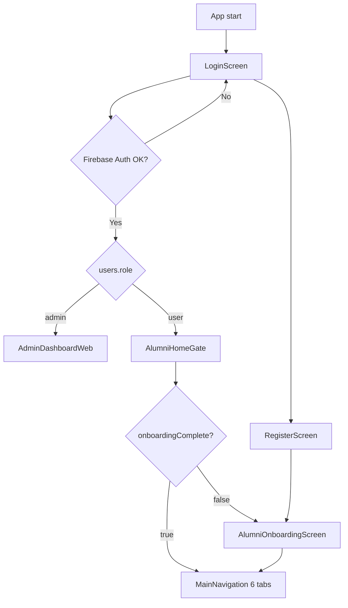
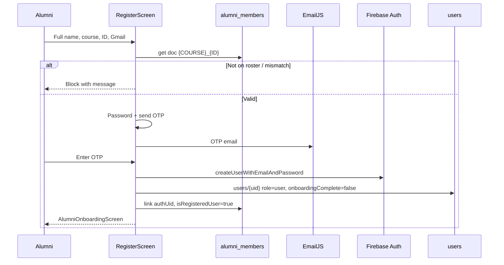
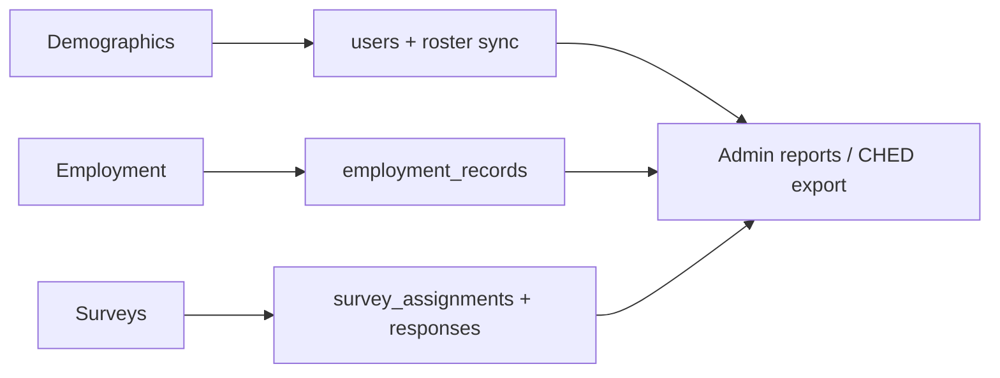
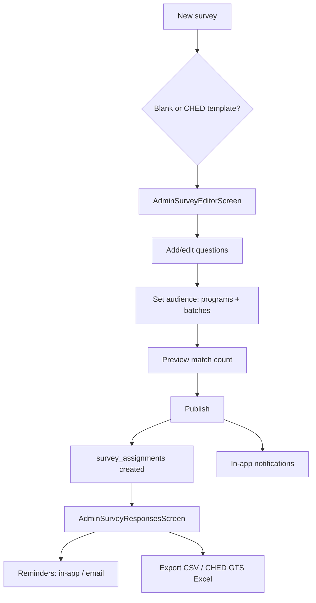

# Alumni System — Complete Feature, Screen & Flow Inventory

**USTP Alumni / Graduate Tracer Platform**  
Master reference for rebuilding from scratch while preserving current behavior.

**Related docs:** [system-overview.md](system-overview.md) · [alumni-roster-complete.md](alumni-roster-complete.md) · [grad-tracker-migration.md](grad-tracker-migration.md) · [ched-survey-templates.md](ched-survey-templates.md)

**Last audited:** June 2026 (from live `lib/` codebase)

---

## Table of contents

1. [System purpose](#1-system-purpose)
2. [Technology stack](#2-technology-stack)
3. [User roles & routing](#3-user-roles--routing)
4. [Screen map (all screens)](#4-screen-map-all-screens)
5. [Authentication & onboarding flows](#5-authentication--onboarding-flows)
6. [Alumni (user) portal — features by area](#6-alumni-user-portal--features-by-area)
7. [Admin portal — features by menu](#7-admin-portal--features-by-menu)
8. [Graduate tracer study (CHED alignment)](#8-graduate-tracer-study-ched-alignment)
9. [Surveys — full lifecycle](#9-surveys--full-lifecycle)
10. [Announcements, forum, events, jobs, messages](#10-announcements-forum-events-jobs-messages)
11. [Feedback & AI assistant](#11-feedback--ai-assistant)
12. [Notifications & email](#12-notifications--email)
13. [Reports, analytics & exports](#13-reports-analytics--exports)
14. [Firestore data model](#14-firestore-data-model)
15. [Services layer (backend logic in app)](#15-services-layer-backend-logic-in-app)
16. [Security rules (summary)](#16-security-rules-summary)
17. [UI/UX patterns (rebuild notes)](#17-uiux-patterns-rebuild-notes)
18. [Known gaps & placeholder UI](#18-known-gaps--placeholder-ui)
19. [Source file index](#19-source-file-index)

---

## 1. System purpose

The platform connects a college/university with graduates across programs. It supports:

| Capability | Description |
|------------|-------------|
| **Official roster** | Registrar-style list; gates who may register |
| **Alumni tracer** | Demographics (Section A/B style) + employment (Section D style) |
| **Custom / CHED surveys** | Targeted assignments, drafts, reminders, exports |
| **Community** | Announcements, forum, events |
| **Careers** | Admin job postings; alumni browse & favorites |
| **Support** | Alumni–admin messaging, feedback tickets, AI help chat |
| **Administration** | Web dashboard: directory, reports, moderation, activity logs |

**Stack:** Flutter (Dart), primarily **web** for admin; **Firebase Auth** + **Cloud Firestore**; optional **EmailJS**; optional **Google Gemini** for AI.

---

## 2. Technology stack

| Layer | Technology | Notes |
|-------|------------|--------|
| UI | Flutter 3 / Material 3 | Seed color `#090A4F` (navy) |
| Auth | Firebase Auth | Email + password |
| Database | Cloud Firestore | Real-time listeners on messages, surveys, forum |
| Hosting | Firebase Hosting | Web build |
| Charts | `fl_chart` | Admin reports & dashboard engagement |
| Excel | `excel` package | Roster import/export, reports, CHED GTS export |
| Email | EmailJS | OTP registration, survey/announcement reminders |
| AI | Gemini API | `lib/config/ai_config.dart` / `ai_defaults.dart` |
| Local prefs | `shared_preferences` | Remember-me email only |
| Images | `image_picker`, `flutter_image_compress` | Profile & message attachments (base64 in Firestore) |

**Entry point:** `lib/main.dart` → `LoginScreen`

---

## 3. User roles & routing

| Role | Firestore | After login |
|------|-----------|-------------|
| **Alumni (`user`)** | `users/{uid}.role == 'user'` | `AlumniHomeGate` → onboarding **or** `MainNavigation` |
| **Admin** | `users/{uid}.role == 'admin'` | `AdminDashboardWeb` (sidebar) |

There is **no** admin toggle on the login screen. Role is always read from Firestore after sign-in.



### Alumni bottom navigation (`MainNavigation`)

| Index | Tab | Screen | Lazy-loaded |
|-------|-----|--------|-------------|
| 0 | Home | `HomeScreen` | First visit |
| 1 | Events | `EventsScreen` | On first visit |
| 2 | Messages | `UserMessagesScreen` | On first visit |
| 3 | Jobs | `JobPostingScreen` | On first visit |
| 4 | Tracer | `IdTracerScreen` (embedded) | On first visit |
| 5 | Profile | `ProfileScreen` | On first visit |

Uses `IndexedStack` + `AutomaticKeepAliveClientMixin` on tabs to preserve state. `switchToTab(index)` used from Home shortcuts.

### Admin sidebar (`AdminDashboardWeb`)

Menu index → screen (see [Section 7](#7-admin-portal--features-by-menu)):

| Index | Label |
|-------|--------|
| 0 | Dashboard |
| 1 | Events |
| 2 | Alumni Directory |
| 4 | Archives |
| 5 | Job Postings |
| 6 | Messages |
| 7 | Activity Logs |
| 9 | Reports & Analytics |
| 10 | Surveys |
| 11 | Announcements |
| 12 | Forum |
| 13 | AI Assistant |
| 14 | Feedback |

(Index 3 and 8 are unused in routing.)

---

## 4. Screen map (all screens)

### 4.1 Public / auth (no bottom nav)

| Screen file | Route / access | Purpose |
|-------------|----------------|---------|
| `login_screen.dart` | App home | Email/password login, remember me, link to register |
| `register_screen.dart` | From login | Roster verification → OTP → create Auth + `users` doc |
| `alumni_home_gate.dart` | Post-login (user) | Routes to onboarding or `MainNavigation` |
| `alumni_onboarding_screen.dart` | First-time user | 4-step wizard: Welcome → Profile → Employment → Done |

### 4.2 Alumni main shell (`MainNavigation`)

| Screen file | Tab / push | Purpose |
|-------------|------------|---------|
| `home_screen.dart` | Tab 0 | Dashboard, notifications, quick access, events/jobs preview, calendar |
| `events_screen.dart` | Tab 1 | Upcoming events, search, filters, grid/list, comments, reminders |
| `user_messages_screen.dart` | Tab 2 | Chat with admin (text + images, reactions) |
| `job_posting_screen.dart` | Tab 3 | Browse jobs, search, filters, favorites, job detail modal |
| `id_tracer_screen.dart` | Tab 4 | Demographics + employment tracer tabs |
| `profile_screen.dart` | Tab 5 | Photo, editable fields, tracer checklist, feedback, logout |

### 4.3 Alumni pushed screens (stack navigation)

| Screen file | Opened from | Purpose |
|-------------|-------------|---------|
| `user_surveys_screen.dart` | Home (pending card), notifications | List assigned surveys |
| `user_survey_take_screen.dart` | My Surveys list | Answer survey; save draft / submit |
| `user_announcements_screen.dart` | Home quick access, notifications | Full announcement feed |
| `forum_screen.dart` | Home quick access | Topic list + create topic |
| `forum_topic_screen.dart` | Forum | Thread posts / replies |
| `ai_assistant_screen.dart` | Home “AI Help” | Gemini chat (alumni mode) |
| `user_feedback_list_screen.dart` | Profile → Feedback | User’s tickets |
| `user_feedback_submit_screen.dart` | Feedback list | New feedback form |
| `user_feedback_detail_screen.dart` | Feedback list | View ticket + admin reply |
| `id_tracer_screen.dart` | Profile tracer checklist | Same tracer, `embeddedInNav: false` + back button |
| `tracer_profile_screen.dart` | *(legacy)* | Standalone wrapper — **not wired in main nav** |

**In-screen widgets (jobs):** `JobPostingCard`, `JobDetailsModal`, `_FavoriteJobsDialog` inside `job_posting_screen.dart`.

### 4.4 Admin shell (`AdminDashboardWeb`)

| Screen file | Menu index | Purpose |
|-------------|------------|---------|
| `admin/admin_dashboard_home.dart` | 0 | KPIs, engagement chart, feeds, quick actions |
| `admin/admin_events_screen.dart` | 1 | CRUD events, notify alumni, view comments |
| `admin_alumni_members_screen.dart` | 2 | Wrapper → `AdminAlumniDirectoryScreen` |
| `admin/admin_alumni_directory_screen.dart` | 2 | Roster list, filters, import/export Excel |
| `admin/admin_alumni_member_detail_screen.dart` | Push from directory | 3 tabs: Profile / Employment / Activity |
| `admin/admin_archives_screen.dart` | 4 | Archived events & archived jobs |
| `admin_job_management.dart` | 5 | Active vs expired jobs, CRUD |
| `add_job_dialog.dart` | Modal from jobs admin | Create/edit job form |
| `admin_messages_screen.dart` | 6 | Alumni conversations, reply, reactions |
| `admin/admin_activity_logs_screen.dart` | 7 | Audit log list |
| `admin_reports_screen.dart` | 9 | Analytics tabs + Excel/PDF export |
| `admin/admin_surveys_screen.dart` | 10 | Survey list, create, publish, close |
| `admin/admin_survey_editor_screen.dart` | Push | Questions, audience, CHED banner |
| `admin/admin_survey_responses_screen.dart` | Push | Overview / Pending / Submitted, reminders, CSV, CHED Excel |
| `admin/admin_announcements_screen.dart` | 11 | List, archive, publish |
| `admin/admin_announcement_editor_screen.dart` | Push | Editor + targeting + notify toggles |
| `admin/admin_forum_screen.dart` | 12 | Moderate topics (lock, pin, delete) |
| `ai_assistant_screen.dart` | 13 | Gemini chat (admin mode) |
| `admin/admin_feedback_screen.dart` | 14 | All feedback tickets |
| `admin/admin_feedback_detail_screen.dart` | Push | Status, admin response, notify user |
| `admin/admin_event_comments_dialog.dart` | Dialog | Moderate event comments |
| `admin/admin_registered_alumni_tab.dart` | *(component)* | Registered users table — used in reports context, not separate menu |
| `admin/widgets/admin_survey_template_picker.dart` | Dialog | Blank vs CHED template clone |

---

## 5. Authentication & onboarding flows

### 5.1 Registration (roster-gated)



| Step | Function |
|------|----------|
| 1 | Enter **full name**, **course** (`CourseConstants`: BSIT, BFPT, BTLED-*), **student ID**, **Gmail** |
| 2 | **Verify alumni status** — exact match on roster document |
| 3 | Set password; **OTP** sent via EmailJS |
| 4 | Verify OTP → create Firebase account |
| 5 | Create `users/{uid}`; claim roster row |
| 6 | Mandatory **onboarding** (cannot skip to Home until complete) |

**Courses supported:** `BSIT`, `BFPT`, `BTLED-IA`, `BTLED-ICT`, `BTLED-HE`

### 5.2 Login

| Function | Detail |
|----------|--------|
| Email + password | Firebase Auth |
| Remember me | Saves **email only** locally (`LoginPreferencesService`) |
| Role routing | Admin → dashboard; User → `AlumniHomeGate` |
| Audit | `LOGIN` entry in `audit_logs` |
| Missing profile | Error if `users/{uid}` missing (admin restore doc linked in login message) |

### 5.3 Onboarding wizard (`AlumniOnboardingScreen`)

| Step | Label | Data collected |
|------|-------|----------------|
| 0 | Welcome | Intro only |
| 1 | Profile | Demographics → `users/{uid}` + sync roster |
| 2 | Employment | `employment_records` document |
| 3 | Done | Sets `onboardingComplete: true` → `MainNavigation` |

Onboarding reuses same field set as tracer (name, ID, program, batch, gender, civil status, birth date, address, contact, employment block).

### 5.4 Returning alumni session

```text
Login → AlumniHomeGate
  → if onboardingComplete → MainNavigation
  → else → AlumniOnboardingScreen
```

`OnboardingService.resolveForCurrentUser()` uses cache-first Firestore read.

---

## 6. Alumni (user) portal — features by area

### 6.1 Home (`HomeScreen`)

| Feature | Description |
|---------|-------------|
| Welcome header | Name + profile image from `users` |
| Notifications bell | Bottom sheet: list, refresh, mark all read, tap → navigate |
| Pending surveys card | Orange card when assignments incomplete → `UserSurveysScreen` |
| Horizontal quick access | Stat cards: Events, Messages (unread count), Jobs, Announcements, Forum, **AI Help** |
| Upcoming events | Preview cards → Events tab |
| Featured jobs | Horizontal scroll → Jobs tab |
| Quick links grid | Alumni Tracer, Profile, Messages, Help (→ Messages) |
| Calendar widget | Month grid + live clock (decorative / UX) |
| Tab navigation | `onSelectTab` / `MainNavigation.switchToTab` |

**Data loaded (deferred / listeners):** profile, pending survey count, announcements preview, events, jobs, message unread count, notifications stream.

### 6.2 Events (`EventsScreen`)

| Feature | Description |
|---------|-------------|
| List upcoming events | `getUpcomingEvents()` — future/active only |
| Search | Text filter on title/description |
| Filters | All, This Week, This Month, Newest |
| View modes | List vs grid toggle |
| Event detail sheet | Theme, date, venue, description, image |
| Event reminders | Schedule/cancel local reminders + Firestore `users/{uid}/reminders` |
| Comments | Add, edit own, delete own; admin can moderate via admin Events |
| Skeleton loading | `EventListSkeleton` on first load |

### 6.3 Messages (`UserMessagesScreen`)

| Feature | Description |
|---------|-------------|
| Thread with admin | Real-time `watchUserAdminConversation()` |
| Send text | Composer + send button |
| Send images | Gallery/camera; compress; base64 in message doc |
| Read state | Marks admin messages read when tab active |
| Message options | Long-press: copy, delete own, add reaction |
| Double-tap | Quick 👍 reaction |
| Reactions | Emoji chips; toggle per user; sync to Firestore `reactions` map |
| Image cache | Decoded base64 cached per message id |
| Skeleton | `MessageListSkeleton` while loading |

### 6.4 Jobs (`JobPostingScreen`)

| Feature | Description |
|---------|-------------|
| List active jobs | From `jobs` collection |
| Search | Title, company, location |
| Filter chips | All, Full-time, Part-time, Remote, Internship |
| Sort | Newest, Oldest, Salary high/low |
| Job count + sort dropdown | Header bar |
| Job card | Company, title, type, location, salary, experience, posted time |
| View details | Bottom sheet modal: full description, requirements, benefits, deadline, contact |
| Favorites | Bookmark per user → `users/{uid}/favorite_jobs` |
| Saved jobs sheet | App bar bookmark icon → list of favorites |
| Skeleton | `JobListSkeleton` on first load |
| Pull-to-refresh | Reload jobs |

### 6.5 Alumni Tracer (`IdTracerScreen`)

Two tabs (lazy-load employment on first visit to tab 1):

#### Demographics tab (`DemographicTracerTab`)

| Field | Stored on |
|-------|-----------|
| Full name | `users/{uid}` |
| Student ID | `users/{uid}` |
| Program / course | `users/{uid}` |
| Batch year | `users/{uid}` |
| Year graduated | `users/{uid}` |
| Contact number | `users/{uid}` |
| Address | `users/{uid}` |
| Gender | `users/{uid}` |
| Civil status | `users/{uid}` |
| Birth date | `users/{uid}` |

**Completion %:** Computed from required fields (`TracerProfile.computeCompletion`). Syncs to roster; may set `hasProfileUpdates` for admin notification.

#### Employment tab

| Field | When employed | When unemployed |
|-------|---------------|-----------------|
| Status | Employed / Unemployed | |
| Months unemployed | | Optional |
| Company, position, industry | Yes | Cleared |
| Employment type | Full-time, Part-time, Contract, Freelance, Self-employed | |
| Start date | Yes | |
| Salary range | Yes | |
| City, province, country | Optional | |
| Email, contact, school ID | Required for submission | |

| Function | Detail |
|----------|--------|
| Submit / update | `employment_records` — one record per user flow |
| Clear form | Reset local fields |
| Progress header | Overall % (50% demo + 50% employment) |
| Verification | **Not shown to alumni** — admin sees status on member detail |
| Skeleton | `TracerFormSkeleton` while loading employment |

### 6.6 Profile (`ProfileScreen`)

| Feature | Description |
|---------|-------------|
| Profile photo | Pick/upload → `profileImageUrl` on user |
| Editable rows | Full name, ID, course, phone (dialogs) |
| Read-only email | From Auth |
| Tracer checklist | Links to demographics / employment tabs |
| Settings placeholders | General, Security, Notifications, Privacy, Linked Accounts — **UI only, no logic** |
| Feedback | → `UserFeedbackListScreen` |
| Logout | Audit log + sign out → `LoginScreen` |

**Note:** “My Surveys” is reached via **Home** (pending card / notifications), not Profile menu.

### 6.7 Surveys (alumni)

See [Section 9](#9-surveys--full-lifecycle).

### 6.8 Announcements (alumni)

| Feature | Description |
|---------|-------------|
| Targeted feed | `getPublishedForUser(uid)` by program/batch |
| List screen | `UserAnnouncementsScreen` |
| Deep link | `initialAnnouncementId` from notification tap |
| Priority display | Normal vs important |

### 6.9 Forum (alumni)

| Feature | Description |
|---------|-------------|
| List topics | Real-time stream, pinned/locked indicators |
| Create topic | FAB → dialog (title, body) |
| Open topic | `ForumTopicScreen` — read posts |
| Reply | If topic not locked |
| Delete own topic | Author only |

### 6.10 Feedback (alumni)

| Feature | Description |
|---------|-------------|
| Categories | Bug, feature, general, portal, event, jobs, other |
| Optional star rating | 1–5 |
| Subject + message (min length enforced in rules) | `feedback` collection |
| List + detail | View status and admin response |

### 6.11 AI assistant (alumni)

| Feature | Description |
|---------|-------------|
| Chat UI | `AiAssistantScreen(isAdmin: false)` |
| Backend | `AiAssistantService` → Gemini when API key configured |
| Setup dialog | Instructions if key missing |

---

## 7. Admin portal — features by menu

### 7.1 Dashboard (index 0)

| Feature | Description |
|---------|-------------|
| KPI metrics | Roster total, registered, tracer complete, employment count, surveys, events, jobs, messages, announcements, forum topics, open feedback |
| Attention strip | Highlights items needing action (unread messages, pending surveys, etc.) |
| Portal activity chart | Area chart from audit logs (`DashboardEngagementChart`) |
| Recent activity feed | Latest `audit_logs` |
| Active events feed | Upcoming events list |
| Quick action chips | Jump to Directory, Surveys, Messages, etc. |
| Pull to refresh | Reload metrics + feeds |
| Live listeners | Unread messages count, open feedback count update in real time |
| Return refresh | Re-fetch KPIs when navigating back to Dashboard |

### 7.2 Events (index 1)

| Feature | Description |
|---------|-------------|
| Create event | Title, theme, date, venue, description, batch years, image, status |
| Edit / delete | Full CRUD |
| Notify alumni | In-app notifications on create (`notifyNewEvent`) |
| Auto-archive | Past events archived by service logic |
| View comments | Dialog — `AdminEventCommentsDialog` |
| Comment moderation | Admin delete |

### 7.3 Alumni Directory (index 2)

| Feature | Description |
|---------|-------------|
| Official roster | `alumni_members` collection |
| Search | Name, ID |
| Filters | Course, registration (registered / not), active (30-day), employment status, show deactivated |
| Sort | Name A–Z / Z–A, etc. |
| Summary chips | Registered count, not registered, profile updates pending |
| Add member | Manual form dialog |
| Edit member | Update roster fields |
| Deactivate / delete | Soft deactivate or remove |
| Import Excel | Columns: Full Name, Course, ID Number |
| Export Excel | Roster dump |
| View member | → `AdminAlumniMemberDetailScreen` |
| Profile update badge | Orange icon when `hasProfileUpdates` until admin opens detail |
| Employment index | Loaded for employment filter chips |

#### Member detail (3 tabs)

| Tab | Content |
|-----|---------|
| **Profile** | Tracer demographics from `users`, completion %, roster snapshot |
| **Employment** | `employment_records` if registered; status banner; all job fields |
| **Activity** | `audit_logs` filtered for this member |

Opening detail clears `hasProfileUpdates` on roster row.

**Employment verification:** `IdTracerService.verifyRecord` / `rejectRecord` exist in service layer; **no dedicated “ID Tracer” menu** — verification UI is not exposed as separate screen in current build (status visible on employment tab).

### 7.4 Archives (index 4)

| Feature | Description |
|---------|-------------|
| Tab: Events | Archived events list |
| Tab: Jobs | Archived/expired jobs |
| Restore / manage | Per archive screen actions |

### 7.5 Job Postings (index 5)

| Feature | Description |
|---------|-------------|
| Tabs | Active vs Expired |
| Search | Filter listings |
| Add job | `AddJobDialog` — full job model fields |
| Edit / delete | Per posting |
| Archive | Status → archived |
| Stats | Views/applications fields on model |
| Skeleton | `JobListSkeleton` on load |

### 7.6 Messages (index 6)

| Feature | Description |
|---------|-------------|
| Conversation list | All alumni threads |
| Unread badges | Per conversation |
| Open thread | Messages + composer |
| Reply text + images | Same as user side |
| Reactions | Add/view emoji reactions |
| Delete messages | Admin can delete |
| Search users | Filter conversation list |
| Skeleton loading | Admin message skeletons |

### 7.7 Activity Logs (index 7)

| Feature | Description |
|---------|-------------|
| List audit entries | Action, user, resource, timestamp, status |
| Filter/search | By action type, user |
| Skeleton | `AdminActivityLogSkeleton` |

### 7.8 Reports & Analytics (index 9)

Four sub-sections (tabs):

| Section | Contents |
|---------|----------|
| **Overview** | KPI cards: roster, tracer, surveys, community |
| **Alumni & tracer** | Charts: employment pie, batch bar, course breakdown, industry (employed), roster stats |
| **Surveys** | Per-survey rollups, question aggregates |
| **Export** | Report generator |

**Export report types:**

1. Alumni Roster  
2. Registered Alumni  
3. Events  
4. Job Postings  
5. Employment Records  
6. Tracer Surveys  
7. Tracer & Survey KPIs  
8. Announcements  
9. Forum Topics  

**Formats:** Excel (multi-sheet), PDF (web download). Tracer & Survey KPIs includes dedicated sheets (`KPI`, `Industry_employed`, `Surveys`, etc.).

### 7.9 Surveys (index 10)

See [Section 9](#9-surveys--full-lifecycle).

### 7.10 Announcements (index 11)

| Feature | Description |
|---------|-------------|
| List | Draft / published / archived |
| Create / edit | `AdminAnnouncementEditorScreen` |
| Targeting | Program chips + batch years (empty = all) |
| Publish | Sets status; optional in-app + email notify |
| Archive / delete | From list menu |
| Recipient count | Shown after publish |

### 7.11 Forum moderation (index 12)

| Feature | Description |
|---------|-------------|
| List all topics | With pin/lock state |
| Lock / unlock | Prevents new replies |
| Pin / unpin | Sort to top |
| Delete topic | Admin only |
| View topic | Read-only thread |

### 7.12 AI Assistant (index 13)

| Feature | Description |
|---------|-------------|
| Admin-mode prompts | Roster, surveys, reports, announcements guidance |
| Same Gemini stack | As alumni assistant with different system prompt |

### 7.13 Feedback (index 14)

| Feature | Description |
|---------|-------------|
| List all tickets | Stream/filter by status & category |
| Open count badge | On menu / dashboard |
| Detail screen | Change status (submitted → in review → resolved → closed) |
| Admin response | Text reply + optional notify alumni |
| Filter chips | Status and category |

---

## 8. Graduate tracer study (CHED alignment)

### Three pillars (alumni)



| Pillar | Alumni UI | Admin visibility |
|--------|-----------|------------------|
| Demographics | Tracer tab 0 / Onboarding | Directory → Profile tab |
| Employment | Tracer tab 1 / Onboarding | Directory → Employment tab |
| Surveys | Home / My Surveys | Surveys → Responses |

### CHED GTS template packs

| Item | Detail |
|------|--------|
| Storage | `survey_templates/{id}` + `questions` subcollection |
| Seed | `lib/data/ched_survey_template_seed.dart` |
| Official pack | `ched_gts_official_v2` (sections C & D) |
| Legacy | `ched_gts_core_v1` |
| Admin create | Template picker → clone to draft survey |
| Prefill | `SurveyPrefillHelper` maps employment → CHED items (e.g. item 16 employed Yes/No) |
| Export | `ChedGtsExportService` — multi-sheet Excel from survey responses + tracer |

Sections **A & B** are collected in Alumni Tracer demographics (not duplicated in survey pack).

---

## 9. Surveys — full lifecycle

### Admin flow



| Step | Function |
|------|----------|
| Create | Title, description; optional `templateId` |
| Question types | `text`, `singleChoice`, `multipleChoice`, `scale`, `date` |
| CHED metadata | `chedItemNumber`, `prefillKey`, `isStandardItem`, `section` |
| Audience | `AudienceTargeting` — course chips + batch years (`2020-2027` or comma list) |
| Publish | Creates assignments; notifies matched alumni |
| Re-assign | Update cohort after filter change |
| Close survey | Stop new responses |
| Responses tabs | Overview, Pending (with reminder actions), Submitted |
| Export CSV | Submitted answers (web) |
| Export CHED GTS Excel | Registrar pack per survey |

### Alumni flow

| Step | Function |
|------|----------|
| Notification | On publish (and reminder) |
| Open | `UserSurveysScreen` → tap assignment |
| Take | `UserSurveyTakeScreen` |
| Prefill | Employment → CHED keys when template survey |
| Save draft | `responses/{uid}` without final submit |
| Submit | Locks survey; updates assignment `completed` |
| Re-open | Read-only if already submitted |

**Assignment statuses:** `notStarted` → `inProgress` → `completed`

---

## 10. Announcements, forum, events, jobs, messages

Cross-reference — core behaviors listed in sections 6–7. Shared rules:

| Module | Alumni write | Admin write | Targeting |
|--------|--------------|-------------|-----------|
| Announcements | Read | CRUD + publish | Program + batch |
| Forum | Topics + posts | Moderate | Public to all signed-in |
| Events | Comments, reminders | CRUD + notify | Batch years on event |
| Jobs | Favorites | CRUD | All alumni |
| Messages | Send to admin | Reply | Per-user thread |

---

## 11. Feedback & AI assistant

| Module | Collection | Alumni | Admin |
|--------|------------|--------|-------|
| Feedback | `feedback` | Submit, list own, read reply | List all, update status, respond |
| AI chat | *(stateless API)* | Home → AI Help | Menu → AI Assistant |

---

## 12. Notifications & email

### In-app notifications

| Type | Typical trigger | Tap navigates to |
|------|-----------------|------------------|
| `event` | New event | Events tab |
| `job` | New job | Jobs tab |
| `message` | New message | Messages tab |
| `survey` | Publish / reminder | `UserSurveysScreen` |
| `announcement` | Publish | `UserAnnouncementsScreen` |
| `system` | General | Varies |

**Storage:** `users/{uid}/notifications` subcollection  
**UI:** Home bell → bottom sheet; mark one / mark all read

### EmailJS

| Use | Template |
|-----|----------|
| Registration OTP | `emailjs_defaults.dart` |
| Survey reminders | Reminder template ID |
| Announcement email | Same reminder template when enabled on publish |

Config: `lib/config/emailjs_defaults.dart` or `--dart-define=EMAILJS_*`  
App works without email; OTP/reminders fail gracefully with messages.

---

## 13. Reports, analytics & exports

| Output | Where | Format |
|--------|-------|--------|
| Dashboard KPIs | Admin home | On-screen |
| Charts | Reports → Alumni & tracer | `fl_chart` |
| Survey analytics | Reports → Surveys | Per-question bars / tables |
| Report generator | Reports → Export | Excel / PDF |
| Survey responses CSV | Survey responses screen | CSV download (web) |
| CHED GTS pack | Survey responses screen | `.xlsx` multi-sheet |
| Roster import/export | Alumni Directory | `.xlsx` |

---

## 14. Firestore data model

| Collection / path | Purpose |
|-------------------|---------|
| `users/{uid}` | Profile, role, tracer fields, `onboardingComplete`, `profileImageUrl` |
| `users/{uid}/notifications` | In-app alerts |
| `users/{uid}/reminders` | Event reminders |
| `users/{uid}/favorite_jobs` | Saved job IDs |
| `alumni_members/{id}` | Official roster; doc id `{COURSE}_{STUDENTID}` |
| `employment_records/{id}` | Employment tracer submissions |
| `events/{id}` | Events |
| `events/{id}/comments/{id}` | Event comments |
| `events/{id}/comments/{id}/replies/{id}` | Admin replies to comments |
| `jobs/{id}` | Job postings |
| `messages/{id}` | Alumni–admin messages |
| `surveys/{id}` | Survey metadata |
| `surveys/{id}/questions/{id}` | Survey questions |
| `surveys/{id}/responses/{userId}` | User answers |
| `survey_assignments/{id}` | Per-user assignment + status |
| `survey_templates/{id}` | CHED / preset packs |
| `survey_templates/{id}/questions/{id}` | Template questions |
| `announcements/{id}` | Announcements |
| `forum_topics/{id}` | Forum topics |
| `forum_topics/{id}/posts/{id}` | Replies |
| `feedback/{id}` | User feedback tickets |
| `audit_logs/{id}` | System audit trail |

---

## 15. Services layer (backend logic in app)

| Service file | Responsibility |
|--------------|----------------|
| `auth_service.dart` | Login, register doc, role |
| `alumni_eligibility_service.dart` | Roster match at registration |
| `alumni_member_service.dart` | Roster CRUD, filters, dashboard counts, deactivate |
| `alumni_roster_import_service.dart` | Parse/import Excel rows |
| `alumni_directory_detail_service.dart` | Member detail aggregate + mark viewed |
| `user_profile_service.dart` | Tracer profile save, roster sync, registered alumni list |
| `onboarding_service.dart` | `onboardingComplete` gate |
| `id_tracer_service.dart` | Employment CRUD, verify/reject, stats |
| `survey_service.dart` | Surveys, publish, assignments, responses, prefill |
| `survey_template_service.dart` | Seed/sync CHED templates |
| `survey_prefill_helper.dart` | Employment → CHED answer mapping |
| `ched_gts_export_service.dart` | CHED Excel workbook builder |
| `survey_report_analytics.dart` | Question aggregates for reports |
| `announcement_service.dart` | CRUD, publish, targeting, notify |
| `event_service.dart` | Events CRUD, archive, counts |
| `event_comment_service.dart` | Event comments |
| `job_service.dart` | Jobs CRUD, active/archived |
| `favorite_job_service.dart` | User favorites stream |
| `message_service.dart` | Threads, send, read, unread counts |
| `notification_service.dart` | Create/list/mark notifications |
| `forum_service.dart` | Topics, posts, lock, pin |
| `feedback_service.dart` | Submit, admin update, open count |
| `audit_service.dart` | Log actions, fetch logs |
| `email_service.dart` | EmailJS send |
| `reminder_service.dart` | Local notifications for events |
| `ai_assistant_service.dart` | Gemini chat |
| `login_preferences_service.dart` | Remember email |

---

## 16. Security rules (summary)

| Rule | Behavior |
|------|----------|
| Admin | `users/{uid}.role == 'admin'` unlocks roster list, survey write, forum moderation, etc. |
| Roster | Alumni: **get** own/unclaimed doc by ID only; **list** admin-only |
| Employment | User creates/updates own; cannot change `verificationStatus` / `verifiedBy` |
| Messages | Participants read; recipient mark read; reactions update for participants |
| Surveys | User writes own `responses/{uid}`; admin manages surveys/assignments |
| Assignments | User may update only `status` on own row |
| Feedback | User creates with `status: submitted`; admin updates |
| Forum | Locked topics block new posts |

Full rules: `firestore.rules`

---

## 17. UI/UX patterns (rebuild notes)

| Pattern | Where used |
|---------|------------|
| Skeleton shimmer | `portal_skeletons.dart`, `admin_skeletons.dart` — home, events, jobs, messages, admin dashboard |
| Lazy tab build | `MainNavigation`, `AdminDashboardWeb` IndexedStack |
| Keep-alive tabs | Jobs, Events, Tracer, Profile |
| Navy + gold theme | `#090A4F`, `#FFD700` accents |
| Web export guard | `export_platform.dart` — Excel/PDF download on web |
| Audience targeting | `audience_targeting.dart` — surveys & announcements |
| Course constants | `course_constants.dart` — roster, registration, targeting |

---

## 18. Known gaps & placeholder UI

| Item | Status |
|------|--------|
| Profile → General / Security / Notifications / Privacy / Linked Accounts | Placeholder — no implementation |
| `tracer_profile_screen.dart` | Legacy — not in navigation |
| Admin employment verify/reject | Service exists; **no button in member detail UI** in current code |
| Separate admin “ID Tracer” menu | **Removed** — employment viewed under Directory |
| `AdminRegisteredAlumniTab` | Component for reports/data, not sidebar item |
| Job “inquire via Messages” share | May be reverted — check `job_posting_screen.dart` before rebuild |
| Global `notifications` top-level collection | Rules exist; app uses **subcollection** under `users` |

---

## 19. Source file index

### Screens (`lib/screens/`)

```
login_screen.dart
register_screen.dart
alumni_home_gate.dart
alumni_onboarding_screen.dart
main_navigation.dart
home_screen.dart
events_screen.dart
user_messages_screen.dart
job_posting_screen.dart
id_tracer_screen.dart
profile_screen.dart
user_surveys_screen.dart
user_survey_take_screen.dart
user_announcements_screen.dart
forum_screen.dart
forum_topic_screen.dart
ai_assistant_screen.dart
user_feedback_list_screen.dart
user_feedback_submit_screen.dart
user_feedback_detail_screen.dart
tracer_profile_screen.dart          # legacy
admin_dashboard_web.dart
admin_job_management.dart
add_job_dialog.dart
admin_messages_screen.dart
admin_reports_screen.dart
admin_alumni_members_screen.dart
admin/
  admin_dashboard_home.dart
  admin_dashboard_metrics.dart
  dashboard_activity_trend.dart
  admin_events_screen.dart
  admin_event_comments_dialog.dart
  admin_alumni_directory_screen.dart
  admin_alumni_member_detail_screen.dart
  admin_archives_screen.dart
  admin_activity_logs_screen.dart
  admin_surveys_screen.dart
  admin_survey_editor_screen.dart
  admin_survey_responses_screen.dart
  admin_announcements_screen.dart
  admin_announcement_editor_screen.dart
  admin_forum_screen.dart
  admin_feedback_screen.dart
  admin_feedback_detail_screen.dart
  admin_registered_alumni_tab.dart
  widgets/                          # admin UI components
```

### Key widgets & core

```
lib/widgets/user/portal_skeletons.dart
lib/widgets/admin/admin_skeletons.dart
lib/widgets/tracer/demographic_tracer_tab.dart
lib/widgets/tracer/tracer_profile_checklist.dart
lib/core/course_constants.dart
lib/core/audience_targeting.dart
lib/data/ched_survey_template_seed.dart
lib/models/                             # all domain models
lib/services/                           # all services (see §15)
```

---

## Quick rebuild checklist

When reimplementing from scratch, preserve this order:

1. Firebase project + `firestore.rules` + indexes  
2. Auth + `users` role + admin seed doc  
3. `alumni_members` roster + registration gate  
4. Onboarding + tracer demographics + employment  
5. `MainNavigation` shell + Home  
6. Messages, events, jobs  
7. Surveys + templates + assignments + CHED export  
8. Announcements + forum + notifications  
9. Admin dashboard + directory + reports  
10. Feedback + AI + audit logs + archives  

---

*This inventory reflects the codebase as of the audit date. Update this file when major features are added or removed.*
