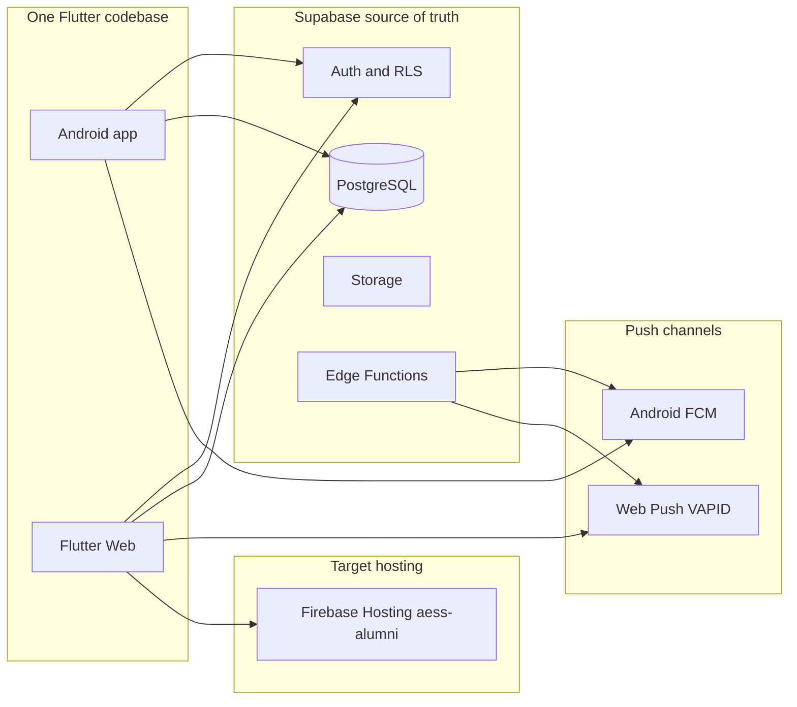

# AESS Unified Responsive Application and Firebase Hosting Plan

**Status:** Audit complete; implementation gated by phase approvals.  
**Date:** 2026-10-19  
**Scope:** One Flutter codebase for Android + web; Supabase remains backend; Firebase Hosting for production web.

> This document is the durable audit and implementation plan. Distinguishes **confirmed** facts from **unverified** assumptions. Runtime Chrome QA and Hosting deploy results belong in phase reports, not assumed here unless noted.

---

## Locked defaults

| Decision | Value |
|---|---|
| Firebase Hosting project | `aess-alumni` (matches PushConfig / production gates; **not** stale `alumni-3fb4d`) |
| Push model | Android FCM + existing Web Push (VAPID + `web/push-sw.js`); do not migrate web to FCM unless separately requested |
| Routing | Keep `AuthGate` + imperative `Navigator`; SPA rewrite to `index.html`; query deep links |
| SMS / Semaphore | **Not present in repo**; contact mobile verify is mock/`sms_unavailable` — out of scope unless approved |
| Production deploy | Requires explicit separate approval after preview checks |

---

## 1. Executive summary

AESS (`alumni_system`) is already a **single Flutter multi-platform application** with `android/`, `ios/`, `web/`, and desktop folders. Supabase is the sole identity and data backend (Auth, PostgreSQL, RLS, Storage, Edge Functions). Firebase is used for **Android FCM delivery only**. Browser alerts already use **standard Web Push**, not Firebase Cloud Messaging on web.

**Works today (code evidence; full Chrome matrix not re-run in the audit):**

- Alumni shell with `PortalBreakpoints` / `PortalContentFrame` and rail vs bottom nav at 900px (`lib/features/shell/presentation/main_navigation.dart`).
- Admin desktop-first shell with collapsing sidebar (`admin_dashboard_shell.dart`).
- Auth via email/password + in-app OTP (no OAuth redirect dependency).
- Web file export/download helpers; message image bytes paths for web.
- Digital card verify via `/?verify=`.

**Main gaps:**

1. No Firebase Hosting config in-repo (`firebase.json` / `.firebaserc` missing); `deploy.sh` still prints `alumni-3fb4d` URLs.
2. Admin UI is not phone-first; Reports/DSS/Events/Jobs/Forum redesign not started; fixed panels and table overflow risks.
3. `dart:io` imports in messaging/onboarding are a web-compile risk until verified with `flutter build web`.
4. Large `fetchAllPages` / unbounded selects can stress browser memory.
5. No Hosting CI; billing / Site URL are manual console steps.
6. Product assumption of Semaphore SMS does not match the codebase.



---

## 2. Actual architecture and current state

| Layer | Reality | Paths |
|---|---|---|
| Entry | Supabase init → `PushService.initialize()` → `MyApp` | `lib/main.dart` |
| Auth root | `AuthGate` → admin / onboarding / `MainNavigation` / login | `lib/features/auth/presentation/auth_gate.dart` |
| Session | `AppSession` wraps Supabase Auth | `lib/core/services/app_session.dart` |
| State | Feature services + `StatefulWidget`; no Riverpod/Bloc/go_router | — |
| Alumni theme | `PortalTheme`, `UstpColors` | `lib/shared/widgets/user/portal_theme.dart`, `lib/core/constants/ustp_colors.dart` |
| Admin theme | `AdminColors`, `AdminDensity` | `lib/shared/widgets/admin/` |
| Supabase config | `--dart-define` / defaults; **rejects service_role** | `lib/core/config/supabase_config.dart`, `supabase_defaults.dart` |
| Firebase client | Lazy Android-only in `FcmPushBridge` | `lib/features/notifications/push/fcm_push_bridge.dart` |
| Web shell | PWA manifest + custom push SW | `web/index.html`, `web/manifest.json`, `web/push-sw.js` |

**Not in tree:** `firebase.json`, `.firebaserc`, `lib/firebase_options.dart`, `google-services.json`, `GoogleService-Info.plist`, `.github/workflows`.

---

## 3. Existing web support and responsive utilities

### Alumni (reuse — do not replace)

| Token | Value | File |
|---|---|---|
| compact | 600 | `lib/shared/widgets/user/portal_breakpoints.dart` |
| medium | 840 | same |
| expanded | 900 | same (`useNavigationRail`) |
| contentMax | 1100 | `PortalContentFrame` |
| chatMax | 760 | same |

Widely used on home, events, jobs, tracer, surveys, forum, messages, profile, feedback, notifications.

### Admin (separate system — extend carefully)

| Token | Value | File |
|---|---|---|
| `AdminDensity.desktopSplitMin` / `statsFourColMin` | 900 | `admin_density.dart` |
| Sidebar collapse | auto `<1100` | `admin_dashboard_page.dart` |
| Sidebar widths | 264 / 72 | `admin_dashboard_shell.dart` |
| `kAdminSurfaceBreakpoint` | 700 | `admin_surface.dart` |
| Form wide | 960 | `admin_form_layout.dart` |

Admin redesign docs (`docs/AESS_ADMIN_REDESIGN_*`) mark Dashboard/Directory/Surveys largely done for **desktop**; Reports/DSS/Events/Jobs/Forum/Messages/Feedback not started. Prior redesign treated admin phone as out of scope; **this initiative includes phone/tablet admin browsers** in later phases.

### Viewport mapping (no third breakpoint system)

| Viewport guideline | Alumni | Admin |
|---|---|---|
| 320–599 | compact | phone: drawer / overlay nav |
| 600–767 | compact → medium | stacked filters, cards |
| 768–899 | medium | tablet: mini-rail |
| 900–1023 | expanded + rail | density split / table vs cards |
| 1024–1439 | expanded | full sidebar when ≥1100 |
| ≥1440 | ContentFrame cap | wide multi-pane |

---

## 4. Complete screen and feature inventory

Classification is from **source evidence**. Runtime verification is marked **Not verified** where no build/browser check was performed in the audit.

| Feature | Web readiness | Evidence |
|---|---|---|
| Auth / register / OTP recovery | Works; polish Site URL at go-live | `auth_service.dart`, `forgot_password_page.dart` |
| Alumni shell / home / events / jobs / forum / tracer / surveys / profile | Works; incremental responsive polish | `PortalBreakpoints` consumers |
| Contact verification | Works; real SMS blocked | `contact_verification_service.dart`, `contact-verify` Edge Function |
| Digital alumni card + `/?verify=` | Web-specific present | `alumni_card_verify_launch.dart` |
| Admin dashboard / directory / surveys | Works desktop web; needs phone/tablet | Redesign docs + always-sidebar |
| GTS Reports / builder / alumni list | Needs responsive | Fixed 380–400 panes; horizontal scroll |
| DSS | Needs responsive; export web-only | Fixed filters; `canExportFiles => kIsWeb` |
| Admin Events/Jobs/Forum/Feedback/Archives/Activity | Needs responsive | Not in closed redesign set |
| Messaging (alumni + admin) | Works with web branches; `dart:io` risk | `message_*`, `kIsWeb` paths |
| File/report exports | Web-specific implemented | `export_platform.dart`, `web_file_download.dart` |
| Local event reminders | Blocked on web | `reminder_service.dart` `_supported => !kIsWeb` |
| Android FCM | Android only | `FcmPushBridge.supported` |
| Web push | Present; verify on Hosting HTTPS | `web_push_bridge_web.dart`, `push-sw.js` |
| AI assistant | Present; server-gated | `ai_assistant_service.dart` |
| Admission / scholarship | **Not present** | No `lib/` matches |
| Semaphore SMS | **Not present** | No repo references |

---

## 5. Confirmed web compatibility issues

### Confirmed (repository facts)

- Missing `firebase.json` / `.firebaserc`.
- Stale Hosting URLs in `deploy.sh` (`alumni-3fb4d`).
- Dual breakpoint systems (alumni `Portal*` vs admin `AdminDensity`).
- Admin always-sidebar; no phone drawer/bottom nav.
- GTS dual-pane and DSS filter fixed widths.
- `fetchAllPages` used for roster / GTS / survey response loads (`lib/core/utils/supabase_paging.dart`).
- Anon key in client defaults (expected; RLS must protect data).
- No Semaphore integration.

### Unverified risks (must not claim green until checked)

- Whether `import 'dart:io'` in messaging/onboarding fails `flutter build web`.
- Printing / PDF preview across browsers.
- Facebook in-app browser session and push limits (`docs/access-link-plan.md`).
- Hosting free-tier bandwidth vs ~1000 visits/day → Blaze + budget alert recommended.
- Navigator-only routing: full page refresh returns to AuthGate root (acceptable short-term).

---

## 6. Supabase and authentication findings

| Topic | Finding |
|---|---|
| Init | `Supabase.initialize` in `main.dart` from `SupabaseConfig` |
| Credentials | Anon/publishable only; service_role **blocked** at validate |
| Auth model | Email/password + in-app emailed OTP; no OAuth / `redirectTo` dependency |
| Session | supabase_flutter defaults → browser localStorage on web |
| Logout | `AuthService.logout()` + image cache clear |
| Admin authority | UI uses `users.role`; **RLS** uses `public.is_admin()` |
| Edge Functions (app) | `contact-verify`, `send-email`, `ai-assist`, `tracer-help` |
| Push send | `send-push` server-triggered (not client-invoked) |
| Site URL | Local `supabase/config.toml` has localhost; update Dashboard at go-live |
| Web vs Android | Same Auth APIs; push and reminders differ by platform |

**Do not** change RLS, GTS math, DSS rules, or historical responses for responsive work.

---

## 7. Firebase Hosting readiness

| Item | Status |
|---|---|
| `firebase.json` / `.firebaserc` | Missing at audit time — add in Phase 8 |
| CLI / project link | Verify before deploy |
| Build | `flutter build web --release` → `build/web` |
| SPA rewrite | `**` → `/index.html` |
| Cache | Long-cache hashed Flutter assets; short/no-cache `index.html`; careful with `push-sw.js` |
| Related doc | `docs/access-link-plan.md` Phase 4 |
| CI | None |

Target project: **`aess-alumni`**. Default URL shape: `https://aess-alumni.web.app` (confirm in Console; do not invent custom domains).

---

## 8. FCM web readiness

| Channel | Status |
|---|---|
| Android FCM | Configured via `PushConfig` dart-defines; lazy `Firebase.initializeApp` |
| Web Push | VAPID public key + `web/push-sw.js` (scope `aess-push/`) |
| `firebase-messaging-sw.js` | **Not used** — do not add a second stack without approval |
| Permission UX | Must stay user-gesture / preferences-driven (not auto on first paint) |
| Token storage | RPC `register_push_token` with platform-aware provider |
| Deep links | `notification_route` query + SW `postMessage` → `NotificationRouter` |

**Phase 6:** verify/harden existing Web Push on HTTPS Hosting. Do not migrate web to FCM.

---

## 9. Security and privacy risks

| Risk | Severity | Mitigation |
|---|---|---|
| Anon key in client | Expected | Keep RLS; never ship service_role |
| Client admin role checks | Soft only | Preserve `is_admin()` RLS |
| Full-table fetch in browser | Medium | Paginate hot paths later; no schema weaken |
| Web localStorage session | Expected | Logout clears caches |
| CDN caching private data | Low for static SPA | Cache only static assets; not API responses |
| Push tokens | Low if RLS OK | Platform-aware register; cleanup on logout |
| Secrets in Edge Functions | Server-only | Keep out of Flutter / Hosting |

New weaknesses → separate remediation plan; do not silently expand redesign scope.

---

## 10. Recommended architecture

1. One Flutter codebase for Android and web.
2. Supabase remains source of truth for auth, data, RLS, storage, Edge Functions.
3. Firebase Hosting serves `build/web` from project `aess-alumni`.
4. Firebase Messaging remains Android-only; Web Push for browsers.
5. Extend existing `Portal*` and admin density/shell — no greenfield web app.
6. Platform adapters only where required (export, push, reminders, file pick, `dart:io` cleanup).

---

## 11. Responsive design strategy

### Principles

- Flexible widths/heights; `LayoutBuilder` / existing helpers; max content widths; wrapping toolbars; scroll without nested conflicts; adaptive dialogs; accessible tap targets; text scaling.

### Navigation

- **Alumni:** keep rail ≥900 / bottom pill — already correct.
- **Admin:** drawer or modal nav below `kAdminSurfaceBreakpoint` (700); keep persistent sidebar semantics on desktop; mini-rail under 1100.

### Tables / GTS / DSS

- Horizontal scroll wrappers for wide tables; card mode below split breakpoints; do not remove columns or change analytics/DSS math.

### Forms / dialogs

- Reuse `showAdminDialogSurface` / narrow bottom-sheet fallbacks; preserve validation and authorization.

---

## 12. Detailed implementation phases

### Phase 0 — Baseline and inventory

| | |
|---|---|
| Objective | Durable audit doc + optional analyze/test/web build |
| Files | `docs/deployment/unified-web-and-mobile-plan.md` |
| Risks | Build may create `build/web` locally |
| Verification | Doc present; optional command results recorded |
| Acceptance | Inventory complete; confirmed vs unverified labeled |
| Complexity | S |
| Approval | Doc write on plan approval; commands need OK |

### Phase 1 — Responsive foundation

| | |
|---|---|
| Objective | Admin narrow helpers, table overflow, dialog width caps |
| Files | `admin_density.dart`, `admin_surface.dart`, `admin_data_table.dart`, related shared admin widgets |
| Dependencies | Phase 0 doc |
| Risks | Touching shared widgets affects many screens |
| Verification | Widget tests / manual narrow resize |
| Acceptance | Shared primitives support phone/tablet without breaking desktop |
| Complexity | M |

### Phase 2 — Shared application shell and navigation

| | |
|---|---|
| Objective | Admin phone/tablet navigation |
| Files | `admin_dashboard_page.dart`, `admin_dashboard_shell.dart` |
| Dependencies | Phase 1 helpers |
| Risks | Menu selection / IndexedStack / overlay theme |
| Verification | Resize across 320–1920; menu still routes |
| Acceptance | Admin usable below 700px; desktop unchanged |
| Complexity | M |

### Phase 3 — Authentication and core workflows

| | |
|---|---|
| Objective | Web auth polish; Site URL checklist; optional access-link query hooks |
| Files | `auth_gate.dart`, auth pages, Supabase Dashboard (manual) |
| Dependencies | Hosting URL for Site URL |
| Complexity | S–M |

### Phase 4 — Feature-by-feature responsive

Groups: Directory/Surveys polish → Reports/GTS → DSS → Events/Jobs/Forum/Messages → remaining. Per-group approval. **No business-logic changes.**

### Phase 5 — Platform-specific functionality

`dart:io` conditional imports; downloads; browser back; clipboard. Preserve Android.

### Phase 6 — FCM / web push

Verify Web Push on HTTPS Hosting; permission flow; token cleanup. Do not break Android FCM.

### Phase 7 — Testing and performance

Viewport matrix; functional regression; Android build; pagination awareness for large admin lists.

### Phase 8 — Firebase Hosting preparation

Add `firebase.json`, `.firebaserc` (`aess-alumni`), update `deploy.sh`. SPA rewrite + safe cache headers.

### Phase 9 — Staging / preview

`firebase hosting:channel:deploy` (or equivalent) after approval. Smoke test.

### Phase 10 — Production deployment

`firebase deploy --only hosting` only after explicit production OK.

### Phase 11 — Post-deployment verification

Live URL, auth, roles, Supabase, exports, web push; rollback via Hosting version history.

---

## 13. File-level change plan

### Phase 0

- `docs/deployment/unified-web-and-mobile-plan.md` (this file)
- Optional: `docs/deployment/web-responsive-test-matrix.md`

### Phase 1

- `lib/shared/widgets/admin/admin_density.dart` — phone/tablet width helpers
- `lib/shared/widgets/admin/admin_surface.dart` — side panel / dialog narrow behavior
- `lib/shared/widgets/admin/admin_data_table.dart` — horizontal scroll wrapper

### Phase 2

- `lib/features/admin/dashboard/presentation/admin_dashboard_page.dart`
- `lib/features/admin/dashboard/widgets/admin_dashboard_shell.dart`

### Phase 8

- `firebase.json` (new)
- `.firebaserc` (new)
- `deploy.sh` (update project URLs)

### Must not change without separate approval

- Supabase RLS / migrations / production data
- GTS/DSS calculations and survey conditionals
- Edge Function secrets / FCM service account
- Android FCM working path (unless bugfix)
- Replacing Supabase with Firebase Auth/DB

---

## 14. Test and acceptance matrix

### Responsive viewports

| Size | Focus |
|---|---|
| 320×700 | Alumni + admin shell overflow |
| 375×812 | Standard phone |
| 430×932 | Large phone |
| 768×1024 | Tablet portrait |
| 1024×768 | Tablet / small laptop |
| 1366×768 | Admin desktop baseline |
| 1440×900 | Wide desktop |
| 1920×1080 | Large desktop |

Checks: no page-level horizontal overflow; usable nav; dialogs fit; tables scroll or cardify; charts resize; forms usable.

### Functional regression

Auth/logout, role routes, Supabase CRUD, surveys/conditionals, GTS analytics/reports, DSS, events/RSVP, jobs, forum, notifications, exports, admin ops.

### Cross-platform

Android still builds; FCM path untouched; reminders still Android-only.

### Deployment

Production build, SPA routes, assets, HTTPS, env, smoke flows.

**Rule:** Do not mark a manual test passed unless it was actually performed.

---

## 15. Deployment and rollback plan

1. `flutter build web --release`
2. Preview/channel deploy → smoke test
3. Production `firebase deploy --only hosting` after explicit OK
4. Rollback: Firebase Hosting release history / prior channel
5. Do not delete `alumni-3fb4d` until confirmed unused
6. Custom domain = optional separate step

### Suggested `firebase.json` shape

```json
{
  "hosting": {
    "public": "build/web",
    "ignore": ["firebase.json", "**/.*", "**/node_modules/**"],
    "rewrites": [{ "source": "**", "destination": "/index.html" }],
    "headers": [
      {
        "source": "/index.html",
        "headers": [
          { "key": "Cache-Control", "value": "no-cache" }
        ]
      },
      {
        "source": "/flutter_bootstrap.js",
        "headers": [
          { "key": "Cache-Control", "value": "no-cache" }
        ]
      },
      {
        "source": "/push-sw.js",
        "headers": [
          { "key": "Cache-Control", "value": "no-cache" }
        ]
      },
      {
        "source": "**/*.@(js|css|wasm|data|png|jpg|jpeg|gif|svg|woff|woff2)",
        "headers": [
          {
            "key": "Cache-Control",
            "value": "public,max-age=31536000,immutable"
          }
        ]
      }
    ]
  }
}
```

Adjust after inspecting actual `build/web` filenames (Flutter may emit `main.dart.js`, `flutter.js`, etc.).

---

## 16. Manual actions required from the owner

1. Confirm Hosting project remains **`aess-alumni`** (or supply another ID).
2. Firebase Console: enable Hosting; CLI login; prefer Blaze + ~$1 budget alert before public traffic.
3. Supabase Dashboard: set Auth Site URL + redirect allow-list to the live Hosting URL at go-live.
4. Approve each implementation phase; **separate OK for production deploy**.
5. Later (out of band): real SMS provider / Semaphore; access-link QR admin page; custom domain.

---

## 17. Risks, dependencies, and unresolved questions

| Item | Notes |
|---|---|
| Hosting enabled on `aess-alumni`? | Unverified until Console/CLI check |
| Production URL | Default `*.web.app`; custom domain optional |
| Traffic mix | New vs returning visitors affects free-tier fit |
| Access-link (`go=register`) | Separate product track vs ship with Hosting |
| `dart:io` web compile | Unresolved until `flutter build web` |
| Semaphore | Documented product expectation vs absent code |

---

## 18. Explicit items that must not change

- Supabase as auth/DB/RLS/storage/Edge source of truth
- Android FCM working path (unless intentional bugfix)
- GTS/DSS calculations, historical responses, survey conditionals
- Service-role exclusion from Flutter client
- No parallel rewrite of the app solely for web
- No silent migration away from Firebase Hosting as the web target
- No production deploy without explicit approval
- No weakening RLS to “make web work”

---

## Appendix A — Key source map

| Concern | Path |
|---|---|
| App entry | `lib/main.dart` |
| Auth gate | `lib/features/auth/presentation/auth_gate.dart` |
| Alumni nav | `lib/features/shell/presentation/main_navigation.dart` |
| Admin shell | `lib/features/admin/dashboard/presentation/admin_dashboard_page.dart` |
| Alumni breakpoints | `lib/shared/widgets/user/portal_breakpoints.dart` |
| Admin density | `lib/shared/widgets/admin/admin_density.dart` |
| Push orchestration | `lib/features/notifications/push/push_service.dart` |
| Web push bridge | `lib/features/notifications/push/web_push_bridge_web.dart` |
| Export gate | `lib/core/utils/export_platform.dart` |
| Deploy script | `deploy.sh` |
| Access link plan | `docs/access-link-plan.md` |
| Notifications doc | `docs/notifications.md` |

---

## Appendix B — Related documentation

- `docs/alumni-user-app-overview.md` — alumni feature map
- `docs/AESS_ADMIN_REDESIGN_MASTER.md` / `PROGRESS.md` — admin redesign status
- `docs/access-link-plan.md` — public link / Hosting notes
- `docs/notifications.md` — FCM + Web Push
- `docs/contact-verification-plan.md` — email/mobile verify (no Semaphore)

---

*End of plan. Phase reports should append dated verification notes rather than rewriting confirmed architecture unless the architecture changes.*

---

## Appendix C — Implementation verification (2026-10-19)

### Phase 0 baseline

| Check | Result |
|---|---|
| Plan doc written | Pass — this file + `web-responsive-test-matrix.md` |
| `dart analyze` on changed admin files | Pass — no issues |
| `flutter test` admin sidebar/header | Pass (14 tests) |
| `flutter test` production gates | Pass (5 tests) |
| `flutter build web --release` | Pass — `build/web` produced. Wasm dry-run warns about `universal_html` / `dart:html` (non-blocking for JS build). `dart:io` messaging paths did **not** block the web build. |

### Phases 1–2 (code)

| Change | Files |
|---|---|
| Admin phone/tablet helpers | `lib/shared/widgets/admin/admin_density.dart` |
| `adminIsPhoneSurface`, full-bleed side panels on phone | `lib/shared/widgets/admin/admin_surface.dart` |
| Horizontal scroll for wide tables | `lib/shared/widgets/admin/admin_data_table.dart` (`AdminDataTable`, `AdminHorizontalScroll`) |
| Drawer nav &lt; 700px; header menu button | `admin_dashboard_page.dart`, `admin_dashboard_shell.dart` |

### Phase 8 (Hosting config)

| File | Status |
|---|---|
| `firebase.json` | Added — SPA rewrite + cache headers |
| `.firebaserc` | Added — default project `aess-alumni` |
| `deploy.sh` | Updated — targets `aess-alumni` |

### Phase 9–10 (deploy) — DONE (2026-10-19)

| Check | Result |
|---|---|
| Firebase CLI account | `rauljuab@gmail.com` |
| Project | `aess-alumni` |
| Preview channel | `https://aess-alumni--preview-iz8tn55n.web.app` (expires ~2026-10-26) |
| Production Hosting (primary) | `https://ustp-aess.web.app` / `https://ustp-aess.firebaseapp.com` |
| Hosting site ID | `ustp-aess` (Firebase project still `aess-alumni`) |
| Legacy site (optional) | `https://aess-alumni.web.app` may still exist; prefer `ustp-aess` |
| Deploy command | `firebase deploy --only hosting --project aess-alumni` — success |

**Owner still verifies manually:** login (alumni + admin), SPA refresh, update Supabase Site URL to `https://ustp-aess.web.app`, optional web push on HTTPS.
