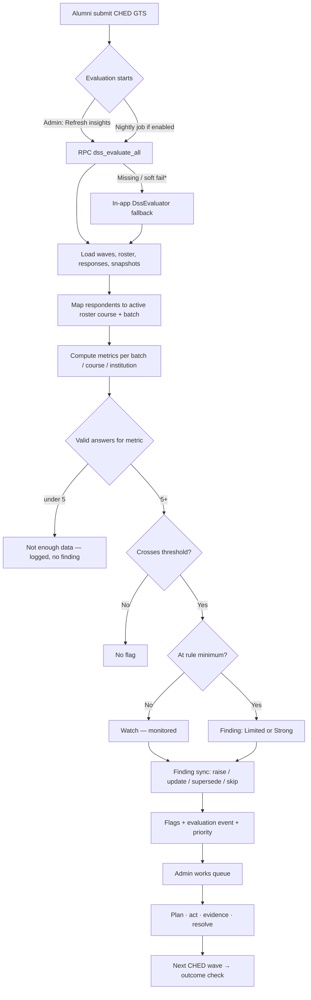

# AESS Decision Support System (DSS) — Complete Overview

**In-app name:** Program Insights  
**Where:** Admin portal → sidebar **Alumni** → **Program Insights** (menu index **15**)  
**Audience:** Administrators only (alumni never see this module)  
**Document written:** 2026-11-05 from current repository source (Flutter + Supabase migrations)  
**Related deeper guide:** [AESS_DSS_USER_AND_DEVELOPER_GUIDE.md](AESS_DSS_USER_AND_DEVELOPER_GUIDE.md)  
**System audit context:** [system-audit/AESS-COMPLETE-SYSTEM-OVERVIEW.md](system-audit/AESS-COMPLETE-SYSTEM-OVERVIEW.md)

> **Verification note:** Behaviours below are **verified in source** unless labelled otherwise. Live database thresholds, nightly job state, and on-screen layout were **not** re-checked against a running production project while writing this file. Seeded thresholds are the migration defaults; Settings may have changed them in a live project.

---

## 1. Why the DSS exists (usefulness and importance)

### 1.1 Problem it solves

AESS collects the official **CHED Graduate Tracer Survey (GTS)** from alumni. Raw survey responses and institutional reports answer *what graduates said*. Program chairs, career offices, and quality-assurance staff still need a disciplined way to:

1. Notice **which program × batch cohorts** look concerning (or exemplary).
2. Avoid acting on **noise from tiny samples**.
3. Turn findings into **owned work** (who acts, by when, with what proof).
4. Check later whether the **next tracer wave** moved in a better direction — without falsely claiming the intervention *caused* the change.

The DSS is AESS’s **Decision Support System** for that loop. It does **not** replace human judgment. It **raises evidence-backed flags**, ranks urgency transparently, and supports accountability.

### 1.2 Importance in the overall system

| Without DSS | With DSS |
|---|---|
| Staff manually scan Reports for every course/batch | Rule engine continuously compares cohorts to thresholds |
| Easy to overreact to 3 answers | Sample-size policy: Not enough data / Watch / Limited / Strong |
| Alerts forgotten after a meeting | Flags have owner, dates, evidence, interventions, outcomes |
| “Did counseling help?” is anecdotal | Next-wave outcome classification (observed change, not causal proof) |
| AI might invent priorities | Priority is deterministic; AI only explains (optional) |

For a capstone or institutional QA narrative: Program Insights is the bridge from **GTS data collection** to **program improvement action**.

### 1.3 One-sentence pitch

> Program Insights reads submitted CHED GTS answers by course and batch, compares clear metrics to admin-tunable rules, and raises prioritized flags with playbooks, ownership, evidence, and next-wave outcomes — while keeping decisions with people, not the algorithm.

### 1.4 Analogy

| School clinic | AESS DSS |
|---|---|
| Lab tests vs reference ranges | Metrics vs rule thresholds |
| “Abnormal” result | Flag / finding |
| Too few readings → repeat | Watch / Not enough data |
| Doctor chooses treatment | Admin chooses intervention |
| Chart notes + follow-up | Owner, evidence, next wave outcome |

---

## 2. Where it lives in the product

| Item | Detail |
|---|---|
| Shell | `AdminDashboardWeb` |
| Nav label | **Program Insights** |
| Section | Alumni |
| Index | `15` (indices 3, 8, 13 unused; AI Assistant nav removed) |
| Primary screen | `AdminDssScreen` — `lib/features/admin/dss/presentation/admin_dss_page.dart` |
| Panels | List · Detail · History · Settings |
| Access | Admin role + RLS (`is_admin()`) on DSS tables |

Alumni Tracer / Reports are **inputs**. DSS is the **admin insight and action queue**.

---

## 3. Complete feature inventory (what exists today)

### 3.1 Core capabilities

| Capability | Status | Notes |
|---|---|---|
| Rule-based evaluation of CHED GTS waves | Implemented in source | Published/closed, non-archived builtin CHED surveys |
| Per cohort flags (course×batch, course roll-up, institution) | Implemented in source | Small cohorts roll up |
| Sample-size / evidence strength policy | Implemented in source | Shared in Dart + SQL |
| 95% Wilson confidence intervals + Confirmed/Possible | Implemented in source | Stored on flags |
| Deterministic priority score with reasons | Implemented in source | Critical / High / Medium / Low / Watch |
| Finding identity across waves (`finding_key`) | Implemented in source | Newer wave can supersede older open/watch flags |
| Refresh insights (manual) | Implemented in source | Prefers RPC `dss_evaluate_all`; falls back to in-app engine |
| Optional scheduled/nightly evaluation | Configured in migrations/docs | Live cron state: confirm in project |
| Flag statuses | Implemented in source | Open, In Progress, Resolved, Dismissed, Watch, Superseded |
| Accountability (owner office, person, dates) | Implemented in source | Detail panel |
| Evidence attachments (structured entries) | Implemented in source | Soft-delete supported |
| Interventions + next-wave outcomes | Implemented in source | Resolve / Continue / Modify / Escalate decisions |
| Same-wave coverage re-check | Implemented in source | Distinct from next-wave outcome |
| One-click actions: survey reminders / job matches | Implemented in source | Server re-checks recipients |
| CSV export of flags | Implemented in source | Includes priority / evidence / accountability columns |
| Report card PDF (program or whole institution) | Implemented in source | |
| History (period, outcomes, evaluation runs) | Implemented in source | |
| Settings: enable rules, thresholds, min N | Implemented in source | Floors enforced by policy |
| Optional “Explain with AI” | Implemented in source | Edge `ai-assist`; validated; no ranking power |
| Q34 suggestion themes | Implemented in source | AI grouping with PII stripped, or keyword fallback |
| Q17 “reasons not employed” on unemployment flags | Implemented in source | Also feeds `SEEKING_WORK_HIGH` |
| “How this works” onboarding strip | Implemented in source | Dismissible via SharedPreferences |

### 3.2 UI surfaces

| Surface | Purpose |
|---|---|
| **List** | Work queue of flags; filters; Refresh insights; export; report card; open History/Settings |
| **Detail** | One flag: what/why/what to do, priority reasons, plan, owner, proof, act, timeline, AI explain, outcomes |
| **History** | Aggregate outcomes and recent evaluation runs |
| **Settings** | Enable/disable rules; edit threshold and minimum answers |

### 3.3 What DSS is *not*

- Not a general chatbot for alumni.
- Not an automatic closer of flags.
- Not a causal inference engine (“intervention X caused Y”).
- Not a replacement for Reports & Analytics (DSS flags; Reports export deep tables/charts).
- Not available to alumni accounts.

---

## 4. How it works (end-to-end)



\*Fallback is **not** used when another run holds the DB lock or the caller is not admin (`DssEvaluationService.fallsBackOn`).

### 4.1 Inputs

| Input | Source |
|---|---|
| CHED GTS surveys | `surveys` where builtin CHED, published or closed, not archived |
| Submitted answers | `survey_responses` (and metrics via GTS answer keys / `gts_respondent_facts` on server) |
| Roster | Active `alumni_members` (course + batch year); deactivated / unlinked excluded |
| Wave roster snapshots | `dss_wave_cohort_snapshots` (open wave: today’s roster saved; closed: prefer snapshot) |
| Rules | `dss_rules` (enabled set) |

### 4.2 Cohort grouping

- Primary grain: **course × batch**.
- Missing batch → labelled **“Batch not recorded”** and counted at **course** level only (policy).
- Unclassified respondents (no active roster course) → **excluded** from cohort metrics.
- Small groups **roll up** to course or institution so sparse batches do not invent fake precision (`dss_rollup.dart` / server equivalent).

### 4.3 Sample-size policy (`DssPolicy`)

| Valid answers for the metric | Evidence | Finding? |
|---|---|---|
| &lt; 5 | Not enough data | No |
| 5 to (gate − 1) | Watch | Monitored only (status Watch) |
| 10–29 (default gate 10) | Limited evidence | Yes |
| ≥ 30 | Strong evidence | Yes |

- Outcome / opportunity / trend rules: minimum answers floor **10**.
- Data-quality rule: floor can be **1** (can fire on sparse/zero responses depending on threshold setup).
- Outcome findings may show a **low coverage** warning when response rate &lt; **30%**.

### 4.4 Finding sync across waves

Each finding has a stable **`finding_key`**. When a newer wave evaluates the same issue:

- Older open/watch flags can be marked **Superseded**.
- Closed flags are not casually re-raised for the same wave identity (see finding-sync / server eval migrations).

Evaluation runs are logged in **`dss_evaluation_events`** (counts/keys — not full PII dumps).

---

## 5. Rules catalog (what can raise a flag)

Seeded in migrations. **Live thresholds may differ** if admins edited Settings.

| Rule ID | Display focus | Category | Default metric / seed threshold | Typical severity | Default enabled |
|---|---|---|---|---|---|
| `DATA_QUALITY_LOW` | Response rate too low | data_quality | `response_rate` **&lt; 40%** | warning | Yes |
| `UNEMPLOYMENT_HIGH` | Not currently employed | outcome | `unemployment_rate` **≥ 25%** | critical | Yes |
| `SEEKING_WORK_HIGH` | Looking for work (Q17-based `seeking_work_rate`) | outcome | **≥ 15%** among employed-or-looking pool | warning | **No** (seeded `enabled = false`) |
| `RELATEDNESS_LOW` | Course / curriculum mismatch | outcome | unrelated/irrelevant **≥ 40%** | warning | Yes |
| `RELATEDNESS_HIGH` | Strong alignment (opportunity) | opportunity | related+relevant **≥ 75%** | info | Yes |
| `UNDEREMPLOYMENT` | Rank/clerical among employed | outcome | clerical share **≥ 35%** | warning | Yes |
| `TIME_TO_JOB_LONG` | Took 1+ years to first job | outcome | long time-to-job **≥ 40%** | warning | Yes |
| `SALARY_STAGNATION` | Salary gap vs peer programs | outcome | peer bracket gap **≥ 1** | info | Yes |
| `UNEMPLOYMENT_TREND_UP` | Not-employed share rose vs previous wave | trend | change **≥ 10 percentage points** | warning | Yes |

Friendly labels in UI (`DssCopy`): e.g. `UNEMPLOYMENT_HIGH` → **“Not currently employed”**.

### 5.1 Metric definitions (conceptual)

Computed in `DssMetrics` / server SQL from CHED answer keys, including:

| Metric area | Primary GTS keys (examples) |
|---|---|
| Employment / not employed | `ched_16` |
| Reasons / seeking | `ched_17` (multi-select) |
| Relatedness / curriculum | `ched_24a`, `ched_32`, suggestions `ched_34` |
| Job level / clerical | `ched_30` |
| Time to first job | `ched_29` |
| Salary brackets | `ched_31` |
| Response rate | Submitted vs expected cohort size for the wave |

Exact hit definitions live in `lib/features/admin/dss/application/dss_metrics.dart` and the server evaluation migration.

---

## 6. Flags, priority, and certainty

### 6.1 Flag contents (typical)

Each flag stores (among other fields):

- Rule, course, batch, survey/wave
- Metric value + threshold snapshot
- Sample / valid / eligible counts
- Evidence strength, confidence interval, certainty
- Title, body, recommended action, playbook steps
- Status, assignment, accountability dates
- Priority score components (computed from facts)

### 6.2 Priority (`DssPriorityCalc`)

Deterministic additive score with **a reason for every point**. Levels: Critical, High, Medium, Low, Watch.

Examples of factors (see `dss_priority.dart` for full logic):

- Rule severity (critical/warning/info)
- How far past the threshold
- Strong evidence bonus
- Confirmed (whole CI past threshold) bonus
- Stale “not started” age, affected-count heuristics, etc.
- Opportunities forced to **Low**
- Watch / non-findings forced to **Watch**

**AI never sets priority.**

### 6.3 Certainty

| Value | Meaning |
|---|---|
| Confirmed | Entire 95% likely range is past the threshold |
| Possible | Point estimate crosses threshold, but the range still overlaps the other side |

---

## 7. How to operate (admin guide)

### 7.1 Prerequisites

1. Admin account signed in.
2. At least one **published or closed** Official CHED GTS wave with submitted responses.
3. Alumni on the **official roster** with course (and ideally batch) so they classify into cohorts.
4. DSS rules enabled (Settings).

### 7.2 Daily / weekly workflow

1. Open **Program Insights**.
2. Click **Refresh insights** after major new submissions or wave close (or rely on nightly job if confirmed on).
3. Work the default **Queue** filter (Open + In Progress), sorted by **priority**.
4. Optional filters: rule, priority, owner office, due (overdue / due soon), search, “mine only”.
5. Open a flag → read **What / Why / What to do**.
6. **Start** work → set **owner office / person / due / next review**.
7. Use **Act** (reminders or job matches where applicable) and/or record interventions.
8. Attach **evidence** (meetings, events, announcements, notes, etc.).
9. When done: **Resolve** (or Dismiss with reason). Resolution paths expect intervention/proof where the UI requires them.
10. After the **next** CHED wave: review **outcome** (improved / worsened / unchanged / insufficient data) and decide Resolve / Continue / Modify / Escalate.
11. Use **History** for period summaries; **CSV** / **report card** for meetings and documentation.

### 7.3 One-click actions

Built by `DssActionService`, executed via repository **`runFlagAction`** (server re-validates recipients):

| Action | Typical use |
|---|---|
| Survey reminders | Non-respondents in the flag’s cohort for that wave (`DATA_QUALITY_LOW` and related) |
| Matching jobs | Unemployed / seeking respondents (`UNEMPLOYMENT_HIGH` etc.) — suggests jobs by program |

Only registered alumni (`auth_uid` present) can receive in-app notifications.

### 7.4 Settings (operate carefully)

- Enable/disable each rule.
- Edit **threshold** (rate fraction, or salary gap in brackets).
- Edit **minimum answers** (`min_n`) — floors enforced (cannot sneak findings below policy).
- After rule edits, UI may hint to **Refresh** so flags match new thresholds.

### 7.5 Exports and reporting

| Output | Use |
|---|---|
| CSV of flags | Spreadsheet tracking, audit packs |
| Report card PDF | Program chair / institution snapshot with outcomes |
| History panel | Trends in interventions and evaluation runs |

For deep CHED tables and institutional Downloads presets, use **Reports & Analytics** — complementary, not duplicated here.

---

## 8. Accountability, interventions, and outcomes

### 8.1 Accountability fields

Owner office, responsible person, plan description / expected effect / target, started-on / due / next-review dates. Overdue and due-soon filters help the queue stay honest.

### 8.2 Evidence

Structured evidence entries on a flag (types such as meeting, event, and other allowed kinds in models/migrations). Soft-delete supported. Used when resolving and for auditability.

### 8.3 Interventions

Records of what was tried (`dss_interventions`), including undecided/continue chains. Outcomes are evaluated relative to the **next** CHED wave, not by rewriting history on the same responses alone.

### 8.4 Same-wave vs next-wave checks

| Check | Meaning |
|---|---|
| Coverage / impact re-check (same wave) | Mostly late submissions / same-wave metric refresh — **not** proof an intervention worked |
| Intervention outcome (next wave) | Compares later wave metrics for the finding — **observed change**, explicitly **not causal proof** |

Copy and UI stress this distinction (`dss_impact.dart`, outcome cards).

---

## 9. Artificial intelligence boundary

| Allowed | Forbidden |
|---|---|
| On-demand “Explain with AI” plain-language text | Auto-open AI that replaces rule text unnoticed |
| Q34 theme grouping after stripping emails/phones/links | AI setting priority, status, or thresholds |
| Validated replies; rule-based fallback if AI fails | AI closing or creating flags |

Client: `DssAiService` → Edge Function `ai-assist`. Feature flag: `AI_ENABLED`. Server needs `GEMINI_API_KEY` (secret — never in the Flutter client).

---

## 10. Database objects (operator mental model)

| Object | Role |
|---|---|
| `dss_rules` | Threshold configuration |
| `dss_flags` | Findings / watch items |
| `dss_flag_notes` | Timeline / status / assign events |
| `dss_flag_checks` | Latest recheck state |
| `dss_flag_evidence` | Proof entries |
| `dss_interventions` | Actions taken + outcome decisions |
| `dss_evaluation_events` | Refresh/run audit |
| `dss_wave_cohort_snapshots` | Roster counts frozen per wave |
| Views `gts_respondent_facts` (etc.) | Metric source for analytics/server eval |

**RLS:** admin-only on DSS tables (authenticated + `is_admin()`).

Key RPCs: `dss_evaluate_all`, `dss_evaluate_intervention`, flag action helpers (see migrations `20261003*`, `20261011*`).

---

## 11. Code map (maintainers)

```
lib/features/admin/dss/
  presentation/   admin_dss_page, detail, history, settings
  widgets/        UI, action dialogs, accountability, outcome cards
  models/         dss_models.dart
  data/           dss_repository.dart
  application/    evaluator, evaluation_service, metrics, policy,
                  priority, finding_sync, impact, actions, export,
                  report card, AI, history, rollup, copy, themes
```

Tests: `test/dss/**` plus root `test/dss_evaluation_test.dart`  
SQL regression scripts: `supabase/regression/phase1*_dss_*.sql`, `dss_cohort_parity.ps1`  
Migrations: `supabase/migrations/20260911*_dss_*.sql`, `20261003*_dss_*.sql`, `20261011*_dss_*.sql`

---

## 12. Automatic vs manual

| Automatic (when configured) | Manual (admin) |
|---|---|
| Metric calculation & flag sync on Refresh / scheduled job | Interpreting flags for local context |
| Priority scoring | Choosing interventions |
| Superseding older findings on newer waves | Setting owners and due dates |
| Server recipient re-check for one-click actions | Confirming send / messaging content |
| Optional nightly evaluate job | Closing / dismissing with notes |
| | Confirming next-wave outcome decisions |

Confirm whether the nightly job `aess-dss-evaluate` (or equivalent) is **on** in the target Supabase project — documented historically in the longer user/developer guide; re-verify for current environments.

---

## 13. Limitations and honest caveats

1. **Only as good as GTS coverage and roster quality.** Unlinked or unbatched alumni dilute or exclude cohorts.
2. **Thresholds are institutional choices**, not CHED law. Defaults are seeds.
3. **Observational outcomes ≠ causation.** The product language says so; do not overclaim in defenses.
4. **Client fallback evaluation** can diverge if server SQL and Dart engines drift — parity tests exist; keep them green.
5. **Opportunity flags** (`RELATEDNESS_HIGH`) are successes to share, not problems to “fix.”
6. **`SEEKING_WORK_HIGH` is off by default** — enable deliberately after understanding Q17 coverage.
7. **AI explanations** can fail or be blocked; rule copy remains the source of truth.
8. **Runtime of live jobs/secrets** was not re-verified in the 2026-11-05 audit pass.

---

## 14. Quick reference card

| Question | Answer |
|---|---|
| Menu name? | Program Insights |
| Who can use it? | Admins only |
| What data? | Submitted Official CHED GTS + active roster |
| How to refresh? | **Refresh insights** (server RPC, app fallback) |
| Default work view? | Queue = Open + In Progress, sort by priority |
| Min answers for a real finding? | Usually **10** (policy) |
| Strong evidence? | **30+** valid answers |
| Does AI decide? | **No** — explains only |
| Proof of impact? | Next wave **observed** change, not causal proof |
| Export? | CSV + report card PDF |
| Tune rules? | Settings panel |

---

## 15. Suggested talking points (defense / stakeholders)

1. **Deterministic rules** with transparent thresholds and sample-size guardrails.  
2. **Priority with reasons** — every urgency point is explainable.  
3. **Closed loop:** flag → ownership → evidence → intervention → next-wave outcome.  
4. **Human in the loop** — DSS supports decisions; it does not replace curriculum or career offices.  
5. **Privacy/admin boundary** — alumni data powers metrics; the module itself is admin-gated via RLS.

---

*End of DSS complete overview. For click-level manuscript detail, metric formulas, and defense Q&A expansions, continue with [AESS_DSS_USER_AND_DEVELOPER_GUIDE.md](AESS_DSS_USER_AND_DEVELOPER_GUIDE.md) and [dss-capability-audit.md](dss-capability-audit.md).*
