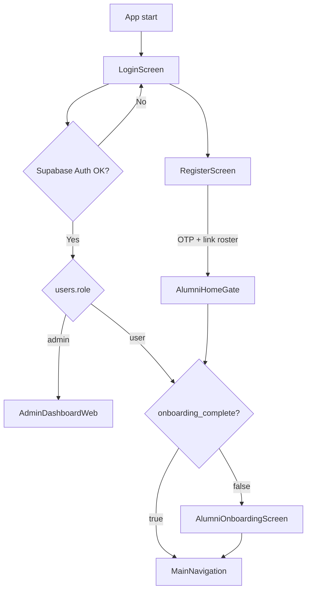

# Alumni System — Full System Overview

**USTP Alumni / Graduate Tracer Platform**  
Complete reference for what the system is, who uses it, every major screen, how features work, and how data flows — based on the **current Flutter + Supabase** codebase.

| | |
|---|---|
| **Last audited** | July 2026 |
| **Stack** | Flutter (Dart) · Supabase (Auth, Postgres, Storage, Edge Functions) |
| **Related docs** | [admin-survey-screens.md](admin-survey-screens.md) · [ched-survey-templates.md](ched-survey-templates.md) · [notifications.md](notifications.md) · [database/](database/) · [README.md](../README.md) |

> Older Firebase-era notes are kept in [archive/](archive/) for history only. **This file is the current source of truth.** The app no longer uses Firebase (except Firebase Cloud Messaging to deliver Android push alerts).

---

## Table of contents

1. [Purpose](#1-purpose)
2. [Technology stack](#2-technology-stack)
3. [Roles & access](#3-roles--access)
4. [End-to-end system flows](#4-end-to-end-system-flows)
5. [Alumni (user) portal — screens & features](#5-alumni-user-portal--screens--features)
6. [Admin portal — screens & features](#6-admin-portal--screens--features)
7. [Graduate tracer & surveys (deep dive)](#7-graduate-tracer--surveys-deep-dive)
8. [Community, careers & support](#8-community-careers--support)
9. [Data model (Supabase)](#9-data-model-supabase)
10. [Services & business logic layer](#10-services--business-logic-layer)
11. [Notifications & email](#11-notifications--email)
12. [Security & configuration](#12-security--configuration)
13. [Source map](#13-source-map)

---

## 1. Purpose

The platform helps a college/university stay connected with graduates and run CHED-aligned graduate tracer studies. It combines:

| Area | What it does |
|------|----------------|
| **Official roster** | Registrar-style list of eligible alumni; **gates who may register** |
| **Graduate tracer** | Live demographic/employment profile + CHED GTS survey waves |
| **Surveys** | Official CHED GTS, custom surveys, targeting, reminders, analytics, exports |
| **Community** | Announcements, forum, events (with comments & reminders) |
| **Careers** | Admin job postings; alumni browse & favorite |
| **Support** | Alumni ↔ admin messaging, feedback tickets, AI assistant (Gemini) |
| **Administration** | Web dashboard: directory, reports, moderation, archives, activity logs |

**Primary programs (roster courses):** BSIT, BFPT, BTLED-IA, BTLED-ICT, BTLED-HE.

---

## 2. Technology stack

| Layer | Technology | Notes |
|-------|------------|--------|
| UI | Flutter 3 / Material 3 | Seed color `#090A4F` (navy) |
| Auth | Supabase Auth | Email + password |
| Database | Supabase Postgres | RLS; realtime on messages (and related) |
| Storage | Supabase Storage bucket `images` | Avatars, message attachments |
| Edge Functions | `send-email`, `send-push`, `tracer-help` | Admin reminder emails (logged); push alerts; AI suggestions for CHED GTS Q19/Q20 |
| Charts | `fl_chart` | Dashboard & reports |
| Export | `excel`, `pdf`, `printing` | Roster, surveys, CHED GTS packs, report packs |
| Email | Gmail SMTP via `send-email` | Secrets on Supabase, not in the client |
| AI | Google Gemini API | Optional; key via config / dart-define |
| Local prefs | `shared_preferences` | Remember-me **email only** |
| Device reminders | `flutter_local_notifications` | Event reminders on device |

**Entry:** `lib/main.dart` → initialize Supabase → `LoginScreen`.

---

## 3. Roles & access

| Role | Stored as | After successful login |
|------|-----------|------------------------|
| **Alumni** | `users.role = 'user'` | Onboarding wizard **or** main tab shell |
| **Admin** | `users.role = 'admin'` | Admin dashboard (sidebar) |

- There is **no** “admin mode” toggle on the login screen. Role always comes from `public.users` after Auth succeeds.
- Alumni accounts must stay linked to an active roster row (`alumni_members.auth_uid`, `is_registered_user`, not deactivated) or login is rejected.
- Admins skip the roster linkage check.



---

## 4. End-to-end system flows

### 4.1 First-time setup (IT / developer)

1. Create/configure a Supabase project (Auth, Postgres, Storage, Edge Functions).
2. Apply migrations under `supabase/migrations/`.
3. Deploy Edge Functions; set secrets (`GMAIL_USER`, `GMAIL_APP_PASSWORD`, etc.).
4. Configure client: `SUPABASE_URL` / `SUPABASE_ANON_KEY` (or defaults in `supabase_defaults.dart`).
5. Seed at least one admin (`scripts/restore_admin` / ensure-admin).
6. Import or create the **official alumni roster** before opening registration.

### 4.2 New alumni registration (roster-gated)

```text
Register
  → Enter full name + course + student ID + Gmail
  → validate_alumni_eligibility (RPC) or local roster match
  → If not on roster / already registered / deactivated → blocked
  → Set password → Supabase Auth sign-up sends a 6-digit OTP email (Gmail SMTP)
  → Confirm OTP (Supabase verifyOTP) → Auth user confirmed
  → link_alumni_registration (RPC) → alumni_members.auth_uid, is_registered_user + users row
  → AlumniHomeGate → Onboarding (required)
  → MainNavigation (Home)
```

### 4.3 Returning login

```text
Login (email + password)
  → Optional Remember me (email only)
  → Assert account still authorized (users + roster for alumni)
  → admin → Dashboard
  → user + incomplete onboarding → Onboarding
  → user + complete → MainNavigation
```

### 4.4 Typical alumni day

```text
Home (notifications, pending surveys, events/jobs preview)
  → Tracer tab (CHED GTS wizard and/or other assigned surveys)
  → My Surveys (from Home banner)
  → Announcements / Forum (from Home)
  → Events (reminders, comments) · Jobs (favorites) · Messages (admin)
  → Profile (update GTS live profile, feedback, logout)
```

### 4.5 Typical admin day

```text
Dashboard (KPIs, activity, quick jumps)
  → Alumni Directory (maintain roster, import/export, member detail)
  → Surveys (create → edit/publish modal → responses → reminders → export)
  → Reports (portfolio analytics + packs)
  → Events / Announcements / Forum / Jobs / Messages
  → Feedback tickets · Activity logs · Archives · AI Assistant
```

### 4.6 Survey lifecycle (core product loop)

```text
Admin creates survey (Official CHED GTS or Blank)
  → Edit dialog: title, schedule, audience (courses/batches)
  → Optional Preview beside editor (wide screens)
  → Publish → assignments upserted for matching alumni (+ optional notify)
  → Alumni take survey (Tracer for CHED; take page for classic)
  → Submit → survey_responses; may sync employment/profile fields
  → Admin: Overview analytics · Pending reminders · Submitted viewer · CSV/Excel/PDF packs
  → Close / Archive → restore from Archives if needed
```

---

## 5. Alumni (user) portal — screens & features

### 5.1 Auth & onboarding screens

| Screen | File | What you see / how it works |
|--------|------|-----------------------------|
| **Login** | `features/auth/presentation/login_page.dart` | Email/password, remember me, link to register. Routes by role + onboarding. |
| **Register** | `features/auth/presentation/register_page.dart` | Roster verify → password → OTP → create account → link roster. |
| **Home gate** | `features/onboarding/presentation/alumni_home_gate.dart` | After register: waits for `onboarding_complete`, then onboarding or main shell. |
| **Onboarding** | `features/onboarding/presentation/alumni_onboarding_page.dart` | 4 steps: Welcome → Profile (GTS form, must be 100%) → optional Photo → Done. Sets `onboarding_complete`. |

**Onboarding profile save:** writes CHED-style demographic + employment-status fields on `users` via `UserProfileService`, then can mirror key fields to `alumni_members`. Photo uploads to Storage `images/avatars/{uid}.jpg`.

### 5.2 Main shell (`MainNavigation`)

File: `features/shell/presentation/main_navigation.dart`  
Bottom navigation + `IndexedStack` (tabs keep state after first visit). Opening the shell records last-active on the roster.

| Tab | Label | Screen | Purpose |
|-----|-------|--------|---------|
| 0 | Home | `home_page.dart` | Dashboard hub |
| 1 | Events | `events_page.dart` | Browse events |
| 2 | Messages | `user_messages_page.dart` | Chat with admin |
| 3 | Jobs | `job_posting_page.dart` | Browse / favorite jobs |
| 4 | Tracer | `tracer_page.dart` | Survey / CHED GTS hub |
| 5 | Profile | `profile_page.dart` | Live profile + feedback + logout |

### 5.3 Home

**Shows:** Greeting, clock, unread notification badge, pending-survey banner, quick access (Events / Messages / Jobs tabs; Announcements, Forum, AI Help as pushed routes), upcoming events (3), featured jobs (5), notification list with deep-links.

**Logic:** Loads streams/queries for notifications, surveys, events, jobs; tapping a notification navigates to the related feature.

### 5.4 Events (alumni)

**Shows:** Searchable event list with filters (All / This Week / This Month / Newest).

**Actions:** Open detail; RSVP (Going schedules local device reminders; the server also sends day-before and day-of reminders to everyone Going); post/read comments and replies.

### 5.5 Messages (alumni)

**Shows:** Conversation with the primary admin account.

**Actions:** Send text; attach compressed images; realtime updates. Reactions / edit-delete where implemented in `MessageService`.

### 5.6 Jobs (alumni)

**Shows:** Active job list with search/filter/sort.

**Actions:** Favorite/unfavorite (`favorite_jobs`); open detail (company, location, salary, requirements, deadline, contact). **No in-app apply** — contact is informational.

### 5.7 Tracer tab (alumni)

**This is the graduate tracer / survey hub** (not the old standalone ID-tracer form).

| Sub-area | Behavior |
|----------|----------|
| **Active** | If a published **built-in CHED GTS** is assigned → inline wizard (sections A→D + review) with skip/visibility rules, prefilled from profile + latest employment. Other assignments open the classic take page. |
| **History** | Submitted responses; CHED rendered read-only. |

Draft/submit go through `SurveyService.saveResponse` → `survey_responses`. On first interactive load (take page or Tracer inline CHED), `SurveyService.recordSurveyOpened` calls RPC `record_survey_opened` (idempotent). Draft saves append `draft_saved` events; first submission appends one `submitted` event. Device metadata stored is coarse only (`device_category`, `platform_family`, `browser_family`) — no IP, raw user agent, or fingerprinting. On CHED submit, answers can merge back into the live profile on `users`.
### 5.8 Profile

**Shows:** Same live GTS profile form used in onboarding (editable anytime).

**Actions:** Save profile (sync roster when configured); change avatar; open **Feedback** list/submit; **Logout**.

### 5.9 Screens opened from Home (not tabs)

| Screen | File | Behavior |
|--------|------|----------|
| **My Surveys** | `user_surveys_page.dart` | Streams `survey_assignments` for the user; open take page. |
| **Take survey** | `user_survey_take_page.dart` | Classic questions + visibility rules; draft/submit; prefill from profile. |
| **Announcements** | `user_announcements_page.dart` | Published announcements matching audience (course/batch). |
| **Forum** | `forum_page.dart` / `forum_topic_page.dart` | Browse/create topics; reply; locked topics block replies. |
| **AI Help** | `ai_assistant_page.dart` | Gemini chat with alumni-oriented prompt (no DB transcript required). |
| **Feedback** | `user_feedback_*_page.dart` | Submit/list/detail tickets (category, subject, message, optional rating). |

---

## 6. Admin portal — screens & features

**Shell:** `AdminDashboardWeb` + `admin_dashboard_shell.dart`  
Sidebar groups: Overview · Alumni & tracer · Community · Careers · System.  
Top header, mobile drawer, logout, live badges (unread messages / open feedback).  
Routing uses menu indices; **3 and 8 are unused** (legacy gaps).

| Index | Menu label | Screen | File |
|------:|------------|--------|------|
| 0 | Dashboard | Home KPIs | `admin_dashboard_home.dart` |
| 2 | Alumni Directory | Roster | `admin_alumni_directory_page.dart` |
| 10 | Surveys | Tracer surveys | `admin_surveys_page.dart` |
| 9 | Reports & Analytics | Reports | `admin_reports_page.dart` |
| 1 | Events | Event management | `admin_events_page.dart` |
| 11 | Announcements | Announcements | `admin_announcements_page.dart` |
| 12 | Forum | Forum moderation | `admin_forum_page.dart` |
| 6 | Messages | Inbox | `admin_messages_page.dart` |
| 5 | Job Postings | Jobs | `admin_job_management_page.dart` |
| 7 | Activity Logs | Audit | `admin_activity_logs_page.dart` |
| 4 | Archives | Restore/delete | `admin_archives_page.dart` |
| 13 | AI Assistant | Admin AI | `ai_assistant_page.dart` |
| 14 | Feedback | Tickets | `admin_feedback_page.dart` |

### 6.1 Dashboard

**Shows:** Counts (roster, registration, tracer, surveys, events, jobs, messages, announcements, forum, feedback), engagement/activity trend chart, active events, recent audit feed, quick-action tiles.

**Logic:** Parallel count queries on load; streams for unread messages and open feedback.

### 6.2 Alumni Directory

**Shows:** Searchable, filterable roster (course, registration, tracer completion, employment); stats strip; split **member detail** panel.

**Actions:**

- Add / edit member (name, course, student ID)
- **Import Excel** (Full Name, Course, ID Number) — skip duplicates
- **Export Excel** (current filtered view)
- Deactivate / reactivate; delete roster row and/or linked portal account
- Open detail: roster + linked user GTS profile + submitted tracer survey snapshots; mark admin-viewed

**Why it matters:** Registration eligibility is checked against this roster.

### 6.3 Surveys (Tracer Surveys)

**List:** Search, filter (draft / published / closed / archived), kind (official CHED / preset / custom), sort, metrics. Card actions: edit, responses, duplicate, export, remind, re-assign, close, archive, delete.

**Create:** Modal picker — **Official CHED GTS** or **Blank survey** (title/description).

**Edit / publish:** Centered **modal dialog** (~720px). Fields: details, optional open/close schedule, audience courses + batch years, questions (full editor for custom; **locked** for builtin CHED). Sticky Save / Publish (or Re-assign).

**Preview:** On wide screens (≥ ~960px), dialog **widens**; editor moves **left**, preview panel on the **right**. Narrow screens use a sheet overlay.

**Responses (inline panel):** Tabs Overview | Pending | Submitted — analytics funnel, reminders to pending, view answers, per-response PDF/Excel/print, CSV / CHED Excel / management pack exports. Participant cards show student ID and avatar when available; submitted cards show privacy-safe device metadata (category/platform/browser only). Response timeline tracks opened, draft-saved, and submitted events when the lifecycle migration is applied.

More detail: [admin-survey-screens.md](admin-survey-screens.md).

### 6.4 Reports & Analytics

**Sections:** Overview · Alumni & tracer · Surveys · Export.

**Shows:** Portfolio KPIs and charts (batch, course, employment, industry, survey rollups, question summaries).

**Actions:** Generate PDF / Excel / CSV report packs; reconcile response counts; browse registered alumni helpers.

### 6.5 Events (admin)

CRUD + archive; notify alumni on create; moderate event comments/replies via dialog.

### 6.6 Announcements

List by status; editor for title/body, audience (programs + batch years) with audience-count preview; Save draft / Publish; archive/delete.

### 6.7 Forum moderation

Live topic list: lock/unlock, pin/unpin, delete. Posts live under topics via `ForumService`.

### 6.8 Messages (admin)

All alumni conversations; search; send text/image; mark read; realtime unread badge on dashboard.

### 6.9 Job postings

Active / expired / archived with search; add (dialog), edit, archive/activate, delete.

### 6.10 Activity logs

Filterable audit trail (`audit_logs`) — action, user, status, date, search. Caps display for performance.

### 6.11 Archives

Tabs: Archived Events | Archived Jobs | Archived Surveys — restore or permanently delete.

### 6.12 AI Assistant (admin)

Same chat UI as alumni, with an **admin-oriented** system prompt. Requires Gemini API key.

### 6.13 Feedback (admin)

Stream of tickets; filter by status; detail: change status + admin response.

---

## 7. Graduate tracer & surveys (deep dive)

### 7.1 Two layers of “tracer” data

| Layer | Where stored | How alumni maintain it |
|-------|--------------|------------------------|
| **Live profile** | `users` columns (demographics, contact, employment status, completion flags) | Onboarding + Profile tab (`GtsProfileForm`) |
| **Survey waves** | `surveys` + `survey_assignments` + `survey_responses` | Tracer tab / My Surveys when admin publishes |

Employment status comes from submitted CHED GTS answers. The read-only view `gts_employment_records` exposes each alumnus's latest submission (used by reports, profile lookups and CHED exports); DSS metrics use `gts_respondent_facts` / `gts_metric`.

Batch means graduation year: `users.year_graduated` and `alumni_members.year_graduated`. The roster is the source of truth for name, course, ID number and year.

### 7.2 Survey flavors

| Flavor | Create path | Questions | Alumni UX | Admin editor |
|--------|-------------|-----------|-----------|--------------|
| **Official CHED GTS (builtin)** | Picker → Official CHED GTS | Schema in code (`ched_*` keys); typically no editable question rows | Tracer → Active wizard A→B→C→D→Review | Metadata + audience only; questions locked |
| **Blank / custom** | Picker → Blank | Admin-defined `survey_questions` | Classic take page | Full question builder + visibility rules |
| **Legacy CHED template** (if seeded) | Template pack | Cloned editable questions | Classic take page | Full editor + disclaimer |

### 7.3 Publish & audience logic

On publish (`SurveyService.publishSurvey`):

1. Load non-admin users as profiles.
2. Match `AudienceTargeting` on target programs / batch years (**empty = all alumni**).
3. Upsert `survey_assignments` (preserve existing status when re-assigning).
4. Mark survey published; update assignment count.
5. Optionally write `user_notifications` for newly assigned users.
6. Optional email reminders later from list/responses (via `EmailService`).

### 7.4 Prefill & sync

- **Profile → survey:** Prefill helpers / `ChedGtsPrefill` fill answers from `users` (+ employment).
- **Survey → profile (submit):** CHED merge into profile; classic may sync employment status via `ProfileSurveySync`.

### 7.5 Analytics & exports

- Per-survey: funnel, program/batch breakdown, trends, choice/scale rollups (`AdminSurveyAnalyticsPanel`).
- CHED Excel multi-sheet pack (`ChedGtsExportService`).
- Management / portfolio packs PDF·Excel·CSV (`SurveyReportPackService`).
- Detailed CSV of responses from admin responses UI.

---

## 8. Community, careers & support

| Feature | Alumni | Admin |
|---------|--------|-------|
| **Announcements** | Read audience-matched published posts | Draft → publish with targeting |
| **Forum** | Create topics, reply | Lock / pin / delete topics |
| **Events** | Browse, remind, comment | CRUD, archive, notify, moderate comments |
| **Jobs** | Browse, favorite | CRUD, archive |
| **Messages** | Thread with admin | Inbox for all alumni |
| **Feedback** | Submit & track tickets | Status + reply |
| **AI** | Help chat (Gemini) | Ops-oriented chat (Gemini) |
| **Notifications** | In-app list on Home | Created by publish/notify flows |

---

## 9. Data model (Supabase)

Primary schema: `supabase/migrations/` (phase1 schema/RLS and follow-ups).

| Table | Role |
|-------|------|
| `users` | Portal profiles, role, onboarding, GTS live fields, avatar URL |
| `alumni_members` | Official roster; registration gate; link to Auth |
| `audit_logs` | Admin/system action trail |
| `events`, `event_rsvps`, `event_comments`, `event_replies` | Events + RSVPs + discussion (`starts_at` / `ends_at` are derived from the date and time text) |
| `jobs`, `favorite_jobs` | Careers |
| `messages` | Alumni ↔ admin chat |
| `user_notifications`, `notification_preferences` | In-app alerts and per-user settings |
| `push_tokens`, `notification_deliveries` | Device tokens; push and email delivery log |
| `programs` | Official program list (roster courses) |
| `dss_flags`, `dss_flag_notes`, `dss_flag_checks` | Decision-support flags, notes and nightly re-checks |
| `survey_templates`, `survey_template_questions` | Template packs |
| `surveys`, `survey_questions` | Survey definitions |
| `survey_assignments`, `survey_responses` | Who must answer & what they answered |
| `survey_response_events` | Append-only opened / draft_saved / submitted lifecycle events (privacy-safe device metadata) |
| `announcements` | Broadcasts with audience fields |
| `feedback` | Support tickets |
| `forum_topics`, `forum_posts` | Community forum |

**RPCs (registration):** `validate_alumni_eligibility`, `link_alumni_registration`.  
**Storage:** bucket `images` (avatars, message images).

---

## 10. Services & business logic layer

Logic lives in Dart services (client talks to Supabase under RLS). One-line map:

### Core (`lib/core/services/`)

| Service | Purpose |
|---------|---------|
| `AppSession` | Current Auth user helpers |
| `AuditService` | Write/query `audit_logs` |
| `EmailService` | Survey reminder emails via the `send-email` Edge Function (OTP is sent by Supabase Auth) |
| `ChedGtsExportService` | Official CHED multi-sheet Excel |
| `SupabaseUserBridge` | Resolve `public.users` by auth id |

### Feature services (`lib/features/**/data/`)

| Service | Purpose |
|---------|---------|
| `AuthService` | Login, register, logout, role routing, authorization checks |
| `AlumniEligibilityService` | Roster eligibility + post-register link |
| `LoginPreferencesService` | Remember-me email |
| `OnboardingService` | Read/write onboarding completion |
| `UserProfileService` | Live tracer profile on `users` (+ roster sync) |
| `IdTracerService` | Read-only employment status from `gts_employment_records` |
| `AlumniMemberService` | Roster CRUD / activity |
| `AlumniDirectoryDetailService` | Admin member detail aggregation |
| `AlumniRosterImportService` | Excel roster import |
| `SurveyService` | Surveys, questions, publish, assign, responses, lifecycle events, reminders, exports |
| `SurveyTemplateService` | Template packs |
| `SurveyReportPackService` | PDF/Excel/CSV report packs |
| `AnnouncementService` | Announcements |
| `EventService` / `EventCommentService` / `ReminderService` | Events domain |
| `JobService` / `FavoriteJobService` | Jobs |
| `MessageService` / `ImageStorageService` | Messaging + Storage uploads |
| `NotificationService` | `user_notifications` |
| `FeedbackService` | Feedback tickets |
| `ForumService` | Forum topics/posts |
| `AiAssistantService` | Gemini HTTP chat |

**Shared constants / helpers:** `audience_targeting.dart`, `course_constants.dart`, `gts_constants.dart`, CHED modules under `features/surveys/ched_gts/`.

---

## 11. Notifications & email

| Channel | When used |
|---------|-----------|
| **In-app** (`user_notifications`) | Survey assigned, event created, messages, feedback updates, etc. |
| **Push alerts** | Queued from `user_notifications`, sent by `send-push` (see [notifications.md](notifications.md)) |
| **Email OTP** | Registration verification (Supabase Auth, Gmail SMTP) |
| **Email reminders** | Survey / announcement follow-ups (admin-triggered via `send-email`; each send is logged in `notification_deliveries`) |
| **Scheduled** | `pg_cron` jobs: event day-before/day-of reminders, job deadlines, survey opening/closing, admin digest |
| **Local device** | Event reminders via `ReminderService` |

If email secrets are missing, reminder emails fail gracefully with a clear configuration error.

---

## 12. Security & configuration

| Concern | Approach |
|---------|----------|
| Client keys | **Anon** key only; never service-role in the Flutter app |
| Authorization | Supabase Auth + Postgres **RLS**; role on `users` |
| Registration | Supabase Auth email OTP + roster RPCs (`validate_alumni_eligibility`, `link_alumni_registration`) |
| Removing alumni | RPC `admin_remove_alumni_account` (deactivate + anonymize; tracer answers kept) |
| Deactivated alumni | Login blocked even with valid password; restrictive RLS policy `active_caller_only` also denies any token issued before deactivation |
| AI | Optional Gemini key; assistant disabled/prompts for setup if missing |
| Migration flags | `MigrationConfig` — Firebase dual-write/fallback off; Supabase is primary |

Configure via `--dart-define` or defaults under `lib/core/config/`.

---

## 13. Source map

```text
lib/
  main.dart                          # Supabase init → LoginScreen
  core/config/                       # Supabase, email, AI, migration
  core/services/                     # Audit, email, CHED export, session
  core/constants/                    # Courses, audience, GTS
  features/
    auth/                            # Login, register, eligibility
    onboarding/                      # Gate + wizard
    shell/                           # Alumni MainNavigation
    home/                            # Alumni home
    alumni/profile/                  # Profile + GTS live form data
    alumni/tracer/                   # Tracer hub + employment helpers
    surveys/                         # Domain models, SurveyService, CHED GTS, user take UI
    admin/dashboard/                 # Admin shell + home
    admin/roster/                    # Alumni directory
    admin/surveys/                   # Survey list, editor modal, responses, analytics UI
    admin/reports/                   # Reports & analytics
    admin/events|announcements|forum|jobs|feedback|archives|activity/
    events|jobs|messages|forum|announcements|feedback|notifications|ai/
  shared/widgets/                    # GTS form, skeletons, onboarding UI
supabase/
  migrations/                        # Schema + RLS
  functions/                         # send-email, send-push, tracer-help
docs/
  full-system-overview.md            # This file
  admin-survey-screens.md            # Survey UI deep dive
  ched-survey-templates.md           # CHED schema notes
```

---

## Quick reference — “what should I open?”

| Goal | Open |
|------|------|
| Understand whole product | **This document** |
| Admin survey UI only | [admin-survey-screens.md](admin-survey-screens.md) |
| CHED question schema | [ched-survey-templates.md](ched-survey-templates.md) |
| Database reference (generated) | [database/](database/) |
| Notifications & push | [notifications.md](notifications.md) |
| Old Firebase-era notes | [archive/](archive/) |
| Run the app | [README.md](../README.md) |

---

*Generated from the live `lib/` and `supabase/` tree. When features change, update this file so it remains the rebuild/handoff reference.*
