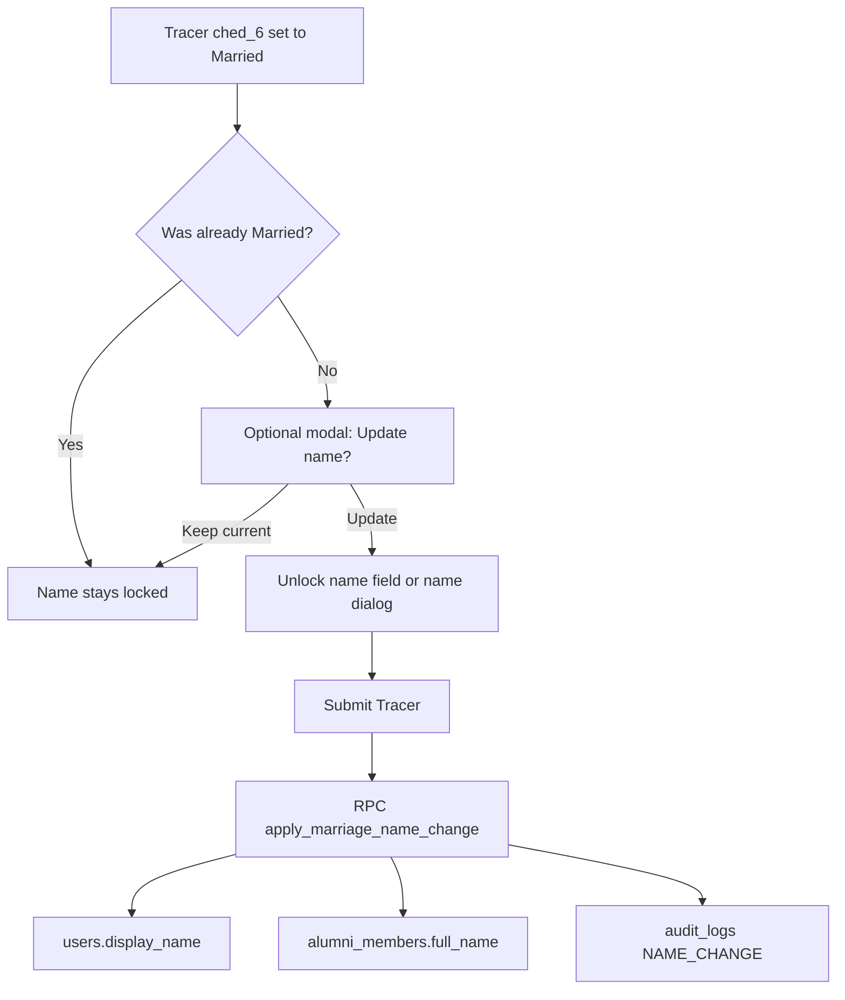

# Marriage-gated name change (v1)

Status: **implemented 2026-10-21** (code + migration
`supabase/migrations/20261021040000_marriage_name_change.sql`, applied to
the linked Supabase project the same day). Recorded 2026-10-17.

Lock alumni names everywhere except an optional Tracer rename when civil
status becomes Married; that path updates both live and roster names and
writes an admin-visible audit log.

**Decisions locked:** `1B` update live + roster together; `2A` Tracer-only
optional rename when Married + audit logs (no alumni name-correction
request flow).

## Current state (hooks)

- Live name: `users.display_name` — editable today on profile and Tracer
  `ched_1`
- Roster name: `alumni_members.full_name` — alumni blocked by DB trigger;
  profile sync intentionally **excludes** name
  (`lib/features/admin/roster/data/alumni_member_service.dart`
  `syncRosterFromTracerProfile`)
- Civil status: `ched_6` / `GtsConstants.civilStatuses` includes `Married`
- Audit: existing `audit_logs` (`lib/core/services/audit_service.dart`) +
  admin Activity tab on member detail — reuse, no new table
- UI lock pattern already exists for year graduated (`yearLocked` /
  `_lockedRow` in `lib/shared/widgets/gts/gts_profile_form.dart`)

## Product rules (v1)

| Surface | Name behavior |
|---------|----------------|
| Live profile / onboarding GTS form | **Read-only** (helper: verified at registration; change only via Tracer if married) |
| Tracer `ched_1` | **Read-only** unless user opted in after selecting Married |
| Trigger | Civil status **becomes** `Married` (prior value ≠ `Married`) |
| Opt-out | Modal is optional; declining keeps birth/current name |
| Other statuses | No rename unlock (Widow etc. out of scope for v1) |
| Typos / legal corrections | Out of scope — admin edits roster/directory as today |

## Implementation todos

1. **db-rpc-lock** — Migration: lock `users.display_name` +
   `apply_marriage_name_change` RPC (live + roster + audit)
2. **profile-lock-ui** — Make name read-only on GTS profile/onboarding;
   ignore name on profile save
3. **tracer-modal** — Tracer: Married transition modal, optional unlock of
   `ched_1`, merge/sync gates
4. **admin-audit-surface** — Ensure `NAME_CHANGE` audit details show in
   member Activity / activity logs
5. **verify** — Analyze + exercise Married rename path; confirm dual name
   + audit

## 1. Database enforcement + dual write

Add migration (new file under `supabase/migrations/`):

1. **Lock `users.display_name` for alumni** in
   `users_guard_protected_columns`: on UPDATE, if not admin/privileged,
   force `new.display_name := old.display_name` unless a session flag is
   set (same pattern as contact verification:
   `current_setting('app.allow_marriage_name_change', true) = 'on'`).

2. **SECURITY DEFINER RPC** `apply_marriage_name_change(p_new_name text)`:
   - Caller must be `auth.uid()`
   - Normalize/trim name; reject empty
   - Load current `users.display_name` + `civil_status`; require
     `civil_status = 'Married'`
   - Contract: RPC only renames; Tracer submit first saves profile with
     civil status via existing path, then if rename opted-in calls RPC
   - Set `app.allow_marriage_name_change = on`, update
     `users.display_name`
   - Update `alumni_members.full_name` for `auth_uid = auth.uid()`
     (bypass owner guard via definer / setting)
   - Insert `audit_logs` row with `action: 'NAME_CHANGE'`,
     `entity_type/resource: 'Profile'`,
     `details.changes: { from, to, reason: 'civil_status_married', source: 'tracer' }`
   - Return `{ from, to }`

3. Grant `execute` to `authenticated`; revoke from `anon`.

**Why RPC:** client cannot update roster `full_name` today; UI-only locks
are bypassable.

## 2. Client: lock name on live profile

In `lib/shared/widgets/gts/gts_profile_form.dart`:

- Add `nameLocked` (default `true` for alumni profile/onboarding; mirror
  year field)
- `_nameField()` → `readOnly: nameLocked` + helper copy (e.g. “Verified
  at registration”)
- `lib/features/alumni/profile/presentation/profile_information_page.dart`
  / save path: never send a changed `displayName` (or always re-apply
  loaded name before save)

## 3. Client: Tracer optional rename UX

In CHED form flow (`lib/features/surveys/ched_gts/ched_gts_form.dart` /
prefill helpers):

- Prefill `ched_1` as today; treat as **locked** by default
- When answer to `ched_6` changes **to** `Married` and previous
  answer/profile civil status was not `Married`, show dialog:
  - Title: update name after marriage?
  - Actions: **Keep current name** / **Update name**
- If Update: unlock `ched_1` (or small name dialog writing into
  `ched_1`); store flag `_marriageNameChangeOptedIn = true`
- If Keep: leave `ched_1` locked and equal to prefilled name
- If user later changes civil status away from Married, clear opt-in and
  re-lock `ched_1` to original

In `lib/features/surveys/ched_gts/ched_gts_prefill.dart`
`mergeIntoProfile`:

- Only apply `displayName` from `ched_1` when opt-in flag is true;
  otherwise keep `current.displayName`

In `lib/features/surveys/data/survey_service.dart`
`_syncProfileFromBuiltinChedGts`:

- Save civil status / other fields via existing `saveTracerProfile`
- If name changed and opted-in: call `apply_marriage_name_change` RPC
  (do **not** rely on client upsert for `display_name`)
- If name “changed” without opt-in: ignore (DB will also strip)

## 4. Admin visibility

- No new admin screen: `NAME_CHANGE` rows appear in existing Activity tab
  (`admin_alumni_member_detail_page.dart` / `getRelatedAuditLogs`) and
  global Activity Logs
- Optionally format `changes.from` → `changes.to` in the activity row
  subtitle if the list already renders `details.changes` (small UI polish
  only if needed)

Demographics already show live vs roster name — after RPC they stay in
sync.

## 5. Tests / verification

- Unit/widget: name field read-only on profile form; Tracer unlock only
  after Married + opt-in
- Service/integration (or migration SQL smoke): RPC updates both tables +
  audit; RPC fails when civil status ≠ Married; alumni direct `users`
  update cannot change `display_name`
- Manual: hot-restart Tracer Married path → modal → rename → confirm
  Directory/detail shows new name on both live and roster + Activity
  entry

## Out of scope (v1)

- Gender-based rules
- Name change for Widow / Separated
- Alumni-initiated name-correction request queue
- Changing name from live profile civil-status edit
