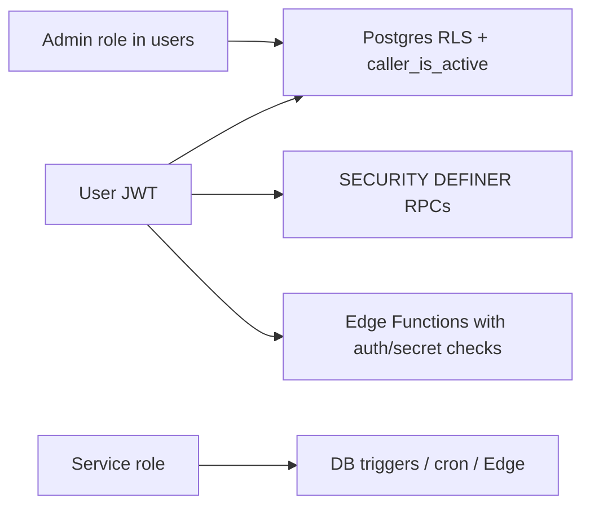
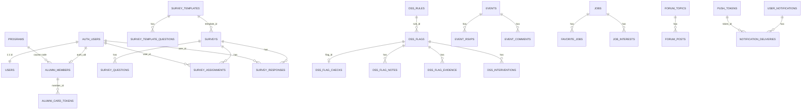
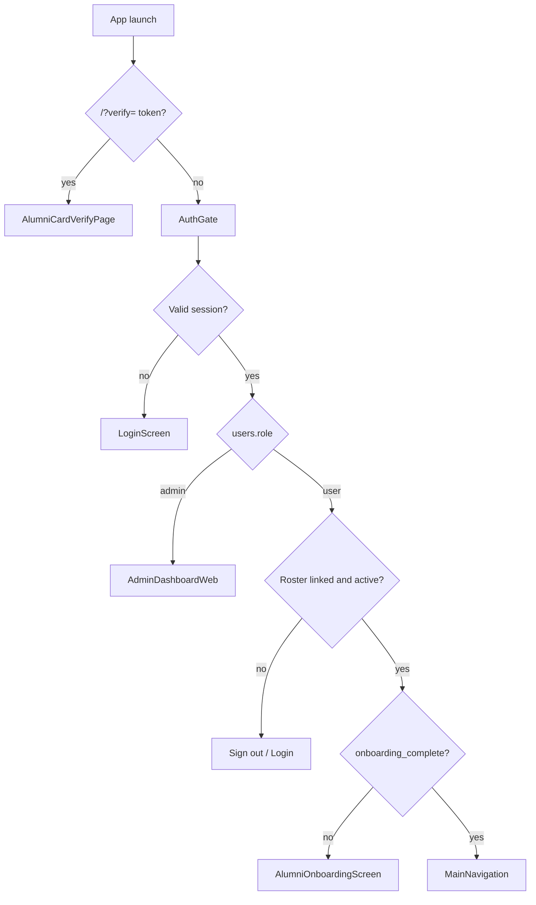
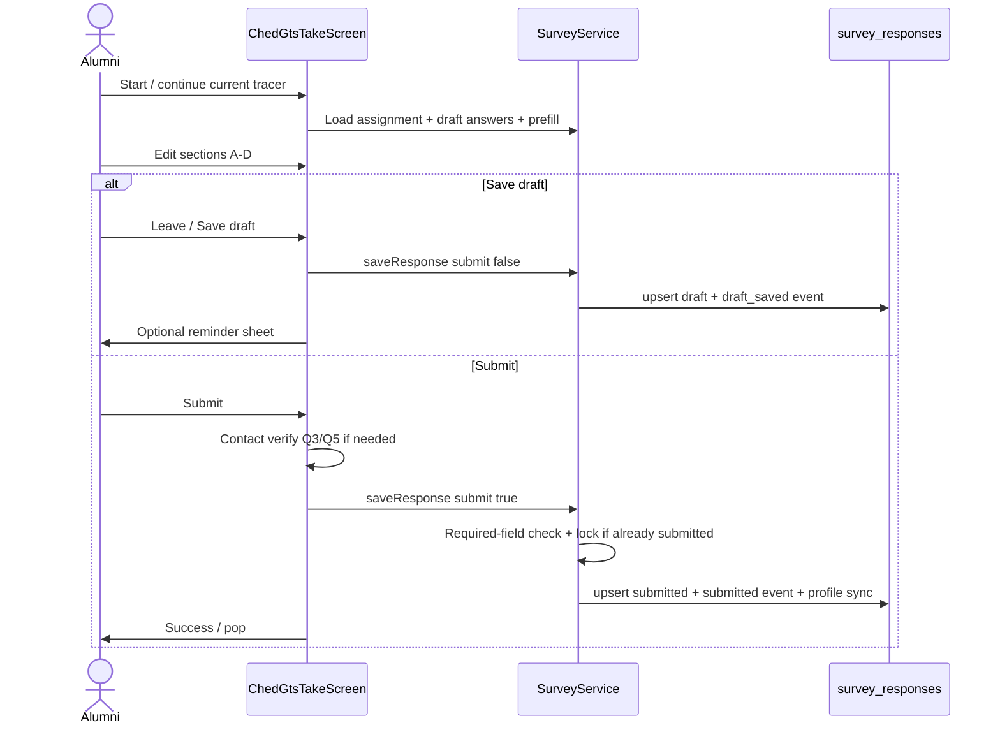
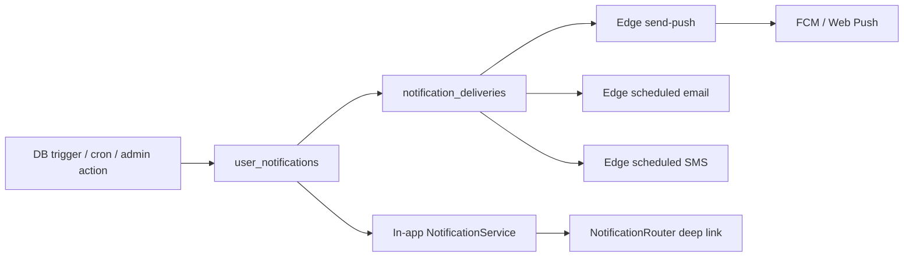

# AESS — Complete System Overview

**Audit date:** 2026-11-05  
**Mode:** Read-only inspection of source, migrations, configs, tests, and existing docs  
**Not performed:** Runtime E2E against live Supabase, secret verification, production exploit testing  

**Repo scale at audit:** ~412 Dart files under `lib/`, 99 SQL migrations, 8 Edge Functions, 124 `*_test.dart` files, no GitHub Actions CI.

This document describes the Alumni Engagement and Support System (AESS) **as it actually exists** in the repository. It consolidates the former system-audit Documents A–K into a single overview. It does not redesign or implement changes.

**No secrets, passwords, API keys, or production credentials are included.**

### Related docs (outside this folder)

- [../dss-complete-overview.md](../dss-complete-overview.md) — DSS / Program Insights deep overview
- [../AESS_DSS_USER_AND_DEVELOPER_GUIDE.md](../AESS_DSS_USER_AND_DEVELOPER_GUIDE.md) — longer DSS user/developer guide
- [../full-system-overview.md](../full-system-overview.md) — living product overview (may drift; see Limitations)
- [../alumni-user-app-overview.md](../alumni-user-app-overview.md) — alumni UX
- [../database/](../database/) — generated DB snapshot (2026-10-05; later migrations exist)
- [../notifications.md](../notifications.md) — notification pipeline
- [../../SYSTEM_DOCUMENTATION.md](../../SYSTEM_DOCUMENTATION.md) — earlier system doc (partially stale)
- [../../README.md](../../README.md) — quick start

### Implementation-status labels

1. **Implemented and verified in source** — code path inspected
2. **Implemented, runtime behavior unverified** — code exists; live execution not tested in this audit
3. **Partially implemented** — incomplete or disconnected pieces
4. **UI-only or placeholder** — UI without confirmed full behavior
5. **Configured but integration unverified** — config/source present; live integration not confirmed
6. **Planned or documented only** — docs/comments only
7. **Not found** — no implementation located
8. **Unable to determine** — insufficient evidence

### Table of contents

1. [Executive overview](#1-executive-overview)
2. [Feature and screen catalog](#2-feature-and-screen-catalog)
3. [Technical architecture](#3-technical-architecture)
4. [Database reference](#4-database-reference)
5. [Feature-to-data mapping](#5-feature-to-data-mapping)
6. [Integrations and dependencies](#6-integrations-and-dependencies)
7. [Workflows and diagrams](#7-workflows-and-diagrams)
8. [Security and reliability](#8-security-and-reliability)
9. [Deployment and maintenance](#9-deployment-and-maintenance)
10. [Limitations and backlog](#10-limitations-and-backlog)
11. [Evidence and source register](#11-evidence-and-source-register)
12. [Final approval gate](#12-final-approval-gate)

---


---

# 1. Executive overview

## System purpose

AESS (Alumni Engagement and Support System / USTP Alumni System) is a Flutter multi-platform portal for USTP alumni engagement and institutional graduate tracer work. It combines:

- Roster-gated alumni registration and profiles
- Official CHED Graduate Tracer Study (GTS) capture and history
- Events, jobs, forum, messaging, announcements, feedback
- Admin roster, surveys, reports/exports, and Program Insights (DSS)

Package name: `alumni_system` (`pubspec.yaml`). Display title: `AESS` (`lib/main.dart`).

## Intended users

| Role | Access | Evidence |
|---|---|---|
| Alumni (`users.role = user`) | Mobile/web portal after roster link + onboarding | `AuthGate`, `MainNavigation` |
| Administrator (`users.role = admin`) | Web-oriented admin shell | `AdminDashboardWeb` |
| Public (unauthenticated) | Login/register/forgot password; digital card verify `/?verify=` | `AlumniCardVerifyPage` |

## Major modules (as implemented)

**Alumni:** Auth, onboarding, home, events, tracer/CHED GTS, jobs, community/forum, profile + digital card, surveys list, messages, notifications, feedback, contact verification.

**Admin:** Dashboard, alumni directory, surveys, reports & analytics, Program Insights (DSS), events, announcements, forum, messages, jobs, activity logs, archives, feedback. Profile edit via dialog (no Settings nav item). AI Assistant **removed from sidebar** (index 13 unused).

## Technology stack (confirmed)

| Layer | Stack |
|---|---|
| Client | Flutter / Dart SDK `^3.9.2`, Material 3 |
| Backend | Supabase Auth, Postgres, RLS, Storage, Realtime, Edge Functions |
| Web hosting | Firebase Hosting site `ustp-aess` (project `aess-alumni`) |
| Push | Android FCM (`firebase_messaging`); Web Push (VAPID + `push-sw.js`) |
| Email | Gmail SMTP via Edge Function `send-email` (**not Resend**) |
| SMS | Semaphore (Edge Functions; mode-configurable) |
| AI | Google Gemini via Edge `ai-assist` / `tracer-help` |

## Architecture overview

Single Flutter codebase. Imperative `Navigator` (no GoRouter). Feature folders under `lib/features/` with `presentation` / `data` / `models`. Client talks to Supabase with the **anon/authenticated JWT**. Privileged work uses RLS, `SECURITY DEFINER` RPCs, and Edge Functions with service role. Firebase is **Hosting + Android FCM only** — not Auth/Firestore for app data (`MigrationConfig` defaults false).

```
Developer / Alumni / Admin
        │
        ▼
 Flutter client (MaterialApp → AuthGate)
        │
        ▼
 Supabase (Auth · PostgREST · Storage · Realtime · Edge)
        │
        ├─► Postgres + RLS + triggers + pg_cron
        └─► Edge: email / SMS / push / AI / contact-verify

 Web release: flutter build web → Firebase Hosting (ustp-aess)
```

## Current implementation status

| Area | Status |
|---|---|
| Alumni portal modules (auth through feedback) | Implemented in source; runtime unverified in this audit |
| Admin modules listed above | Implemented in source; runtime unverified |
| Reports catalog (20 available products) | Implemented in source |
| DSS / Program Insights | Implemented in source + DB RPCs |
| Edge Functions (email, SMS, push, AI, contact, tracer-help) | Source present; live secrets/cron **Configured but integration unverified** |
| iOS distribution / App Store pipeline | Project exists; not a documented primary release path |
| CI/CD (GitHub Actions) | **Not found** |

## Major limitations

- No automated CI; deploy scripts cover **web hosting only**, not Supabase migrations/functions.
- Docs drift (`full-system-overview.md` still lists admin AI; `SYSTEM_DOCUMENTATION.md` undercounts Downloads presets).
- Android `applicationId` still `com.example.alumni_system`; no `google-services.json` in repo.
- Sensitive admin mutations rely on RLS (client alone is not a trust boundary).
- CHED GTS: sections A–D only (no Section E); paper question remapping; schema `3.0.0` vs PDF asset `3.1.0` notes in project docs.
- GTS draft is **explicit save**, not continuous autosave.

## Official roster courses (README)

BSIT, BFPT, BTLED-IA, BTLED-ICT, BTLED-HE


---

# 2. Feature and screen catalog

## B.1 Navigation model

- **No named Flutter routes.** `MaterialApp(home: …)` → `AuthGate` or card verify.
- Alumni: `MainNavigation` `IndexedStack` (6 tabs) + `Navigator.push` for secondary screens.
- Admin: sidebar/drawer `IndexedStack` by menu index (`_pageOrder`).
- Deep links: share HTTPS paths + notification route strings (`ShareLinkRouter`, `NotificationRouter`).

### Share / notification route vocabulary

| HTTPS path | Notification route | Handler area |
|---|---|---|
| `/tracer/<uuid>` | `tracer/<uuid>` | Tracer / surveys |
| `/surveys/<uuid>` | `survey/<uuid>` | Surveys |
| `/events/<uuid>` | `event/<uuid>` | Events |
| `/jobs/<uuid>` | `job/<uuid>` | Jobs |
| `/community/<uuid>` | `forum/<uuid>` | Forum |

Also: `announcement`, `feedback/{id}`, `messages`, `profile`, `admin/...` — see `lib/features/notifications/application/notification_target.dart`, `lib/features/share/share_destination.dart`.

### Alumni tabs (`PortalTabs` / `main_navigation.dart`)

| ID | Tab | Widget | Narrow | Wide (≥900) |
|---|---|---|---|---|
| AL-HOME | Home | `HomeScreen` | Bottom nav | NavigationRail |
| AL-EVT | Events | `EventsScreen` | | |
| AL-TRC | Tracer | `TracerScreen` | | |
| AL-JOB | Jobs | `JobPostingScreen` | | |
| AL-COM | Community | `UserCommunityScreen` → `ForumScreen` | | |
| AL-PRF | Profile | `ProfileScreen` | | |

### Admin sidebar (`kAdminNavSections`)

| Index | Label | Widget |
|---|---|---|
| 0 | Dashboard | `AdminDashboardHome` |
| 2 | Alumni Directory | `AdminAlumniMembersScreen` / directory |
| 10 | Surveys | `AdminSurveysScreen` |
| 9 | Reports & Analytics | `AdminReportsScreen` |
| 15 | Program Insights | `AdminDssScreen` |
| 1 | Events | `AdminEventsScreen` |
| 11 | Announcements | `AdminAnnouncementsScreen` |
| 12 | Forum | `AdminForumScreen` |
| 6 | Messages | `AdminMessagesScreen` |
| 5 | Job Postings | `AdminJobManagement` |
| 7 | Activity Logs | `AdminActivityLogsScreen` |
| 4 | Archives | `AdminArchivesScreen` |
| 14 | Feedback | `AdminFeedbackScreen` |

Unused indices: **3, 8, 13**.

---

## B.2 Alumni screens

| Screen ID | Name | Platform | Access | Purpose / actions | Services / DB | Status | Evidence |
|---|---|---|---|---|---|---|---|
| AUTH-LOGIN | Login | Shared | Public | Email/password, remember me | `AuthService` → Auth + `users`/`alumni_members` | Implemented, runtime unverified | `login_page.dart` |
| AUTH-REG | Register | Shared | Public | Eligibility → signup → OTP → roster link | `AlumniEligibilityService`, `AuthService` | Implemented, runtime unverified | `register_page.dart` |
| AUTH-FORGOT | Forgot password | Shared | Public | Recovery OTP → new password | `AuthService` | Implemented, runtime unverified | `forgot_password_page.dart` |
| AUTH-GATE | AuthGate | Shared | Session | Route by role/onboarding | Auth / session | Implemented, runtime unverified | `auth_gate.dart` |
| AL-ONB | Onboarding | Shared | Auth alumni | Profile steps; sets `onboarding_complete` | `OnboardingService`, profile/contact | Implemented, runtime unverified | `alumni_onboarding_page.dart` |
| AL-HOME | Home | Shared adaptive | Auth alumni | Events, announcements, surveys attention, calendar, deep links | Multiple services | Implemented, runtime unverified | `home_page.dart` |
| AL-EVT | Events | Shared | Auth alumni | List/calendar, RSVP, comments, local reminders | `EventService`, RSVP/comment/reminder | Implemented, runtime unverified | `events_page.dart` |
| AL-TRC | Tracer hub | Shared | Auth alumni | Current CHED status, start/continue, history, draft reminder | `SurveyService`, `CurrentTracer`, reminder | Implemented, runtime unverified | `tracer_page.dart` |
| AL-GTS | CHED GTS take | Shared | Auth alumni | Sections A–D wizard; draft/submit; contact verify; Q19 help | `ChedGts*`, `SurveyService`, `tracer-help` | Implemented, runtime unverified | `ched_gts_take_screen.dart` |
| AL-TRC-HIST | Tracer history | Shared | Auth alumni | Past submitted waves | Survey responses | Implemented, runtime unverified | `tracer_history_screen.dart` |
| AL-CHED-RO | CHED response view | Shared | Auth alumni | Read-only submitted answers | Responses | Implemented, runtime unverified | `ched_response_screen.dart` |
| AL-SRV | My Surveys | Shared | Auth alumni | Non-CHED + survey list; open take | `SurveyService` | Implemented, runtime unverified | `user_surveys_page.dart` |
| AL-SRV-TAKE | Survey take | Shared | Auth alumni | Custom survey answering | `SurveyService` | Implemented, runtime unverified | `user_survey_take_page.dart` |
| AL-JOB | Jobs | Shared | Auth alumni | Browse, favorite, interest, recommend | Job/favorite/interest services | Implemented, runtime unverified | `job_posting_page.dart` |
| AL-COM | Community/Forum | Shared | Auth alumni | Topics, posts, bookmarks, report, reactions | `ForumService` | Implemented, runtime unverified | `forum_page.dart` etc. |
| AL-PRF | Profile hub | Shared | Auth alumni | Card + account menu | Card/profile | Implemented, runtime unverified | `profile_page.dart` |
| AL-PRF-INFO | Profile information | Shared | Auth alumni | Edit GTS-linked fields, photo, contacts | `UserProfileService`, contact verify | Implemented, runtime unverified | `profile_information_page.dart` |
| AL-CARD-V | Card verify (public) | Web primarily | Public | Verify QR/token | `verify_alumni_card` RPC | Implemented, runtime unverified | `alumni_card_verify_page.dart` |
| AL-MSG | Support messages | Shared | Auth alumni | Alumni↔admin office chat | `MessageService` | Implemented, runtime unverified | `user_messages_page.dart` |
| AL-NTF | Notifications | Shared | Auth alumni | Inbox, mark read, deep link | `NotificationService` | Implemented, runtime unverified | `notifications_page.dart` |
| AL-NTF-PREF | Notification prefs | Shared | Auth alumni | Channel toggles, push device | Prefs + `PushService` | Implemented, runtime unverified | `notification_preferences_page.dart` |
| AL-FB-* | Feedback list/submit/detail | Shared | Auth alumni | Submit tickets, view status | `FeedbackService` | Implemented, runtime unverified | feedback presentation |
| AL-PWD | Change password | Shared | Auth alumni | Dialog from profile | `AuthService.changePassword` | Implemented, runtime unverified | `change_password_page.dart` |
| AL-AI | General AI chat | — | — | **Not alumni-facing** | Admin/moderation only | Not found (alumni) | `ai_assistant_service.dart` usages |
| AL-HELP | Tracer AI help | Shared | Auth alumni | Q19→Q20 occupation helper | Edge `tracer-help` | Implemented, runtime unverified | `ched_gts_help_service.dart` |

### Alumni feature notes (by module)

#### Registration and authentication
- Flow: eligibility RPC → `signUp` (email confirm required) → OTP verify → `link_alumni_registration` → onboarding/home.
- Password policy: min 8 + letters + numbers (`password_policy.dart`).
- Login gate: `_assertAccountStillAuthorized` checks `users` + (non-admin) roster / deactivation.
- Contact verification: Edge `contact-verify` + RPC `apply_verified_contact` (email/mobile OTP). SMS path may include demo/mock UI — confirm production mode separately.

#### Dashboard / home
- Profile, upcoming events, announcements, community preview, survey/tracer attention, calendar (events + surveys + jobs), unread messages/notifications.
- Per-section error/retry for some loads; optional sections often fail silently.

#### Profile and digital card
- Profile hub menu: Profile information, My Surveys, Support messages, Notifications, Feedback, Change password, Sign out.
- Digital card: front identity / back QR + short code; offline cache; public verify page.
- Name/year/program locks with marriage-gated display name change (DB + CHED flow).

#### CHED GTS / Tracer
- Built-in schema `ChedGtsBuiltin.schemaVersion = '3.0.0'`; kind `ched_gts_builtin`.
- Sections **A–D only** (no Section E referrals).
- Items `ched_1`–`ched_34` with remapped paper duplicates: printed 24/25/26 → ids `ched_24a` / `ched_24b` / `ched_25` (no `ched_26` id).
- Draft: **explicit save** (leave “Save draft” or submit) — **not** continuous autosave.
- Submit locks response; lifecycle events: opened / draft_saved / submitted.
- Prefill from profile; contact verify on Q3 email / Q5 mobile before submit.
- Legacy `ched_survey_template_seed.dart` is admin editable C&D pack — **not** the alumni take path.
- PDF asset version notes: see `docs/ched-gts-pdf-export.md` (v3.1.0 asset vs 3.0.0 schema).

#### Events / Jobs / Forum / Messages / Notifications / Feedback
- Events: list/calendar, RSVP going/cant_attend, comments (admin replies), local reminders (native; limited on web).
- Jobs: search/filters, favorites, interests, course-based recommendations.
- Forum: compose, edit, bookmarks, report, helpful reactions, @mentions.
- Messages: office chat only (alumni ↔ admins), text/image, edit/delete own, retry failed sends.
- Notifications: in-app inbox + prefs + push registration; delivery via DB queue + Edge `send-push`.
- Feedback: categories, message ≥10 chars, optional rating; statuses submitted / inReview / resolved / closed.

---

## B.3 Admin screens (primary + nested)

| Screen ID | Name | Access | Key actions | Status | Evidence |
|---|---|---|---|---|---|
| AD-DASH | Dashboard | Admin | KPIs, quick actions, Verify card QR | Implemented, runtime unverified | `admin_dashboard_home.dart` |
| AD-DIR | Alumni Directory | Admin | Search/filter, add, Excel import, deactivate, detail, CHED PDF ZIP export | Implemented, runtime unverified | `admin_alumni_directory_page.dart` |
| AD-DIR-D | Member detail | Admin | Demographics, employment, surveys | Implemented, runtime unverified | `admin_alumni_member_detail_page.dart` |
| AD-SRV | Surveys list | Admin | Create CHED/custom, publish, assign, remind, archive | Implemented, runtime unverified | `admin_surveys_page.dart` |
| AD-SRV-ED | Survey editor | Admin | Questions, schedule, audience | Implemented, runtime unverified | `admin_survey_editor_page.dart` |
| AD-SRV-RSP | Survey responses | Admin | Review, timeline, exports, formal report | Implemented, runtime unverified | `admin_survey_responses_page.dart` |
| AD-RPT | Reports & Analytics | Admin | Overview/Tracer/Survey/Downloads/Builder | Implemented, runtime unverified | `admin_reports_page.dart` |
| AD-DSS | Program Insights | Admin | Evaluate flags, actions, settings, export | Implemented, runtime unverified | `admin_dss_page.dart` + detail/history/settings |
| AD-EVT | Events admin | Admin | CRUD, archive, comments moderation | Implemented, runtime unverified | `admin_events_page.dart` |
| AD-ANN | Announcements | Admin | Draft/publish/archive, targeting | Implemented, runtime unverified | `admin_announcements_page.dart` |
| AD-FORUM | Forum moderation | Admin | Lock/pin/delete, reports | Implemented, runtime unverified | `admin_forum_page.dart` |
| AD-MSG | Admin messages | Admin | Inbox, compose, media | Implemented, runtime unverified | `admin_messages_page.dart` |
| AD-JOB | Job management | Admin | CRUD, archive, interests | Implemented, runtime unverified | `admin_job_management_page.dart` |
| AD-ACT | Activity logs | Admin | Filter, paginate, export | Implemented, runtime unverified | `admin_activity_logs_page.dart` |
| AD-ARC | Archives | Admin | Restore/delete events/jobs/surveys | Implemented, runtime unverified | `admin_archives_page.dart` |
| AD-FB | Feedback admin | Admin | Status + response | Implemented, runtime unverified | `admin_feedback_page.dart` |
| AD-AI | AI Assistant nav | — | Removed from shell | Not found (nav) | `admin_dashboard_page.dart` default case |

**Dialogs/panels (major):** announcement editor side panel; survey export/formal report dialogs; DSS action dialogs; alumni directory dialogs; admin profile dialog; card verify dialog on dashboard.

### Admin reports catalog (available)

Survey export modal (6): `survey.submitted_responses`, `survey.management_summary`, `survey.ched_outcomes`, `survey.ched_excel_pack`, `survey.ched_fillable_pdfs`, `survey.pending_assignments`.

Downloads library (14 presets): institutional GTS summary, graduate employment, curriculum relevance, first job salary, educational background, alumni demographics, CHED wave compare, program/cohort comparison, GTS participation quality, survey participation, CHED portfolio pack, portal executive snapshot, alumni employment records, active roster extract.

All catalog entries audited as `available`; `planned` empty (`report_catalog.dart` + tests).

### Admin DSS rules (seeded examples)

`DATA_QUALITY_LOW`, `UNEMPLOYMENT_HIGH`, `RELATEDNESS_LOW`, `UNDEREMPLOYMENT`, `TIME_TO_JOB_LONG`, `SALARY_STAGNATION`, `RELATEDNESS_HIGH`, `SEEKING_WORK_HIGH` (default disabled), `UNEMPLOYMENT_TREND_UP`.

Flag statuses: Open, In Progress, Resolved, Dismissed, Watch, Superseded.

---

## B.4 Platform behavior

| Concern | Behavior |
|---|---|
| Shared shell | One codebase; adaptive layouts |
| Alumni ≤900px | Bottom nav |
| Alumni ≥900px | NavigationRail (`PortalBreakpoints`) |
| Admin &lt;700 | Drawer |
| Admin 700–1100 | Collapsible sidebar |
| Admin ≥1100 | Expanded sidebar |
| Local event reminders | Disabled/limited on web (`ReminderService` + `!kIsWeb`) |
| Web deploy | Primary production path |

Do **not** assume mobile web and native mobile are identical pixel layouts; they share widgets with breakpoint-driven chrome.


---

# 3. Technical architecture

## C.1 Frontend architecture

### Entry and navigation

```
main.dart
  → Supabase.initialize + PushService + ShareLinkRouter
  → MaterialApp(home: AuthGate | AlumniCardVerifyPage)
       ├─ Login / Register / ForgotPassword
       ├─ AlumniOnboardingScreen → MainNavigation
       ├─ MainNavigation (IndexedStack tabs + pushes)
       └─ AdminDashboardWeb (IndexedStack by menu index)
```

- No GoRouter, no `MaterialApp.routes` / `onGenerateRoute`.
- Global navigator key: `lib/core/navigation/app_navigator.dart`.
- Deep links held until AuthGate / signed-in shell is ready.

### Organization

Feature-first under `lib/features/*` with `presentation`, `data`, `models`, occasional `application`/`widgets`. Shared UI in `lib/shared/widgets/{user,admin}`. Core in `lib/core/{config,services,pdf,navigation,utils,constants}`.

Typical layering:

```
presentation (screens/widgets)
        │
        ▼
data (*Service / *Repository)
        │
        ▼
Supabase client (Auth / PostgREST / Storage / Functions)
```

This is **not** labeled Clean Architecture / MVVM / Riverpod in code — it is a pragmatic feature-folder + service pattern.

### State management

| Approach | Evidence |
|---|---|
| No Provider / Riverpod / Bloc / GetX / MobX | Absent from `pubspec.yaml` |
| Primary: `StatefulWidget` + `setState` | Shells, pages, forms |
| Local listenables: `ValueNotifier` / `ValueListenableBuilder` | Overlay theme, admin profile controller, survey catalog refresh |
| Streams / Supabase | Auth session, live dashboard channels, message watches |
| Singletons / statics | `PushService`, `NotificationRouter`, `ShareLinkRouter`, `MainNavigationState.active` |

### UI systems

- Alumni: `PortalTheme`, `PortalBreakpoints`, portal menus/overlays.
- Admin: `AdminDensity`, `AdminDirectoryTheme` / survey theme aliases, dense Workspace-like chrome.
- Brand: `UstpColors` (`lib/core/constants/ustp_colors.dart`); Material seed in `main.dart` still uses `0xFF090A4F` (differs from official USTP navy `#1A1851` — known brand-rule tension).
- Charts: `fl_chart`.
- PDF: `pdf` + `printing`; Syncfusion for official CHED fillable forms.
- Excel/CSV: `excel`, `archive`, `xml`.
- Maps: `flutter_map` + `latlong2`.
- Images: `image_picker`, `flutter_image_compress`, Storage upload helpers.
- Local storage: `shared_preferences` (remember-me email, card cache, drafts, push device choice).

### Platform-specific code (examples)

| Concern | Location |
|---|---|
| Web debug error guards | `lib/main.dart` |
| Web launch URL / App Links | `share_link_router.dart` |
| Alumni card verify query | `alumni_card_verify_launch.dart` |
| Push FCM vs web | `push_service.dart`, `fcm_push_bridge.dart` |
| Local reminders off web | `reminder_service.dart` |
| Export/download/upload | `export_platform.dart`, `web_file_*.dart` |
| Client context | `client_context.dart` |

---

## C.2 Backend and integration architecture

```
Flutter client (anon JWT)
  → Supabase Auth
  → PostgREST tables/views + RPC
  → Storage (images, message-attachments)
  → Realtime channels
  → Edge Functions (service role / secrets)
       ├─ send-email / send-scheduled-emails
       ├─ send-scheduled-sms
       ├─ send-push
       ├─ ai-assist / tracer-help
       └─ contact-verify
  → pg_cron / pg_net (scheduled notifications, emails, SMS, DSS recheck, audit purge)
```

### Where logic runs

| Layer | Examples |
|---|---|
| Client | Form validation, UI role routing, optimistic favorite toggles, report PDF/Excel building, DSS in-app evaluate **fallback** |
| Database (RLS / triggers / RPC) | Eligibility/link, auto-assign, notification enqueue, card issue/verify, contact apply, DSS `dss_evaluate_all`, push token register, job expiry |
| Edge Functions | Gmail SMTP, Semaphore SMS, FCM/Web Push dispatch, Gemini proxy, contact OTP |

Sensitive operations that look client-only still depend on RLS/RPC — Flutter `_assertAdminCaller` is **not** a trust boundary.

### Supabase client init

`lib/main.dart` validates `SupabaseConfig.configurationError`, blocks release builds with non-empty `AESS_ENV`, then `Supabase.initialize(url:, publishableKey:)`. Shared accessor: `supabase` getter.

Service-role keys are rejected by `SupabaseConfig.validate` if mistakenly passed as anon key.

---

## C.3 Authentication and authorization sketch



Roles: `user` | `admin` on `users.role`. Alumni also require linked, non-deactivated `alumni_members` for API use (migrations: linked-alumni-only, caller_is_active).

Frontend visibility (hiding admin menus) ≠ authorization. Enforcement is expected at RLS/RPC/Edge.

---

## C.4 Deployment architecture

```
Developer → flutter build web → Firebase Hosting (ustp-aess)
Supabase project → DB migrations + Edge Functions + secrets (separate from deploy.sh)
Android APK/AAB → local Flutter Android build (signing via key.properties.example; FCM via dart-defines)
```

Firebase Hosting site `ustp-aess`, project `aess-alumni`. SPA rewrite to `index.html`. Assetlinks / cache headers in `firebase.json`.

**Gap:** Hosting deploy does not apply migrations or deploy Edge Functions.


---

# 4. Database reference

**Caveat:** Live DB may differ if migrations are not fully applied. Prefer migrations over the Oct 5 snapshot when they disagree.

---

## D.1 Migration eras (high level)

| Era | Theme |
|---|---|
| Phase 1–3 (20260716*) | Core schema, RLS, Firestore ID bridges |
| Phase 4–5 | Eligibility RPCs, Supabase-only auth, drop Firebase bridge columns, images bucket |
| Mid 2026 | GTS columns, survey lifecycle, events engagement, forum redesign, messages, jobs interests, DSS |
| Oct 2026 hardening | Security, integrity, programs + GTS catalog, performance, GTS analytics views, notifications, legacy cleanup |
| Late Oct–Nov | Contact verify, alumni card, scheduled email/SMS, audit logging + retention |

Dropped by Phase 7 (`20261005160000`): legacy `notifications`, `employment_records`, `reminders` (and related).

---

## D.2 Table / view inventory (current expected schema)

Approx. **49 public tables** (40 from docs + post-snapshot additions). Pattern: RLS enabled; restrictive `active_caller_only` + permissive owner/admin policies.

### Identity and roster

| Database object | Type | Purpose | PK | Important relationships | RLS/access | Used by |
|---|---|---|---|---|---|---|
| `users` | table | App profile 1:1 auth | `id` | `id → auth.users` CASCADE | Restrictive active caller; self/admin | Auth, profile, admin |
| `alumni_members` | table | Official roster | `id` | `auth_uid → auth.users` SET NULL; `course → programs` | Owner/admin | Registration, directory, card |
| `programs` | table | Program catalog | `code` | ← members.course | Admin write | Roster, filters |
| `alumni_card_tokens` | table | QR/backup codes | `id` | → members CASCADE | RPC-mediated | Digital card |
| `contact_verifications` | table | OTP hashes | `id` | → auth.users CASCADE | No client policies | contact-verify |

Notable columns (post-snapshot): contact verify fields, employment follow-ups on `users`; `profile_updated_at` on `alumni_members`. Unique roster identity: `(normalize_student_id, course)`.

### Surveys / GTS

| Object | Type | Purpose | Notes |
|---|---|---|---|
| `survey_templates` / `survey_template_questions` | tables | Template library | Cascade questions |
| `surveys` / `survey_questions` | tables | Published waves | status draft/published/closed; optional `template_id` |
| `survey_assignments` | table | Per-user assignment | unique (survey_id, user_id); notStarted/inProgress/completed |
| `survey_responses` | table | Draft/submitted answers | unique (survey_id, user_id); `answers` jsonb |
| `survey_response_events` | table | Lifecycle audit | opened / draft_saved / submitted |
| `gts_question_catalog` | table | CHED item catalog | `(schema_version, item_id)` |
| `tracer_draft_reminders` | table | Draft nudges | unique (user_id, survey_id) |
| `tracer_help_usage` | table | AI helper daily count | `(user_id, used_on)` |
| `ai_usage` | table | ai-assist daily count | service_role only |

### DSS

| Object | Purpose |
|---|---|
| `dss_rules` | Metric thresholds |
| `dss_flags` | Findings (status includes watch/superseded; finding_key) |
| `dss_flag_checks` | Latest recheck state |
| `dss_flag_notes` | Action log |
| `dss_wave_cohort_snapshots` | Roster counts per wave |
| `dss_evaluation_events` | Refresh insights audit |
| `dss_flag_evidence` | Soft-delete evidence |
| `dss_interventions` | Intervention outcomes |

### Engagement / ops

| Object | Purpose |
|---|---|
| `events`, `event_comments`, `event_replies`, `event_rsvps` | Events engagement |
| `jobs`, `favorite_jobs`, `job_interests` | Careers |
| `messages` | Alumni↔admin DM |
| `announcements` | Broadcasts |
| `feedback` | Support tickets |
| `forum_topics`, `forum_posts`, `forum_tags`, `forum_topic_tags`, `forum_bookmarks`, `forum_helpful_reactions`, `forum_reports`, `forum_moderation_events` | Community |
| `user_notifications`, `notification_preferences`, `push_tokens`, `notification_deliveries` | Notify pipeline |
| `audit_logs`, `audit_logs_archive` | Activity / security |
| `report_definitions` | Saved GTS report configs |

### Views

| View | Purpose |
|---|---|
| `gts_respondent_facts` | Submitted CHED GTS + roster cohort + typed answer columns |
| `gts_employment_records` | Compatibility shape over facts |
| `gts_report_facts` | De-identified answers (minus personal keys); `security_invoker` |

---

## D.3 Storage buckets (Supabase)

| Bucket | Settings | Access pattern |
|---|---|---|
| `images` | public; ~2MB; image/jpeg | Public read; avatars under `avatars/{uid}…`; admin broader write |
| `message-attachments` | private; 2MB; image/jpeg | Path `{uid}/…jpg`; sender write; recipient/admin read via messages join |

Root `storage.rules` is **Firebase Storage** (authenticated RW style) — separate from Supabase Storage.

---

## D.4 ER diagram (core hubs)



**Hubs:** `auth.users` / `users` (identity), `alumni_members` (roster truth), `surveys` (GTS waves), `dss_flags` (findings), `events` / `forum_topics` / `jobs` (engagement).

Application-level associations (not always FK): GTS answers in jsonb; notification `route` strings; report filters stored in `report_definitions`.

---

## D.5 RLS pattern (summary)

Documented in `docs/database/rls-policies.md` (Oct 5). Common rules:

- Restrictive `active_caller_only` on nearly all tables (deactivated/unlinked blocked via `caller_is_active`).
- Helpers: `is_admin()`, `is_signed_in()`, `caller_is_active()`.
- Owner-or-admin for PII (responses, feedback, roster self-row).
- Admin-only for DSS, reports, program writes, survey admin ops.
- No permissive client policies (service_role / SECURITY DEFINER only): `ai_usage`, `contact_verifications`, `alumni_card_tokens`, `tracer_help_usage`.
- Messages: alumni may only message admins; participants/admin can select/update.

Snapshot dated 2026-10-05 may lag later migrations — treat as guidance, re-query live for audits.

---

## D.6 Triggers, functions, cron (high level)

**Auth:** `handle_new_user`, `sync_user_email_from_auth`.

**Ubiquitous:** `set_updated_at` on mutable tables.

**Domain highlights:** roster ownership/normalize; survey counters/auto-assign/notify; message guards + notify; forum counts/moderation; event starts_at/ends_at + RSVP/comment notify; job sync/expire; notification queue + push kick; DSS status/accountability/evaluate; card `issue_alumni_card_token` / `verify_alumni_card`; contact `apply_verified_contact`; audit `record_failed_auth_attempt` / `purge_expired_audit_logs`.

**Cron (from docs + later migrations):** audit retention, DSS recheck, notification cleanup/morning/frequent/events, tracer reminders, push dispatch, scheduled survey email/SMS.

Full lists: `docs/database/triggers.md`, `docs/database/functions.md`.

---

## D.7 Data integrity and lifecycle

- Soft archive: events/jobs/surveys `archived`; DSS flag statuses include Resolved/Dismissed/Watch/Superseded.
- Survey responses: draft → submitted; **locked after submit** in client (`SurveyService.saveResponse`).
- Cascade deletes on many child FKs; roster `auth_uid` SET NULL on user delete.
- Unique constraints: roster student+course; users email (when non-empty); notification dedupe keys.
- Audit: `audit_logs` + tiered retention to `audit_logs_archive` (`20261104020000`).
- Orphan risk: application associations without FK (json answers, route strings) require app discipline.
- No database cleanup was performed during this audit.


---

# 5. Feature-to-data mapping

| Feature / screen | Read | Write | Services / Edge / RPC |
|---|---|---|---|
| Login / session gate | `users`, `alumni_members` | Auth session | `AuthService` |
| Register + roster link | RPCs eligibility | Auth signup; link RPC; `users` | `AlumniEligibilityService` (`validate_alumni_eligibility`, `link_alumni_registration`) |
| Forgot / change password | Auth | Auth password; revoke other sessions | `AuthService` |
| Onboarding | `users` | `users.onboarding_complete` + profile fields | `OnboardingService`, profile/contact |
| Profile information | `users`, `gts_employment_records` | `users`, roster sync, Storage avatars | `UserProfileService`, contact-verify / `apply_verified_contact` |
| Digital card | members + profile | `issue_alumni_card_token` | `AlumniCardService`, `AlumniCardTokenService` |
| Public card verify | verify RPC | — | `verify_alumni_card` |
| Home | events, jobs, announcements, surveys, forum, messages, notifications, `users` | — | Multiple feature services |
| CHED GTS take | assignments, responses, `users` | `survey_responses`, `survey_response_events`, profile sync | `SurveyService`, `ChedGts*`, Edge `tracer-help` |
| Tracer history / RO | responses / assignments | — | Tracer screens |
| My Surveys / custom take | surveys*, assignments, responses | responses / events | `SurveyService` |
| Tracer draft reminder | `tracer_draft_reminders` | upsert/cancel | `TracerReminderService` |
| Events list/detail | `events` | views counter (as implemented) | `EventService` |
| Event RSVP | `event_rsvps` | set/clear RSVP | `EventRsvpService` |
| Event comments | `event_comments`, `event_replies` | insert/update/delete | `EventCommentService` |
| Local event reminders | — | device local notify | `ReminderService` (native) |
| Jobs browse | `jobs` | views RPC | `JobService` (`increment_job_views`, `expire_past_deadline_jobs`) |
| Job favorites / interests | favorites, interests | upsert/delete | `FavoriteJobService`, `JobInterestService` |
| Forum | forum_* | topics/posts/reports/bookmarks/reactions | `ForumService`, `ForumBookmarkService`; moderation may call `ai-assist` |
| Messages | `messages`, admin list RPCs | messages + Storage | `MessageService` / repository; RPCs `list_support_admins`, `admin_conversation_inbox` |
| Notifications inbox | `user_notifications` | mark read / delete | `NotificationService` |
| Notification prefs | `notification_preferences` | upsert | `NotificationPreferencesService` |
| Push device | `push_tokens` | register/unregister RPCs | `PushService`; Edge `send-push` (server) |
| Feedback | `feedback` | insert / status/response | `FeedbackService` |
| Admin dashboard metrics | counts across roster, surveys, events, jobs, messages, forum, feedback, audit | — | Dashboard home loaders |
| Admin directory | `alumni_members`, `users`, responses | CRUD members; import | `AlumniMemberService`, `AlumniRosterImportService`, CHED PDF export |
| Admin remove account | members/users | RPC remove | `admin_remove_alumni_account` |
| Admin surveys | surveys* | CRUD/publish/assign/remind | `SurveyService`, templates |
| Admin survey responses | responses, events, users | — (exports in-memory) | response pages + export services |
| Admin reports | `gts_*` views, responses, `report_definitions`, roster | saved definitions | report / institutional / GTS list services |
| Admin DSS | dss_*, `gts_respondent_facts` | flags/notes/evidence/interventions; evaluate | `DssRepository`, `dss_evaluate_all`, `dss_evaluate_intervention` |
| Admin events/jobs/announcements | respective tables | CRUD / archive | respective `*Service` |
| Admin forum | forum_* | lock/pin/delete/report handle | `ForumService` |
| Admin messages | messages | reply / compose | `MessageService` |
| Admin feedback | `feedback` | status + admin response | `FeedbackService` |
| Admin archives | archived events/jobs/surveys | restore / permanent delete | Event/job/survey services |
| Admin activity logs | `audit_logs` (+ archive select) | client `logAction` inserts | `AuditService` |
| Audit failed auth | — | RPC | `record_failed_auth_attempt` |
| Scheduled survey email/SMS | assignments, prefs | claim/dispatch delivery | Edge `send-scheduled-emails` / `send-scheduled-sms` |
| AI admin assist | — | usage counters server-side | Edge `ai-assist` |

## Notes

- CHED answers live in `survey_responses.answers` jsonb keyed by `ched_*` ids from `ChedGtsBuiltin`.
- Notification *records* ≠ delivery success; deliveries tracked in `notification_deliveries`.
- Directory primary bulk export path inspected: **CHED GTS PDF ZIP**; roster Excel extract is Reports Downloads preset `active_roster_extract` (doc drift elsewhere).


---

# 6. Integrations and dependencies

## F.1 Technology inventory

| Layer | Technology | Actual purpose | Evidence in project | Version | Status |
|---|---|---|---|---|---|
| Language | Dart | App code | `pubspec.yaml` SDK | `^3.9.2` | Confirmed |
| Framework | Flutter | UI multi-platform | `pubspec.yaml` | SDK | Confirmed |
| Icons | cupertino_icons | iOS-style icons | pubspec | ^1.0.8 | Confirmed |
| Backend BaaS | supabase_flutter | Auth/DB/Storage/Functions client | pubspec, `main.dart` | ^2.9.0 | Confirmed in source |
| HTTP | http | Helpers | pubspec | ^1.2.2 | Confirmed |
| i18n/dates | intl | Formatting | pubspec | ^0.19.0 | Confirmed |
| Images | image_picker, flutter_image_compress | Pick/compress uploads | pubspec | see pubspec | Confirmed |
| PDF | pdf, printing | Client PDF build/print/share | pubspec / `lib/core/pdf` | see pubspec | Confirmed |
| CHED PDF fill | syncfusion_flutter_pdf | Official form fill | `ched_gts_pdf_export/` | ^33.2.13 | Confirmed |
| Excel | excel, archive, xml | Import/export | pubspec | see pubspec | Confirmed |
| Charts | fl_chart | Admin analytics | pubspec | ^0.67.0 | Confirmed |
| Local notify | flutter_local_notifications, timezone | Event reminders (native) | `ReminderService` | see pubspec | Confirmed |
| Prefs | shared_preferences | Local prefs/cache | pubspec | ^2.5.4 | Confirmed |
| Web DOM | universal_html, web | Web bridges | pubspec | see pubspec | Confirmed |
| Maps | flutter_map, latlong2 | Venue maps | pubspec | see pubspec | Confirmed |
| SVG | flutter_svg | SVG assets | pubspec | ^2.3.0 | Confirmed |
| Firebase core/messaging | firebase_core, firebase_messaging | Android FCM | `FcmPushBridge` | see pubspec | Source; live unverified |
| QR | qr_flutter | Alumni card QR | pubspec | ^4.1.0 | Confirmed |
| Share | share_plus | Share exports/links | pubspec | ^12.0.2 | Confirmed |
| Deep links | app_links | Android App Links | `ShareLinkRouter` | ^6.4.1 | Confirmed |
| Hosting | Firebase Hosting | Web CDN/SPA | `firebase.json`, deploy scripts | — | Confirmed |
| Email | Gmail SMTP via Edge | OTP/reminders/scheduled | `send-email`, `GMAIL_*` names | — | Source; live unverified |
| SMS | Semaphore | OTP/survey SMS | `_shared/semaphore_sms.ts` | — | Source; live unverified |
| AI | Gemini via Edge | Assist + tracer help | `ai-assist`, `tracer-help` | — | Source; live unverified |
| State libs | — | None of Provider/Riverpod/Bloc | pubspec absences | — | Confirmed absent |
| Router package | — | Imperative Navigator only | `main.dart`, shells | — | Confirmed |
| Resend | — | — | No usage | — | **Not found** |
| Firebase Auth/Firestore | Legacy off | Migration flags default false | `migration_config.dart` | — | Not active |

Dev: `flutter_test`, `flutter_lints` ^5.0.0, `supabase` ^2.14.0, `flutter_launcher_icons`.

---

## F.2 Integration matrix

| Integration | Purpose | Calling component | Configuration location | Data exchanged | Status | Failure behavior |
|---|---|---|---|---|---|---|
| Supabase Auth | Login/OTP/reset | `AuthService` | `SUPABASE_URL`, `SUPABASE_ANON_KEY` | Credentials/session | Implemented and verified in source | Mapped errors / sign-out on ban |
| PostgREST | CRUD/RPC | `*Service` | same | Domain data | Implemented and verified in source | Exceptions → snackbars/retries |
| Storage | Avatars, message images | `ImageStorageService` | buckets `images`, `message-attachments` | JPEG blobs | Implemented and verified in source | Size/type errors |
| Edge `send-email` | Admin reminder email | `EmailService` | `EMAIL_DELIVERY_*`, `GMAIL_*` | Reminder content | Configured but integration unverified | Function errors to client |
| Edge `send-scheduled-emails` | Survey campaigns | Cron/pg_net | `PUSH_DISPATCH_SECRET`, Gmail | Assignment claims | Configured but integration unverified | Caps/timeouts in migrations |
| Edge `send-scheduled-sms` | Survey SMS | Cron/pg_net | `SMS_MODE`, `SEMAPHORE_*` | SMS payload | Configured but integration unverified | Mode/caps |
| Edge `send-push` | Deliver queue | Cron → function | VAPID, FCM SA | Delivery rows | Configured but integration unverified | Delivery status rows |
| Edge `ai-assist` | Gemini proxy | `AiAssistantService` | `AI_ENABLED`, `GEMINI_*` | Task payloads | Configured but integration unverified | Task/limit errors |
| Edge `tracer-help` | Q19 help | `ChedGtsHelpService` | Gemini + usage table | Occupation suggest | Configured but integration unverified | Daily limit ~20 |
| Edge `contact-verify` | Contact OTP | Contact service | `CONTACT_OTP_SECRET`, Gmail/SMS | Codes hashed | Configured but integration unverified | Typed exceptions |
| Firebase Hosting | Web release | deploy scripts | `.firebaserc` | Static `build/web` | Implemented and verified in source | Deploy CLI errors |
| App Links / share | Deep links | `ShareLinkRouter` | `SHARE_BASE_ORIGIN` | Path → route | Implemented and verified in source | Held until auth ready |

---

## F.3 Environment variable names (no values)

### Client (dart-define / defaults)

| Name | Purpose | Required? |
|---|---|---|
| `SUPABASE_URL` | Project URL | Required (or defaults) |
| `SUPABASE_ANON_KEY` | Publishable anon key | Required (or defaults); never service role |
| `AESS_ENV` | `demo` ribbon / validation; must be empty in release | Optional |
| `FIREBASE_API_KEY` | Android FCM options | For Android push |
| `FIREBASE_APP_ID` | Android FCM options | For Android push |
| `FIREBASE_MESSAGING_SENDER_ID` | Android FCM options | For Android push |
| `FIREBASE_PROJECT_ID` | Android FCM options | For Android push |
| `WEB_PUSH_VAPID_PUBLIC_KEY` | Web push | For web push |
| `AI_ENABLED` | Client AI feature flag (default true) | Optional |
| `EMAIL_DELIVERY_ENABLED` | Client email invoke flag | Optional |
| `EMAIL_DELIVERY_FUNCTION` | Function name (default `send-email`) | Optional |
| `MIGRATION_FIRESTORE_READ_FALLBACK` | Legacy (default false) | Optional |
| `MIGRATION_FIRESTORE_DUAL_WRITE` | Legacy (default false) | Optional |
| `SHARE_BASE_ORIGIN` | Share link origin | Optional |
| `AESS_PUBLIC_WEB_ORIGIN` | Public card/web origin | Optional |

Also: `firebase_defines.json` holds Firebase **names** used at build.

### Server / Edge / demo (from examples and runbooks)

`SUPABASE_SERVICE_ROLE_KEY`, `GMAIL_USER`, `GMAIL_APP_PASSWORD`, `GMAIL_SENDER_NAME`, `SMS_MODE`, `SEMAPHORE_API_KEY`, `SEMAPHORE_SENDER_NAME`, `CONTACT_OTP_SECRET`, `GEMINI_API_KEY`, `GEMINI_MODEL`, `PUSH_DISPATCH_SECRET`, `VAPID_PUBLIC_KEY`, `VAPID_PRIVATE_KEY`, `VAPID_SUBJECT`, `FCM_SERVICE_ACCOUNT`, `DEMO_PROJECT_REF`, `DEMO_SUPABASE_URL`, `DEMO_ANON_KEY`, `DEMO_SERVICE_ROLE_KEY`, `DEMO_DB_URL`.

See `docs/database/secrets-runbook.md`, `supabase/.env.example`, `supabase/.env.demo.example`.

---

## F.4 Edge Functions inventory

| Function | Role | Status |
|---|---|---|
| `send-email` | Admin reminder via Gmail SMTP | Implemented and verified in source |
| `send-scheduled-emails` | Cron survey emails | Implemented and verified in source |
| `send-scheduled-sms` | Cron survey SMS | Implemented and verified in source |
| `send-push` | Web Push + FCM from deliveries | Implemented and verified in source |
| `ai-assist` | Gemini proxy; task allow-list | Implemented and verified in source |
| `tracer-help` | CHED Q19/Q20 helper | Implemented and verified in source |
| `contact-verify` | Email/mobile OTP | Implemented and verified in source |
| `_shared/branded_email.ts` | Shared email branding | Implemented |
| `_shared/semaphore_sms.ts` | Semaphore helper | Implemented |


---

# 7. Workflows and diagrams

---

## G.1 Alumni registration and verification

```mermaid
sequenceDiagram
  actor A as Alumni
  participant UI as RegisterScreen
  participant Elig as validate_alumni_eligibility
  participant Auth as Supabase Auth
  participant Link as link_alumni_registration
  A->>UI: Name, student ID, course, year, email, password
  UI->>Elig: RPC validate
  Elig-->>UI: OK / not_found / already_exists / ...
  UI->>Auth: signUp (email confirm required)
  Auth-->>A: Email OTP
  A->>UI: Enter code
  UI->>Auth: verifyOTP signup
  UI->>Link: RPC link roster
  UI->>UI: pushReplacement AlumniHomeGate / Onboarding
```

- Frontend: form validators + password policy.
- Trusted backend: eligibility/link RPCs; Auth email confirmation; post-login account/roster checks.

---

## G.2 Login and authenticated session



---

## G.3 Alumni profile update

1. User opens Profile → Profile information.
2. Edit fields; dirty leave confirm if needed.
3. Email/mobile changes may require contact-verify OTP + password recheck.
4. `UserProfileService` upserts `users` and syncs roster-facing fields.
5. Photo via `ImageStorageService` → `images` bucket.
6. Success/error snackbars (`portalFriendlyError`).

---

## G.4 CHED GTS survey assignment

1. Admin creates/publishes Official CHED GTS survey with audience (courses/batches) and schedule.
2. Auto-assign migrations/triggers create `survey_assignments` for **linked** alumni matching audience (late joiners → current tracer only per migrations).
3. Alumni see assignment on Tracer hub / home attention / My Surveys (CHED builtins may be hidden from generic list depending on UI filters).

---

## G.5 Survey completion and submission



**No continuous autosave** — dirty flag + explicit draft or submit.

---

## G.6 Historical response handling

- Submitted waves listed via Tracer history.
- `ChedResponseScreen` read-only.
- Re-edit after submit blocked in `SurveyService` (`wasSubmitted`).

---

## G.7 Notifications and reminders



Local event reminders: `ReminderService` on native for RSVP Going (3d / 1d / day-of). Tracer draft reminders: `tracer_draft_reminders` + cron.

Creating a notification **record** ≠ confirmed delivery.

---

## G.8 Event RSVP

Alumni Events UI → `EventRsvpService.setRsvp` / clear → `event_rsvps` (going / cant_attend) → optional local reminder schedule → comment threads via `EventCommentService`.

---

## G.9 Job posting and discovery

Admin creates/activates `jobs` → alumni Jobs tab browse/search/filter → favorite (`favorite_jobs`) / interest (`job_interests`) → server may expire past deadlines → recommendations client-side by course.

---

## G.10 Messaging

Alumni `UserMessagesScreen` ↔ Admin `AdminMessagesScreen`: insert/update `messages` (alumni may only message admins per RLS); realtime with polling fallback; images via Storage (`message-attachments` / `images` as implemented); unread counts; retry failed sends.

---

## G.11 Report generation and export

Admin Reports page or survey export modal → select catalog entry / filters → service loads responses/`gts_*` views/roster → builds PDF/Excel/CSV in client → platform download/share. Saved configs in `report_definitions`. CHED fillable PDFs via Syncfusion export modules.

---

## G.12 DSS calculation and recommendation

Admin Program Insights → Evaluate (prefer RPC `dss_evaluate_all`; client fallback exists) → rules over GTS facts/cohort snapshots → `dss_flags` + notes/evidence/interventions → actions (survey reminder, job matches) → optional AI explain via `ai-assist` → CSV/report card export.

---

## G.13 Administrative roster / user management

Directory filters/search → add member / Excel import (`AlumniRosterImportService`) → edit/deactivate/reactivate → detail panel → optional account remove RPC → CHED PDF ZIP batch export from directory; roster Excel via Reports Downloads.

Role changes: `AuthService.setUserRole` exists; RLS expected to force self-inserts to `user` and restrict admin role assignment to admins.

---

## G.14 Account deletion / archival

- Alumni self-serve account deletion UI: **Not found**.
- Admin: deactivate member; account remove RPC path.
- Content archival: Events/Jobs/Surveys Archives module (restore / permanent delete).
- Audit retention: tiered purge to `audit_logs_archive`.


---

# 8. Security and reliability

---

## Confirmed mechanisms (source / migrations / docs)

| Mechanism | Where |
|---|---|
| Supabase Auth passwords + email OTP signup/recovery | `AuthService` |
| Password policy (min 8, letters+numbers) | `password_policy.dart` |
| Client blocks service-role / secret keys | `SupabaseConfig.validate` |
| Release builds reject non-empty `AESS_ENV` | `main.dart` |
| Post-login roster / deactivation checks | `_assertAccountStillAuthorized` |
| RLS + `caller_is_active` / `is_admin()` | migrations + `docs/database/rls-policies.md` |
| Contact changes via OTP Edge + `apply_verified_contact` | contact-verify flow |
| Push/email dispatch secrets for scheduled workers | Edge + migrations |
| AI usage / tracer-help daily caps | `ai_usage`, `tracer_help_usage` |
| Eligibility RPC enumeration hardening | `20261007010000` |
| Audit logging + failed-auth RPC + tiered retention | `20261104010000`, `20261104020000` |
| Message rules: alumni → admins only | messages RLS / triggers |
| Notification writes server-oriented | phase6 notifications migrations |

---

## Frontend vs real authorization

| Control type | Examples | Trust level |
|---|---|---|
| UI visibility | Hide admin shell from alumni | Convenience only |
| Client `_assertAdminCaller` / role reads | Feedback admin actions, some comment deletes | Soft gate |
| RLS / RPC / Edge | Roster writes, survey admin, DSS, contact apply, push register | Expected real boundary |

Admin mutations from the Flutter client with a user JWT **depend on RLS** being correct and applied.

---

## Concerns requiring review

| ID | Finding | Severity | Confidence | Notes |
|---|---|---|---|---|
| SEC-01 | Admin mutations from client JWT depend entirely on RLS correctness | High | Medium | Oct 5 RLS snapshot may lag |
| SEC-02 | `AuthService.setUserRole` exists; mitigated by RLS forcing self `user` role | Medium | High | Sensitive surface |
| SEC-03 | Broad GRANTs noted in Oct 5 RLS docs — policies are the gate | Medium | Medium | Re-verify live |
| SEC-04 | README mentions default admin seed credentials (must change in production) | Medium | High | Ops hygiene |
| SEC-05 | Firebase `storage.rules` authenticated RW style — if still used, weak; primary storage is Supabase | Low–Med | Medium | Confirm unused |
| SEC-06 | Live Edge secrets / cron not verified in this audit | — | N/A | Integration unverified |
| SEC-07 | SMS contact path includes demo/mock UI affordances | Medium | Medium | Confirm production mode |
| SEC-08 | Android package still `com.example.alumni_system` | Medium | High | Store identity |
| SEC-09 | No committed `google-services.json` (defines/local only) | Medium | Medium | FCM setup risk |

---

## Reliability patterns observed

- Many screens: try/catch + snackbars / retry UI.
- Messages: failed send map + retry.
- Survey submit: re-validates required fields; locks after submit.
- Auth: network vs auth error messaging.
- Home: partial section failures often isolated.

No production SLO / uptime claims.

---

## Testing posture

| Kind | Status |
|---|---|
| Unit / widget tests | ~124 `*_test.dart` under `test/` (reports, DSS, CHED, auth, onboarding, directory heavy) |
| Integration / E2E against live project | Not found as standard CI job |
| Backend SQL regression scripts | `supabase/regression/` present (e.g. DSS parity) — not Flutter CI |
| Security tests | Limited / not a formal suite |
| GitHub Actions CI | **Not found** |
| Tests executed during this audit | **No** |

Recommended future tests (not implemented here): RLS regression suite against staging; Edge function smoke tests; registration/eligibility abuse cases; push delivery end-to-end; survey submit lock concurrency.


---

# 9. Deployment and maintenance

---

## Quick start (README)

```powershell
flutter pub get
flutter run -d chrome
```

Configure Supabase via:

- Defaults: `lib/core/config/supabase_defaults.dart`
- Or dart-defines: `SUPABASE_URL`, `SUPABASE_ANON_KEY`

**Doc drift:** README still says `lib/config/supabase_defaults.dart` — actual path is `lib/core/config/...`.

Email: Gmail SMTP through Edge Function `send-email`. Set function secrets `GMAIL_USER`, `GMAIL_APP_PASSWORD`, `GMAIL_SENDER_NAME` before relying on OTP/email reminders.

### Ensure admin account

```powershell
cd scripts/restore_admin
npm install
npm run ensure-admin
```

Default seed credentials are documented in README for local/bootstrap — **change in production**. Values are not repeated here.

---

## Web production deploy

### `deploy.sh` (authoritative messaging)

```bash
flutter build web --release --no-tree-shake-icons
firebase deploy --only hosting --project aess-alumni
```

Documented live URLs:

- `https://ustp-aess.web.app`
- `https://ustp-aess.firebaseapp.com`

### `deploy.bat`

Same Flutter build; Firebase deploy without `--project` in the script body; **success banner still cites legacy `alumni-3fb4d.*` URLs** — treat as stale vs `.firebaserc` / `deploy.sh`.

### Hosting config

- `firebase.json` — site `ustp-aess`, public `build/web`, SPA rewrite, push-sw / asset cache headers, assetlinks
- `.firebaserc` — default project `aess-alumni`

**Neither deploy script applies Supabase migrations or deploys Edge Functions.**

---

## Build targets

| Target | Support in repo |
|---|---|
| Web | Primary; Firebase Hosting |
| Android | Full project; `applicationId` `com.example.alumni_system`; FCM via dart-defines / local files; `key.properties.example` for signing |
| iOS | Runner project present; not primary documented release path |
| Windows / macOS / Linux | Flutter platform folders present |

---

## Environment separation

| Environment | How identified |
|---|---|
| Live | Empty `AESS_ENV`; live project defaults; release builds must omit `AESS_ENV` |
| Demo | `AESS_ENV=demo` + overridden demo URL/keys (`SupabaseConfig` validates) |
| Staging (named third) | Not clearly formalized beyond demo vs live |

Environment ribbon: `EnvironmentBanner` + `SupabaseConfig.environmentLabel`.

---

## Backend maintenance (inferred runbook)

1. Apply SQL migrations under `supabase/migrations/` with your usual Supabase CLI/workflow.
2. Deploy Edge Functions under `supabase/functions/` and set secrets (names in §6 / `docs/database/secrets-runbook.md`).
3. Confirm pg_cron / pg_net jobs for push, email, SMS, tracer reminders, DSS recheck, audit purge.
4. Regenerate DB docs when refreshing the Oct 5 snapshot: `docs/database/README.md` + `docs/database/queries/`.

Exact production project refs and secret values: **require confirmation; not printed here**.

---

## Client dart-define checklist (names only)

`SUPABASE_URL`, `SUPABASE_ANON_KEY`, `AESS_ENV`, `FIREBASE_API_KEY`, `FIREBASE_APP_ID`, `FIREBASE_MESSAGING_SENDER_ID`, `FIREBASE_PROJECT_ID`, `WEB_PUSH_VAPID_PUBLIC_KEY`, `AI_ENABLED`, `EMAIL_DELIVERY_ENABLED`, `EMAIL_DELIVERY_FUNCTION`, `MIGRATION_FIRESTORE_READ_FALLBACK`, `MIGRATION_FIRESTORE_DUAL_WRITE`, `SHARE_BASE_ORIGIN`, `AESS_PUBLIC_WEB_ORIGIN`.

---

## Related maintenance docs

- `docs/notifications.md`
- `docs/database/`
- `docs/AESS_DSS_USER_AND_DEVELOPER_GUIDE.md`
- `docs/demo-data-plan.md`
- `docs/ched-gts-pdf-export.md`

---

## Current deployment limitations

- Hosting-only automated scripts.
- No GitHub Actions CI for test/build/deploy.
- Android/iOS store pipelines not fully documented in-repo.
- `deploy.bat` URL drift.
- Backend/function/secret drift possible if only web is redeployed.


---

# 10. Limitations and backlog

---

## Findings

| Finding ID | Class | Description | Evidence | Affected module | User / ops impact | Severity | Confidence | Recommended action | DB change? |
|---|---|---|---|---|---|---|---|---|---|
| F-01 | Documentation gap | Admin AI listed as menu 13 in overview; shell removed | `docs/full-system-overview.md` vs `admin_dashboard_page.dart` | Admin nav / docs | Misleading ops docs | Low | High | Update overview; document index 15 DSS | No |
| F-02 | Documentation gap | SYSTEM_DOC says 6 Downloads presets; code has 14 | `SYSTEM_DOCUMENTATION.md` vs `reports_downloads_panel.dart` | Reports | Wrong audit baseline | Low | High | Update SYSTEM_DOCUMENTATION | No |
| F-03 | Documentation gap | README config path wrong | `README.md` → should be `lib/core/config/` | Setup | Setup friction | Low | High | Fix path | No |
| F-04 | Partial implementation | `deploy.bat` stale hosting URLs | `deploy.bat` vs `deploy.sh` | Deploy | Wrong post-deploy messaging | Low | High | Align URLs | No |
| F-05 | Missing capability | No GitHub Actions CI | `.github` absent | Quality | Regressions uncaught in PR | Medium | High | Add CI running `flutter test` (+ analyze) | No |
| F-06 | Maintainability | Android `com.example.alumni_system` | `android/app/build.gradle.kts` | Android | Store identity risk | Medium | High | Rename applicationId before store | No |
| F-07 | Partial / unverified | FCM without committed `google-services.json` | android tree | Push | Android push may fail unless defines/local files | Medium | Medium | Document required local secrets | No |
| F-08 | Partial implementation | CHED GTS: no Section E; paper # remapping; schema 3.0.0 vs PDF asset 3.1.0 | `ched_gts_schema.dart`, `docs/ched-gts-pdf-export.md` | Tracer / PDF export | Compliance/export mismatch risk | Medium | High | Document officially; align versions if required | Maybe catalog |
| F-09 | Partial implementation | No continuous GTS autosave | `ched_gts_take_screen.dart` | Tracer | Data loss if leave without draft save | Medium | High | UX: autosave or stronger prompts | No |
| F-10 | Security concern | Client-side admin writes trust RLS | Services inventory | AuthZ | Misconfigured RLS = privilege issues | High | Medium | Periodic RLS regression tests on staging | Possibly |
| F-11 | Missing capability | Alumni self-serve account deletion | Not found | Privacy | Privacy process gap | Medium | Medium | Define policy + implementation | Likely |
| F-12 | Documentation / process | Hosting deploy ≠ backend deploy | `deploy.sh` | Ops | Functions/migrations can drift | High | High | Document/runbook for migrations + functions | No |
| F-13 | Documentation gap | Directory “Export Excel” claim vs CHED PDF ZIP | overview vs directory page | Roster / Reports | Operator confusion | Low | High | Clarify export locations | No |
| F-14 | Potential issue requiring runtime validation | Live Gemini/SMTP/VAPID/cron | Edge + secrets docs | Notifications / AI / email | Features appear present but may be off | Medium | Low* | Confirm secrets & cron in project | No |
| F-15 | Maintainability concern | Large services / UI modules | SurveyService, forum, directory UI | Multiple | Harder changes | Medium | Medium | Incremental modularization | No |
| F-16 | Planned / legacy | Firestore migration flags | `migration_config.dart` | Migration | Dead paths if left on accidentally | Low | High | Keep defaults false; remove when safe | No |
| F-17 | Documentation gap | Brand seed `0xFF090A4F` in `main.dart` vs USTP navy `#1A1851` | `main.dart`, brand rule | Theming | Inconsistent brand | Low | High | Align Material seed with `UstpColors` | No |
| F-18 | Documentation gap | SYSTEM_DOC architecture tree omits `admin/dss/` | `SYSTEM_DOCUMENTATION.md` | DSS | Incomplete mental model | Low | High | Update architecture tree | No |
| F-19 | Missing capability | Formal named staging environment | Config only demo/live | Ops | Harder pre-prod validation | Low | Medium | Define staging project + runbook | No |
| F-20 | Potential issue | Contact “text message check coming soon” UX copy | `profile_information_page.dart` | Contact verify | User confusion if SMS is live | Low | Medium | Align copy with actual SMS mode | No |

\*Low confidence on live infra because the live Supabase project was not queried.

---

## Classification legend

- Confirmed defect  
- Partial implementation  
- Missing capability  
- Security concern  
- Performance concern  
- Data integrity concern  
- Documentation gap  
- Maintainability concern  
- Potential issue requiring runtime validation  
- Planned enhancement  

---

## Suggested priority order (if authorizing future work)

1. Confirm live secrets/cron/migrations (F-14, F-12) — ops verification, often no code.
2. RLS regression coverage (F-10).
3. Fix high-visibility doc drift used by capstone/audits (F-01, F-02, F-03, F-13).
4. CI (F-05).
5. CHED version/compliance clarity (F-08).
6. GTS draft UX (F-09).
7. Android identity / FCM packaging (F-06, F-07).
8. Account deletion policy (F-11).

Do not replace Flutter+Supabase architecture solely for novelty.


---

# 11. Evidence and source register

---

## K.1 Key source paths

| Area | Key paths |
|---|---|
| Entry | `lib/main.dart` |
| Navigation | `lib/core/navigation/app_navigator.dart`, `lib/features/shell/presentation/main_navigation.dart`, `lib/features/admin/dashboard/presentation/admin_dashboard_page.dart`, `lib/features/admin/dashboard/widgets/admin_dashboard_shell.dart` |
| Auth | `lib/features/auth/data/auth_service.dart`, `alumni_eligibility_service.dart`, `login_preferences_service.dart`, `presentation/auth_gate.dart`, `login_page.dart`, `register_page.dart`, `forgot_password_page.dart`, `auth_shell.dart` |
| Onboarding | `lib/features/onboarding/presentation/alumni_onboarding_page.dart`, `alumni_home_gate.dart`, `data/onboarding_service.dart` |
| Contact verify | `lib/features/contact_verification/**` |
| Profile / card | `lib/features/alumni/profile/**`, `lib/features/alumni/card/**` |
| Home | `lib/features/home/presentation/home_page.dart` |
| Events | `lib/features/events/**` |
| Jobs | `lib/features/jobs/**` |
| Forum | `lib/features/forum/**`, `lib/features/community/presentation/user_community_page.dart` |
| Messages | `lib/features/messages/**` |
| Notifications | `lib/features/notifications/**` |
| Feedback | `lib/features/feedback/**` |
| Surveys / CHED | `lib/features/surveys/**`, `lib/features/surveys/ched_gts/ched_gts_schema.dart` (`schemaVersion 3.0.0`), `ched_gts_take_screen.dart`, `lib/features/alumni/tracer/**` |
| Admin roster | `lib/features/admin/roster/**` |
| Admin surveys | `lib/features/admin/surveys/**` |
| Admin reports | `lib/features/admin/reports/**` especially `models/report_catalog.dart` |
| Admin DSS | `lib/features/admin/dss/**` |
| Admin other | `announcements`, `events`, `forum`, `jobs`, `feedback`, `archives`, `activity`, `profile`, `ched_gts_pdf_export` under `lib/features/admin/` |
| AI | `lib/features/ai/data/ai_assistant_service.dart` |
| Config | `lib/core/config/supabase_config.dart`, `supabase_defaults.dart`, `email_delivery_config.dart`, `ai_config.dart`, `push_config.dart`, `migration_config.dart` |
| PDF core | `lib/core/pdf/**` |
| Share / deep links | `lib/features/share/**` |
| Edge Functions | `supabase/functions/{send-email,send-scheduled-emails,send-scheduled-sms,send-push,ai-assist,tracer-help,contact-verify}/`, `_shared/*` |
| Migrations | `supabase/migrations/*.sql` (99 files) |
| DB docs | `docs/database/{README,tables-and-columns,rls-policies,functions,triggers,constraints,indexes,secrets-runbook}.md` |
| Deploy | `deploy.sh`, `deploy.bat`, `firebase.json`, `.firebaserc`, `firebase_defines.json`, `storage.rules` |
| Tests | `test/**` (124 `*_test.dart`) |
| Scripts | `scripts/restore_admin/**`, `tool/**`, `tools/**` |
| Existing overviews | `README.md`, `SYSTEM_DOCUMENTATION.md`, `docs/full-system-overview.md`, `docs/alumni-user-app-overview.md`, `docs/notifications.md`, `docs/ched-gts-pdf-export.md`, `docs/AESS_DSS_USER_AND_DEVELOPER_GUIDE.md` |

---

## K.2 Classes / functions frequently cited

| Name | Role |
|---|---|
| `MyApp`, `main` | App bootstrap |
| `AuthGate` | Session routing |
| `AuthService` | Login/register/password/role |
| `AlumniEligibilityService` | Roster gate RPCs |
| `MainNavigation` / `PortalTabs` | Alumni shell |
| `AdminDashboardWeb` / `kAdminNavSections` | Admin shell |
| `ChedGtsBuiltin` | Official GTS schema in code |
| `SurveyService.saveResponse` | Draft/submit/lock |
| `CurrentTracer` | Newest CHED assignment |
| `PushService` | Device registration |
| `NotificationRouter` / `ShareLinkRouter` | Deep links |
| `DssRepository` / `dss_evaluate_all` | DSS persistence/eval |
| `AessReportCatalogEntry` / Downloads presets | Report products |
| `SupabaseConfig` | Env validation |

---

## K.3 Inspection coverage

| Area | Coverage |
|---|---|
| Project structure / pubspec / README / deploy | Inspected |
| Routing / shells / screen inventory | Inspected via code + explore agents |
| Alumni modules A–L | Inspected in source |
| Admin modules + reports catalog + DSS | Inspected in source |
| Services / Edge Functions list | Inspected |
| Migrations inventory + schema synthesis | Inspected (summaries; not every SQL line re-read end-to-end in isolation) |
| Tests inventory / CI absence | Inspected |
| Live Supabase dashboard / secrets presence | **Not inspected** |
| Runtime E2E / `flutter test` execution | **Not executed** |
| Production hosting content | **Not verified** |
| Every widget test body | Light / not exhaustive |
| iOS App Store metadata / signing secrets | Light |

---

## K.4 Doc vs code discrepancies recorded

See §10 Limitations (F-01, F-02, F-03, F-13, F-17, F-18) and §2 / §9 notes.

---

## K.5 Scale metrics at audit time

| Metric | Count |
|---|---|
| Dart files under `lib/` | ~412 |
| SQL migrations | 99 |
| Flutter `*_test.dart` | 124 |
| Edge Functions (named) | 7 + shared helpers |
| GitHub Actions workflows | 0 |

---

## K.6 Secrets policy for this package

No passwords, API keys, tokens, service-role keys, connection strings, or personal user data are included. Env **names** only. Seed credential hint exists in root README historically — operators must rotate; values are not copied into this audit package.


---

# 12. Final approval gate

1. **Contains:** Flutter alumni + admin portal on Supabase — roster-gated auth, CHED GTS, events, jobs, forum, messaging, notifications, feedback, reports, DSS; web via Firebase Hosting; Android FCM + Edge Functions for delivery/AI/email/SMS.
2. **Status mix:** Most features implemented in source / runtime unverified; Edge secrets and cron unverified live; admin AI nav removed but some docs still claim it; no CI.
3. **Stack:** Flutter + setState/ValueNotifier + imperative Navigator; Supabase Auth/DB/Storage/Realtime/Edge; Firebase Hosting + FCM only.
4. **Database:** ~49 public tables + GTS views; hubs at users/roster, surveys, DSS flags, events/jobs/forum.
5. **Top findings:** RLS is the trust boundary; deploy scripts do not ship backend; doc drift; CHED GTS deviations must stay explicit; strong local tests, no CI.
6. **Needs clarification:** Live migration/secret state; store release plan; official CHED instrument version; account-deletion policy.

*End of consolidated AESS complete system overview (formerly Documents A–K).*
